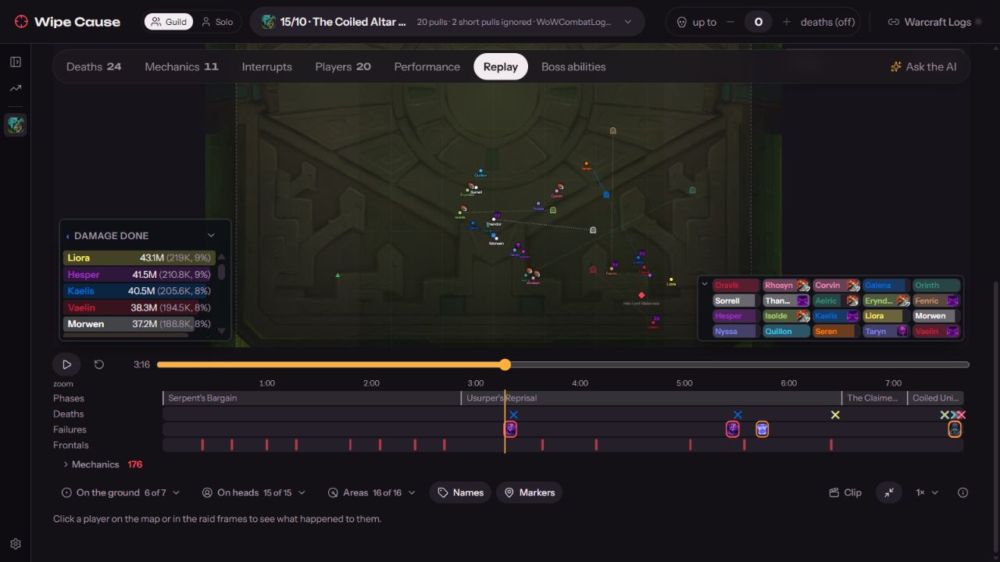
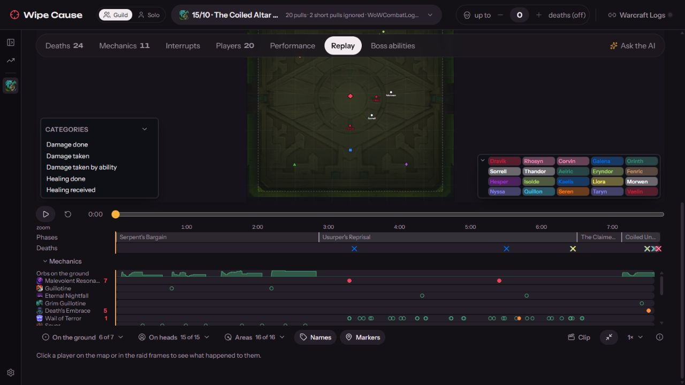
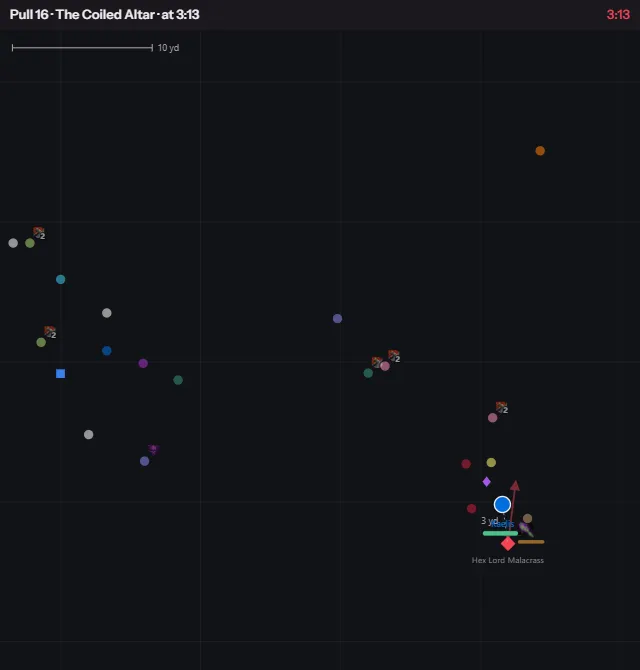
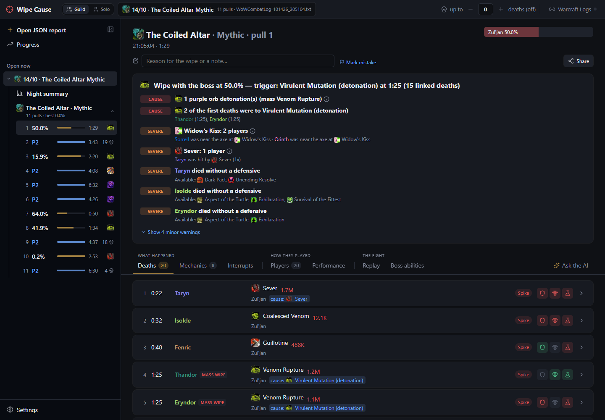
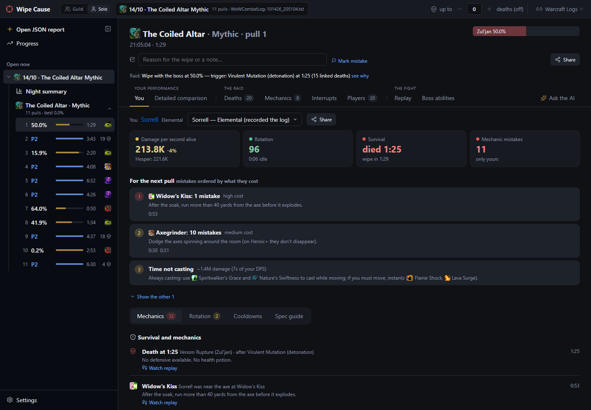
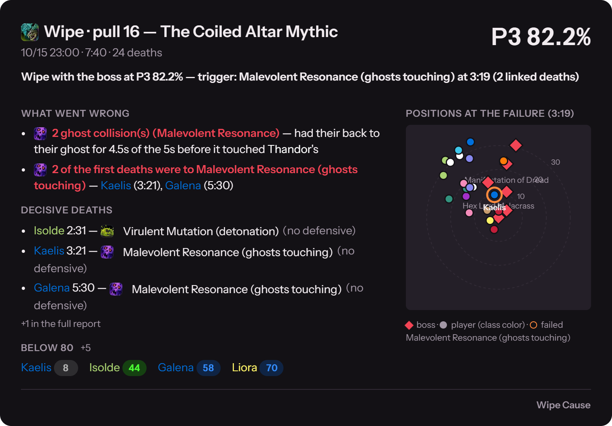

  
  

  

<h1 align="center">Wipe Cause</h1>

  <b>Turn the next pull into progress.</b> 
  See what caused the wipe, replay the mistake and know what to fix before the next pull. 
  Raid analysis for your guild. Personal coaching for your character. All from your WoW combat log.

  
  
  

  <a href="https://github.com/keter45/wipe-cause/releases/latest">What's new</a>
  &nbsp;·&nbsp;
  <a href="README.pt-BR.md">Português</a>

  <a href="#see-it-in-action">See it in action</a> ·
  <a href="#get-started">Get started</a> ·
  <a href="docs/USAGE.md">User guide</a> ·
  <a href="docs/CONTRIBUTING.md">Contribute</a>

<i>Replay the fight, find the mistake and bring the fix to the next pull.</i>

## See it in action

### The whole fight, on the map and timeline

Follow players in the arena alongside frontals, areas, orbs and ghosts from boss mechanics. Raid frames show health and debuffs; meters track damage and healing. Select a player on the map or in the frames to investigate what happened to them.

Navigate phases, deaths and failures, or expand the individual mechanic lanes. Click a mark to jump to the event, zoom the timeline and replay the moment at the speed you need.

### From the mistake to a clip for your raid

Choose the start and end of the moment, adjust the camera and export an **animated WebP** with the whole arena or a player in focus. In Live mode, the app can also send the wipe clip to Discord.

  

### Understand deaths. Fix mechanics.

See the killing blow, active debuffs, healing received and defensives left unused. Each mechanic shows who missed it, how often and what to do differently.

See the pull diagnosis

### Make every raid night count

Find your best pull, recurring wipe causes and downtime. Track the mechanics your group is working on, pull by pull, and compare progress across saved nights.

### Improve your own play

Switch to **Solo** for a personal review: rotation, cooldowns, survival and your most costly mistakes. Compare with top players of your spec on the same boss. For healers, review healing and cooldown coverage against references from other guilds.

### Bring the review to Discord

In **Live** mode, see the analysis between pulls and automatically send the wipe card and replay clip to your raid channel. Share pull, boss and night summaries as images, HTML or PDF.

| Also included | What it helps you do |
| --- | --- |
| **Warcraft Logs** | Bring together local logs and guild reports; download missing pulls. |
| **Warcraft Recorder** | Open the video at the mistake and switch between guild POVs. |
| **Interrupts and dispels** | Review missed kicks, assignments and dispel timing. |
| **Ask the AI** | Ask questions using the pull's deaths, mechanics and notes as context. |
| **English and Portuguese** | Switch the interface, analysis and share cards together. |

## Get started

**[Download for Windows](https://github.com/keter45/wipe-cause/releases/latest/download/WipeCause_x64-setup.exe)** or **[open in your browser](https://keter45.github.io/wipe-cause/)**.

1. In WoW, enable **Advanced Combat Logging** under *Options → Network* and type `/combatlog` before raiding.
2. Open your log in Wipe Cause. The desktop app usually finds the WoW logs folder automatically; in the browser, drop `WoWCombatLog.txt` onto the page.
3. Pick a night, a boss and a pull. Connect Warcraft Logs to bring in your guild's reports.

The desktop app adds live monitoring, Warcraft Recorder videos, automatic Discord posts and automatic updates. **The browser runs the same analysis locally**, with no install.

To link straight to a pull, add the Warcraft Logs report and fight: `https://keter45.github.io/wipe-cause/?report=<code>&fight=<id>` (Warcraft Logs has to be connected; without `fight` it opens the night summary).

Windows installation notice

On first launch, Windows may show “Windows protected your PC” because the app does not yet have a paid signing certificate. Choose **More info → Run anyway** to continue.

Your combat log is analyzed on your PC. Optional integrations connect to their own services; **Ask the AI** sends the pull context, including player names, to your chosen provider.

Need setup details or want to contribute? Read the **[user guide](docs/USAGE.md)** or **[development guide](docs/CONTRIBUTING.md)**.
