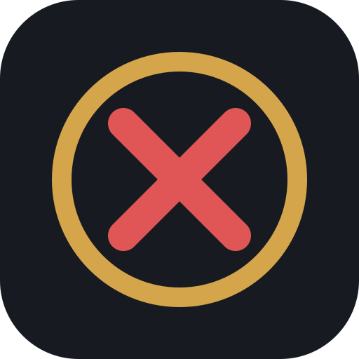
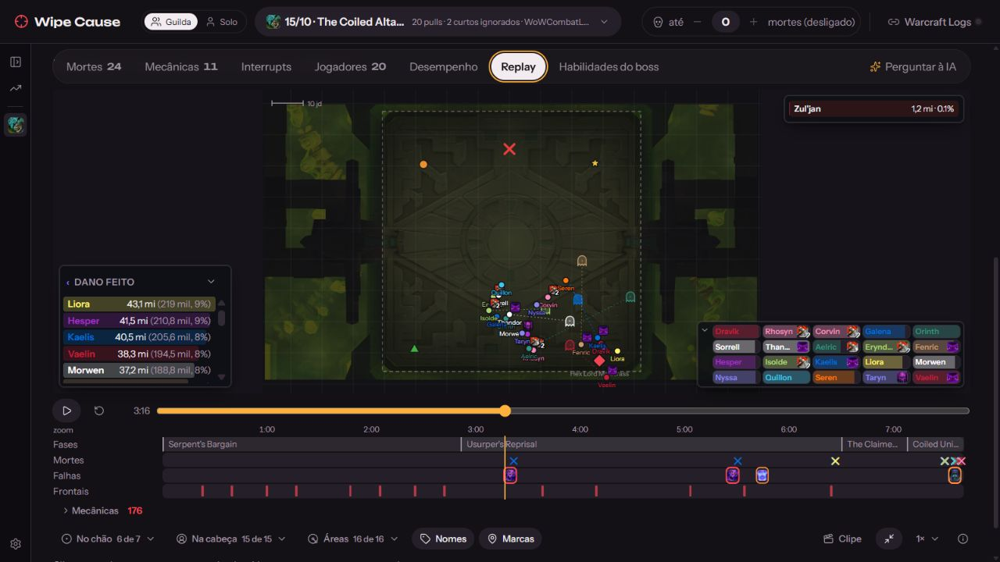
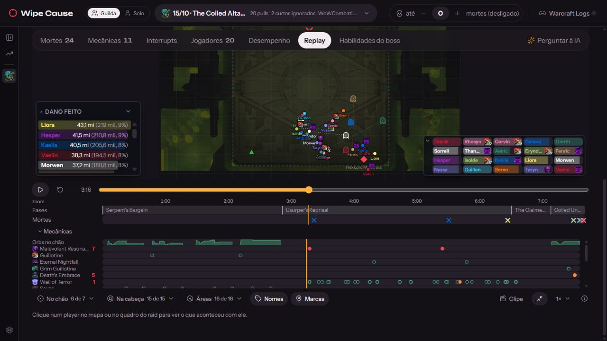
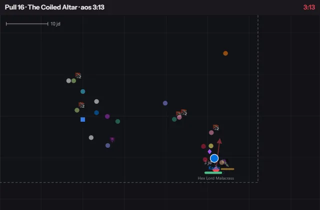
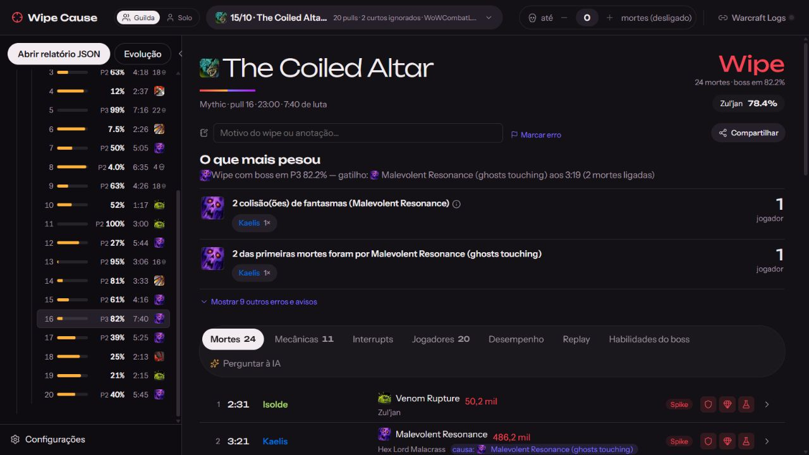
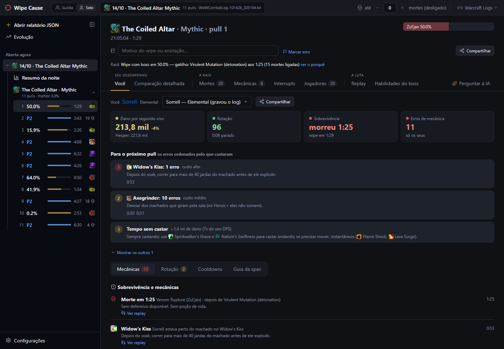
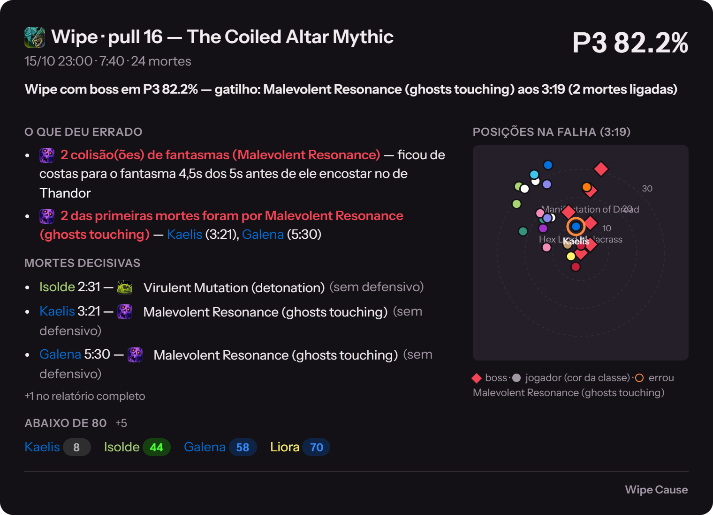

  
  

  

<h1 align="center">Wipe Cause</h1>

  <b>Transforme a próxima try em progresso.</b> 
  Veja o que causou o wipe, reveja o erro e saiba o que ajustar antes do próximo pull. 
  Análise da raid para sua guilda. Evolução individual para seu personagem. Tudo a partir do combat log do WoW.

  
  
  

  <a href="https://github.com/keter45/wipe-cause/releases/latest">Novidades da versão</a>
  &nbsp;·&nbsp;
  <a href="README.md">English</a>

  <a href="#veja-em-ação">Veja em ação</a> ·
  <a href="#comece-aqui">Comece aqui</a> ·
  <a href="docs/USAGE.pt-BR.md">Guia de uso</a> ·
  <a href="docs/CONTRIBUTING.pt-BR.md">Contribuir</a>

<i>Reveja a luta, encontre o erro e leve o ajuste para a próxima try.</i>

## Veja em ação

### A luta inteira, no mapa e na linha do tempo

Acompanhe os players na arena junto de frontais, áreas, orbs e fantasmas das mecânicas. Os frames da raid mostram vida e debuffs; os medidores acompanham dano e cura. Selecione um player no mapa ou nos frames para investigar o que aconteceu com ele.

Navegue pelas fases, mortes e falhas ou abra as faixas de cada mecânica. Clique em uma marca para ir direto ao evento, ajuste o zoom da linha do tempo e reveja o trecho na velocidade que precisar.

### Do erro ao clipe para a raid

Escolha o início e o fim do trecho, ajuste a câmera e exporte um **WebP animado** com a arena inteira ou foco no player. No modo ao vivo, o app também pode enviar o clipe do wipe ao Discord.

  

### Entenda as mortes. Acerte as mecânicas.

Veja o golpe final, os debuffs ativos, a cura recebida e os defensivos que sobraram. Cada mecânica mostra quem errou, quantas vezes e o que fazer diferente.

Veja o diagnóstico do pull

### Faça cada noite de raid render

Encontre a melhor try, as causas recorrentes dos wipes e o tempo parado. Acompanhe as mecânicas que o grupo quer melhorar, pull a pull, e compare a evolução entre noites salvas.

### Melhore o seu próprio jogo

Mude para **Solo** e veja sua rotação, cooldowns, sobrevivência e os erros que mais custaram. Compare com os tops da sua spec no mesmo boss. Para healers, veja cura e cobertura de cooldowns com referências de outras guildas.

### Leve a análise para o Discord

No **modo ao vivo**, veja a análise entre pulls e envie automaticamente o cartão do wipe e o clipe do replay ao canal da raid. Compartilhe resumos do pull, do boss e da noite como imagem, HTML ou PDF.

| Também tem | Para que serve |
| --- | --- |
| **Warcraft Logs** | Reúne logs locais e reports da guilda; baixa os pulls que faltam. |
| **Warcraft Recorder** | Abre o vídeo no instante do erro e alterna entre POVs da guilda. |
| **Interrupts e dispels** | Mostra cortes perdidos, escala de interrupts e o momento dos dispels. |
| **Perguntar à IA** | Responde com as mortes, mecânicas e anotações do pull como contexto. |
| **Português e inglês** | Troca o idioma da interface, da análise e dos cartões juntos. |

## Comece aqui

**[Baixe para Windows](https://github.com/keter45/wipe-cause/releases/latest/download/WipeCause_x64-setup.exe)** ou **[abra no navegador](https://keter45.github.io/wipe-cause/)**.

1. No WoW, ative **Advanced Combat Logging** em *Opções → Rede* e digite `/combatlog` antes da raid.
2. Abra o log no Wipe Cause. O app costuma encontrar a pasta de logs do WoW sozinho; no navegador, arraste o `WoWCombatLog.txt` para a página.
3. Escolha a noite, o boss e o pull. Conecte o Warcraft Logs para trazer os reports da guilda.

O app adiciona monitoramento ao vivo, vídeos do Warcraft Recorder, posts automáticos no Discord e atualizações automáticas. **O navegador faz a mesma análise localmente**, sem instalar.

Para linkar direto um pull, passe o report e o fight do Warcraft Logs: `https://keter45.github.io/wipe-cause/?report=<código>&fight=<id>` (com o Warcraft Logs conectado; sem `fight`, abre no resumo da noite).

Aviso na instalação do Windows

Na primeira execução, o Windows pode mostrar “O Windows protegeu o computador” porque o app ainda não tem certificado de assinatura pago. Clique em **Mais informações → Executar assim mesmo** para continuar.

Seu combat log é analisado no seu PC. As integrações opcionais se conectam aos respectivos serviços; **Perguntar à IA** envia o contexto do pull, incluindo nomes dos players, ao provedor escolhido.

Para configurar integrações ou contribuir, veja o **[guia de uso](docs/USAGE.pt-BR.md)** e o **[guia de desenvolvimento](docs/CONTRIBUTING.pt-BR.md)**.
