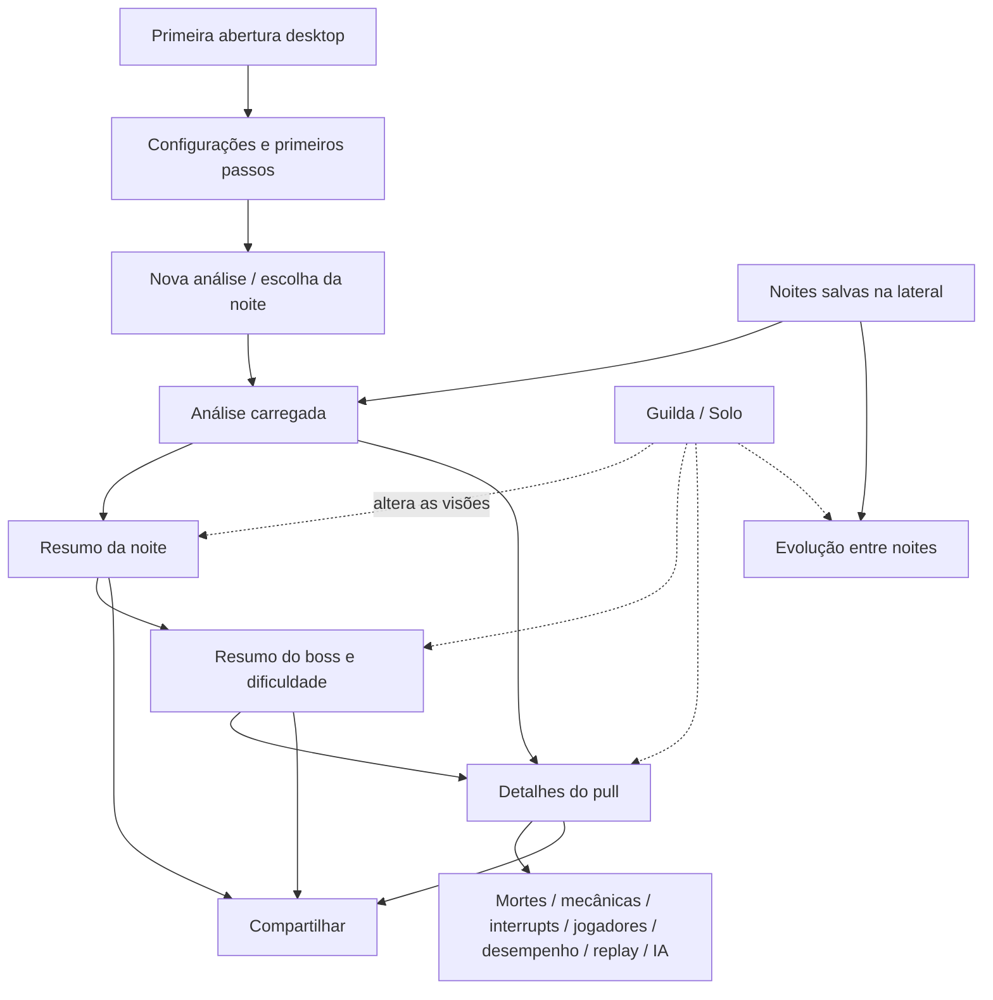
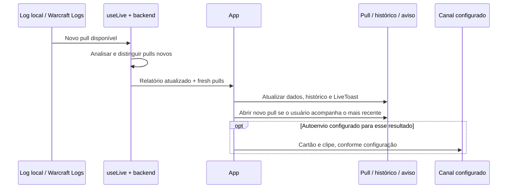
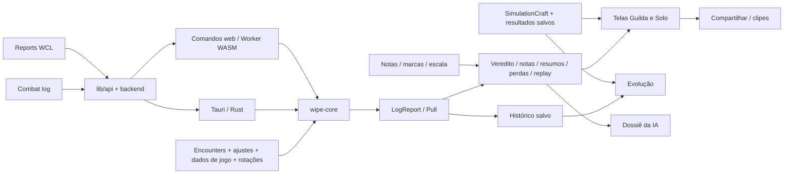

# Wipe Cause — mapa do aplicativo

Documentação funcional e técnica das telas, componentes e conexões entre funcionalidades.

**Referência:** navegação na versão `0.37.0` em **21/10/2026**, com as alterações locais da
árvore de trabalho daquela data; texto conferido contra o código da versão `0.42.0` em
**27/10/2026**, só pelo código, sem abrir as telas.

## Como ler

Este documento explica onde cada recurso aparece, de quais dados depende e que outras partes do app ele afeta. O [guia de uso](USAGE.pt-BR.md) explica a operação cotidiana; o [guia de contribuição](CONTRIBUTING.pt-BR.md) cobre desenvolvimento e manutenção.

Foram percorridas as telas no navegador local, usando relatórios do projeto, a interface de desenvolvimento e o build de desenvolvimento web com backend WASM. O código React, as funções de domínio, os comandos Tauri e o adaptador web foram consultados para conferir as conexões. A [cobertura da inspeção](#8-cobertura-da-inspeção) distingue navegação observada de operações confirmadas somente no código.

## 1. Visão do produto

O app transforma eventos de combate em três níveis de leitura: **noite → boss e dificuldade → pull**. A partir do pull, é possível investigar mortes, erros de mecânica, interrupts, desempenho e posições; depois, voltar aos resumos para enxergar repetição e progresso.

O foco **Guilda** responde o que aconteceu com o grupo. O foco **Solo** reaproveita a mesma análise para mostrar o que um personagem pode corrigir. Trocar de foco altera as apresentações de noite, boss, pull e evolução; não exige importar novamente o log.

Existem três ambientes distintos:

| Ambiente | Dados e execução | Consequência para a interface |
| --- | --- | --- |
| Desktop Tauri | Núcleo Rust, arquivos do PC e integrações nativas | Análise, histórico, ao vivo, Warcraft Recorder, SimulationCraft, bandeja e atualizações |
| Site, com `VITE_TARGET=web` | O mesmo núcleo compilado para WASM em Worker; armazenamento do navegador | Análise local de arquivo, histórico, Warcraft Logs, regras, IA e compartilhamento; sem os recursos que exigem programas e monitoramento do PC |
| Desenvolvimento da UI, `npm run dev` fora do Tauri | Relatórios JSON e dados de demonstração; `hasBackend=false` | Permite percorrer a UI; várias integrações são exemplos ou exibem aviso de indisponibilidade |

Um aviso de “disponível no app instalado” visto no terceiro ambiente não prova que o recurso falta no site. A versão web tem seu próprio backend. As condições estão em [backend.ts](../src/lib/backend.ts), [api.ts](../src/lib/api.ts) e [commands.ts](../src/web/commands.ts).

## 2. Navegação e estrutura das telas



### Estado de navegação

A navegação principal é controlada por estado em [App.tsx](../src/App.tsx), sem um roteador de páginas para cada tela:

| Estado | Significado |
| --- | --- |
| `page` | `analysis`, `browse`, `trends` ou `settings` |
| `report` | `LogReport` aberto; fica disponível ao visitar configurações e evolução |
| `summary` | `NIGHT` para noite, chave de boss para resumo do boss, `null` para pull |
| `selected` | ID do pull selecionado dentro do relatório |
| `mode` | Foco Guilda ou Solo, mantido por `lib/mode.ts` |
| `deathCutoff` | Corte usado na análise aberta |
| `wclCode` e `videos` | Contexto adicional de Warcraft Logs e POVs associados aos pulls |
| `settingsFocus` | Seção de Configurações que um atalho mandou abrir |
| `sidebarOpen` | Lateral aberta ou recolhida, lembrada em localStorage |
| `firstRun` | Primeira abertura no desktop: Configurações com os primeiros passos abertos |

Sem relatório, a área de análise apresenta a entrada para escolher uma noite (com backend ou com `?demoLogs=1`; no `npm run dev` sem backend, um aviso de modo navegador). Abrir um relatório começa no resumo da noite; o último wipe de raid, ou o último pull disponível, fica preparado como seleção. Bosses são agrupados por encontro e dificuldade, evitando misturar Heroic e Mythic.

Os parâmetros `?report=<código>&fight=<id>` são uma entrada direta para reports do Warcraft Logs quando há backend. Sem `fight`, abre-se a noite. Os parâmetros de demonstração descritos no fim deste documento são exclusivos de desenvolvimento; entre eles, `?report=<json>&videos=<scan.json>` abre um relatório gerado pelo `wipe-cli` e casa os vídeos de um scan do Warcraft Recorder, só sem backend.

### Estrutura compartilhada

| Componente | Responsabilidade | Conexão com o restante do app |
| --- | --- | --- |
| `App` | Carregar análise, coordenar seleção, histórico, páginas e eventos ao vivo | Distribui relatório e callbacks para as telas |
| `Header` | Foco Guilda/Solo, noite aberta, reanálise, corte e integrações da noite | Troca o contexto global e associa WCL e vídeos |
| `Sidebar` | Nova análise (sem backend, “Abrir relatório JSON”), Evolução, noites fixadas/recentes, árvore de bosses e pulls, configurações e, no desktop, o indicador de versão que confere atualizações | Selecionar um item atualiza a área principal |
| `SidebarRail` | Versão recolhida da lateral | Oferece atalhos, até oito noites salvas e, se a análise aberta não estiver no histórico, mais uma entrada para ela |
| `PullList` | Árvore noite → boss/dificuldade → resumo e pulls | Mostra resultado, progresso, duração e gatilho/mortes antes de abrir o pull |
| `SetupContext` | Status das integrações e atalhos até uma seção de configurações | Salvar um formulário recarrega os indicadores compartilhados |
| `PlayerClassesContext` | Relação entre jogadores e classes | Mantém cores e apresentação dos nomes consistentes |
| `SpellHoverLayer`, `SpellIcon`, `Names` | Habilidades, tooltips e nomes destacados | Reutilizados nas análises, mapas, tabelas e respostas da IA |
| `ErrorBoundary` | Conter erros de renderização em uma área | Um problema num pull ou painel pode preservar o restante da navegação |

Fontes: [App](../src/App.tsx), [Header](../src/components/Header.tsx), [Sidebar](../src/components/Sidebar.tsx), [PullList](../src/components/PullList.tsx), [setup](../src/lib/setup.ts).

## 3. Tela por tela

### 3.1 Configuração inicial e “Como funciona”

Na primeira abertura desktop, sem análises salvas e sem a marca de onboarding, o app abre Configurações com os primeiros passos. `FirstSteps` lista quatro passos, cada um com um atalho para um cartão: pasta de logs do WoW, ligar o combat log no jogo, entrar com o Warcraft Logs (recomendado) e os opcionais (ao vivo quando o WoW abrir, vídeos, Discord e IA), cujo atalho leva só ao cartão “Ao vivo quando o WoW abrir”. O botão “Começar: escolher uma noite” fica desabilitado enquanto falta a pasta de logs. Depois da primeira vez, os mesmos passos ficam recolhidos em “Como funciona”. Os cartões indicam o essencial e as integrações opcionais.

A pasta de logs é essencial ao fluxo desktop; no site, o arquivo é escolhido diretamente e esse requisito não se aplica. O indicador de Advanced Combat Logging usa o relatório aberto: sem relatório, o app pede conferência no jogo, sem afirmar que a opção está ligada.

**Saída:** começar leva à escolha da noite. Atalhos espalhados pelo app podem abrir Configurações já na seção necessária.

Fontes: [SettingsView](../src/components/settings/SettingsView.tsx), [FirstSteps](../src/components/settings/FirstSteps.tsx).

### 3.2 Nova análise / escolha da noite

`LogBrowser` reúne fontes locais e reports do Warcraft Logs em noites. No desktop, a pasta pode ser detectada ou configurada. A lista apresenta encontros, dificuldade, número de pulls, kills, fonte e situação da análise. Há atualização da lista, abertura de outro arquivo, análise em lote e filtros, guardados em localStorage:

- **Guilda / Pug / Todos**, só quando há noites de pug: separa as raids com o núcleo que se repete nos seus logs das raids com outros personagens.
- **Boss**, e, depois de escolher um boss com mais de uma dificuldade, a **dificuldade**.
- **Guilda do Warcraft Logs**: com login em mais de uma guilda, um seletor escolhe de qual vêm as noites remotas (últimos 30 dias).

| Ação | O que faz | Resultado |
| --- | --- | --- |
| Analisar | Analisa o log local disponível | Abre o relatório e atualiza o histórico |
| Completar | Busca pulls ausentes nos reports do WCL, aproveitando dados locais quando possível | Forma uma análise com as fontes da noite |
| Baixar | Noite que só está no WCL; como Completar, pede confirmação com o número de pulls e o tempo estimado do download (“Baixar e analisar”) | Analisa a noite inteira pelo WCL; reabrir depois é rápido |
| Analisar todos | Processa em sequência os logs elegíveis ainda não analisados; deixa a noite em gravação de fora | Alimenta o histórico e a Evolução sem abrir cada noite |
| Abrir arquivo | Escolhe um combat log fora da lista | Inicia o mesmo fluxo de análise |
| Colar report externo | Recebe um link/código WCL, inclusive fora da guilda | Analisa conforme a disponibilidade da conexão |

No site, o usuário escolhe ou arrasta um `.txt`; não há varredura automática da pasta do WoW. A integração WCL acrescenta as noites remotas. Durante a análise, `App` mostra progresso, inclusive a posição no lote; falhas aparecem como mensagem e não transformam automaticamente o resultado em sucesso.

**Conexão principal:** a normalização de noites e fontes evita que “log local” e “report remoto” precisem ser dois caminhos de navegação independentes.

Fontes: [LogBrowser](../src/components/LogBrowser.tsx), [guildNights](../src/lib/guildNights.ts), [nights](../src/lib/nights.ts), [web/files](../src/web/files.ts).

### 3.3 Noites salvas e barra lateral

O histórico permite reabrir análises sem repetir o processamento original. Noites fixadas e recentes aparecem na lateral, com ações para fixar/desafixar e excluir. Existe exclusão conjunta das não fixadas, com confirmação na própria UI.

Expandir uma noite não equivale a abri-la na área principal. Para uma noite fechada, a lateral pode carregar os pulls apenas para montar a árvore; escolher um resumo ou pull efetiva a troca. O destino de um pull entre relatórios é recuperado pelo instante de início, pois o ID pode mudar numa reanálise.

A exclusão do histórico remove a análise salva, não é uma ação de apagar o combat log original. A interface também sinaliza quando o arquivo de origem não está disponível: o resumo salvo e a possibilidade de reler o arquivo são capacidades distintas.

Fontes: [Sidebar](../src/components/Sidebar.tsx), [history.rs](../src-tauri/src/history.rs), [web/history](../src/web/history.ts).

### 3.4 Resumo da noite — Guilda

`NightOverview` é a visão ampla da sessão. Mostra número de bosses, pulls e kills; tempo de raid; tempo em combate; downtime; intervalos médios/medianos e maiores pausas. Cards de boss apresentam resultado, melhor progresso e principal causa dos wipes. A linha do tempo reúne pulls e intervalos.

**Entradas:** pulls do relatório, com filtro de conteúdo de raid. Masmorras podem existir nos dados, mas não entram nas métricas de tempo e nos cards de raid.

**Saídas:** card abre o resumo daquele boss; elementos da linha do tempo abrem pulls; Compartilhar produz o cartão da noite.

Fontes: [NightSummary](../src/components/NightSummary.tsx), [night](../src/lib/night.ts), [content](../src/lib/content.ts).

### 3.5 Resumo do boss — Guilda

`BossSummary` restringe a noite ao mesmo boss e dificuldade. É o ponto de ligação entre diagnóstico de um pull e evolução do grupo dentro da sessão.

| Bloco | Conteúdo e conexão |
| --- | --- |
| Resumo | Quantidade de pulls/wipes/kills, melhor tentativa e ritmo entre trys |
| Progresso | Fase e vida do boss por pull; clicar permite investigar a tentativa |
| Métricas do grupo | Mecânicas escolhidas para acompanhar, sugestões pelo que falhou, totais e contribuição individual; abre os pulls relacionados |
| Tempos de fase | Compara transições quando os dados e as regras de fase existem |
| Origem de stacks | Acrescenta contexto de stacks nos bosses que produzem esses dados |
| Causas dos wipes | Agrega gatilhos, mortes ligadas e falhas por mecânica |
| Linha do tempo | Mostra combate e intervalos daquele boss |
| Vilões / mocinhos | Destaca problemas recorrentes, ajudas, interrupts e notas |
| Robô para a raide | Simula DPS e tanks elegíveis em fila e mostra potencial dos resultados salvos |
| Placar | Consolida nota, mortes, erros, recursos e produção por jogador |

Métricas escolhidas são preferências por encontro; não são novas regras de detecção. Escolher uma métrica muda o acompanhamento exibido. Alterar uma regra muda a análise e exige reprocessamento.

Fontes: [NightSummary](../src/components/NightSummary.tsx), [BossMetrics](../src/components/BossMetrics.tsx), [PhaseTimes](../src/components/PhaseTimes.tsx), [StackOrigins](../src/components/StackOrigins.tsx), [RaidBot](../src/components/perf/RaidBot.tsx).

### 3.6 Pull — estrutura e diagnóstico

`PullView` contém o cabeçalho do encontro, dificuldade, horário, duração, resultado, vida dos bosses e informações de corte/call de wipe. A barra de ações reúne anotação, marcação manual, compartilhamento e, quando associados, vídeo e link WCL.

O bloco **O que mais pesou** usa o veredito para destacar a causa e as mortes decisivas; outros avisos ficam recolhidos. Em Solo, o diagnóstico da raid é reduzido a uma linha e pode ser expandido, deixando a leitura individual em destaque.

As abas são preservadas em memória por foco: Guilda começa em Mortes; Solo, em Você. Trocar de pull mantém a última aba daquele modo. `PullView` fecha vídeo e recolhe avisos ao mudar o pull.

| Aba | Componente principal | Dados e ações |
| --- | --- | --- |
| Mortes | `DeathList` | Abre a investigação de cada morte, recursos, recap e posição |
| Mecânicas | `MechanicsView` | Expande falhas e participantes, replays, eventos, dispels e ajustes |
| Interrupts | `InterruptsView` e `AssignmentsPanel` | Cortes, tentativas, casts que passaram e escala |
| Jogadores | `PlayersTable` | Nota, produção, dano tomado, mortes, defensivos, consumíveis e dados complementares |
| Desempenho / Comparação detalhada | `PerformanceView` | Rotação e comparação com tops, própria raid ou simulação, conforme papel |
| Replay | `FightReplay` | Luta completa, mapa, quadros da raid, medidores, fases e eventos |
| Habilidades do boss | `EnemySpellsTable` | Casts, hits, dano, IDs e criação de regra |
| Perguntar à IA | `AskView` | Dossiê, sugestões e conversa contextual |
| Você, no foco Solo | `SoloPullView` | Sobrevivência, perdas, rotação/cura, cooldowns e próximos ajustes |

Fonte: [PullView](../src/components/PullView.tsx).

### 3.7 Mortes

A lista mantém a ordem temporal e distingue mortes consideradas, decisivas e ignoradas. Uma morte ignorada pode continuar visível para contexto mesmo sem entrar nas contas.

Ao expandir uma morte, aparecem a classificação, golpe final, vida antes de morrer, dano e cura recentes, debuffs, recursos disponíveis/não usados e o recap dos últimos 15 segundos. Os filtros do recap separam dano, cura e defensivos/debuffs. Posição, distâncias e vizinhos dependem da captura do log; há fallback de mapa estático quando não existe replay adequado.

**Conexões:** o replay curto posiciona a morte no espaço; `PlayAt` abre o vídeo associado no momento relevante; a ação de marcar erro permite registrar uma interpretação manual que o log não prova. Essa marca depois entra no veredito, na nota e no dossiê.

Fontes: [DeathList](../src/components/DeathList.tsx), [replay](../src/lib/replay.ts), [marks](../src/lib/marks.ts).

### 3.8 Mecânicas, pares e dispels

Cada card de `MechanicsView` reúne resultado, gravidade, explicação, dica, participantes, contagens e momentos. A tela diferencia falhas, mecânicas sem falha e itens que ainda não são avaliados automaticamente. Ausência de avaliação não equivale a execução correta.

Quando disponíveis, o detalhe apresenta:

- Replays por jogador ou ocorrência, snapshots de posição e linha do tempo.
- Créditos de quem ajudou, interrompeu ou dispelou.
- Tempo até o dispel, alvo, responsável e ausência de dispel.
- Falhas envolvendo pares, fantasmas e colisões, com os participantes e trajetórias.

`PairingFaults`, `ReplayView` e `PositionMap` reaproveitam os dados da mecânica. A atribuição de culpa é determinada pelo tipo da regra e pelo contexto; a simples presença de um nome num evento não significa sempre penalidade individual.

**Saída adicional:** Ajustar regras deste boss abre um painel no lugar do conteúdo das mecânicas.

Fontes: [MechanicsView](../src/components/MechanicsView.tsx), [PairingFaults](../src/components/PairingFaults.tsx), [blame](../src/lib/blame.ts).

### 3.9 Ajustes e criação de regras

`RuleTuning` trabalha com uma camada de ajustes sobre as regras padrão: habilitar/desabilitar, gravidade, foco, tolerância, stacks, tempos, papéis e textos, conforme o tipo. Permite importar/exportar ajustes e restaurar padrões. O ajuste é associado ao encontro; o arquivo importado é validado para o boss correspondente.

`EnemySpellsTable` é a entrada para descobrir uma habilidade ainda não coberta: apresenta nome, ID, origem, casts, hits e dano. **Criar regra** abre `CreateRule` com o contexto da habilidade.

**Efeito ao salvar:** grava o ajuste e solicita reanálise. Com ao vivo ativo, reinicia o acompanhamento com as regras novas. No desenvolvimento sem backend, os ajustes são demonstrativos e não reprocessam o JSON já aberto.

As regras distribuídas ficam em `encounters/`; o desktop pode carregar YAMLs do usuário por cima das embutidas e aplicar os ajustes. O site aplica os ajustes locais ao núcleo WASM. Configuração de replay e rotação são dados relacionados, mas têm seus próprios processos de manutenção.

Fontes: [RuleTuning](../src/components/RuleTuning.tsx), [CreateRule](../src/components/CreateRule.tsx), [EnemySpellsTable](../src/components/EnemySpellsTable.tsx), [rules](../src/lib/rules.ts), [rule_tuning.rs](../src-tauri/src/rule_tuning.rs).

### 3.10 Interrupts e escala

`InterruptsView` mostra casts inimigos cortados ou concluídos, percentual interrompido, tentativas e resultados por jogador. Expansões detalham a participação individual. Quando não há cast interrompível, apresenta um estado vazio específico.

`AssignmentsPanel` recebe uma escala colada de MRT/NSRT ou escrita à mão. O parser identifica habilidade por nome ou `{spell:ID}`, reconhece jogadores e organiza grupos por add. A checagem percorre os casts em ordem para mostrar quem tinha a vez, quem cortou e quem cobriu outra pessoa.

**Conexão com o diagnóstico:** perder a própria vez pode afetar veredito e nota. Não ter cortes, isoladamente, não demonstra que alguém descumpriu uma escala. Os detalhes de dispel ficam nos cards de mecânica, não numa aba principal independente.

Fontes: [InterruptsView](../src/components/InterruptsView.tsx), [AssignmentsPanel](../src/components/AssignmentsPanel.tsx), [assignments](../src/lib/assignments.ts).

### 3.11 Jogadores e notas

`PlayersTable` permite comparar o grupo dentro do pull: nota, parse WCL quando disponível, DPS/HPS, dano tomado, mortes, defensivos e poções/healthstones. Dados de potencial do robô podem complementar a apresentação quando existem simulações salvas.

A nota geral em `scorePull` parte de 100 e considera gravidade das falhas, foco, responsabilidade individual, escala de interrupts, mortes decisivas, defensivos disponíveis e tempo vivo. Há tratamento próprio para mortes em massa. No kill, o parse WCL pode reduzir a nota; wipes não têm esse parse de kill.

**Distinções necessárias:** nota geral do jogador, nota de rotação, parse WCL e percentual do potencial simulado são medidas diferentes. Os resumos reutilizam as notas dos pulls; não se deve interpretar um número de rotação como nota global da raid.

Fontes: [PlayersTable](../src/components/PlayersTable.tsx), [score](../src/lib/score.ts), [massDeaths](../src/lib/massDeaths.ts), [wclParses](../src/lib/wclParses.ts).

### 3.12 Desempenho e comparação detalhada

No foco Guilda, `PerformanceView` começa com um seletor de personagem por papel. Mostra a rotação quando disponível e permite escolher uma referência. No foco Solo, recebe o personagem selecionado em Você; a rotação já está na visão individual.

| Referência | Disponibilidade e finalidade |
| --- | --- |
| Top players do WCL | Busca referências da spec no encontro; carrega o fight selecionado e compara produção e decisões |
| Na própria raid | Amostras elegíveis da mesma spec na noite, inclusive outro pull do personagem |
| Robô / SimulationCraft | Para DPS e tanks elegíveis; simula setup e modelo da luta |
| Composição parecida, para healer | Restringe a comparação detalhada a logs externos com composição próxima; não oferece um colega da raid como referência |

Os painéis de comparação incluem produção por segundo vivo, tempo vivo, casts por minuto, ilvl, janelas de vantagem, decisões, bursts, cooldowns, casts, poções, dano tomado e setup. A presença de cada bloco depende dos dados e da referência carregada.

`RotationPanel` combina resultado calculado pelo núcleo com referências distribuídas dos tops: erros, abertura, usos possíveis de cooldown, prioridades e guia da spec. A referência distribuída pode funcionar sem uma consulta nova ao WCL; o comparador interativo de tops depende da integração.

Fontes: [PerformanceView](../src/components/perf/PerformanceView.tsx), [RotationPanel](../src/components/RotationPanel.tsx), [WclTops](../src/components/WclTops.tsx), [performance](../src/lib/performance.ts), [bench](../src/lib/bench.ts), [decisions](../src/lib/decisions.ts).

### 3.13 Robô / SimulationCraft

O robô aparece no comparador individual e no resumo do boss para a raide. O fluxo individual escolhe um pull elegível, constrói o perfil a partir do setup/talentos e do modelo da luta, executa o SimulationCraft e salva o resultado. A interface apresenta progresso, cancelamento, erros e opção de simular novamente.

O modelo considera aspectos como duração, movimento, alvos/adds, disponibilidade de alvo, fases/vida e buffs temporários. Desde a v0.40.0 ([notas](releases/v0.40.0.md)), o robô fica na fase de execute (abaixo de 20% e de 35%) pelo mesmo tempo que a luta, medido pela vida do boss em cada fase (`bossEndPct` em `simProfile.ts`); análises antigas, sem essa linha de vida, usam a vida do boss no corte. As suposições e o detalhamento pertencem ao resultado da simulação: a porcentagem de potencial depende desse modelo.

`RaidBot` coloca DPS e tanks com setup/spec em fila, reaproveita os resultados salvos e permite simular os que faltam. `usePotentials` leva esses resultados aos jogadores do pull, `useNightPotentials` à Evolução, e o próprio `RaidBot` os lê no resumo do boss (`loadPotentials`). Consultar a Evolução não dispara uma simulação nova.

**Disponibilidade:** a execução exige o desktop; há uma ponte opcional de desenvolvimento em `vite.config.ts` (`POST /__simc`), que roda o SimulationCraft de `WIPE_DEV_SIMC_EXE` e guarda os resultados em localStorage. O backend web comum declara o recurso indisponível.

Fontes: [BotComparison](../src/components/perf/BotComparison.tsx), [botSim](../src/lib/botSim.ts), [simProfile](../src/lib/simProfile.ts), [botRaid](../src/lib/botRaid.ts), [simc.rs](../src-tauri/src/simc.rs). Ver também [simulação](simulation.md).

### 3.14 Replay curto, replay completo e clipes

Há três usos relacionados, com necessidades diferentes:

| Recurso | Dados necessários | Onde aparece |
| --- | --- | --- |
| Replay de um erro/morte | Tracks e referências de tempo capturados na análise | Mortes, mecânicas, pares e Solo |
| Replay completo | `Pull.fight`, ou origem e offset/fight ID para carregar a luta inteira | Aba Replay |
| Clipe WebP | Replay e momentos escolhidos; alguns caminhos usam o pull completo | Botão Clipe, Compartilhar e Discord |

`FightReplay` usa `loadFullPull` para obter a luta completa sob demanda. O desktop pode reler o log local ou buscar o fight do WCL; o site usa o arquivo ainda aberto ou a fonte WCL. O replay completo inclui o combate inteiro, sem o corte estatístico de mortes. A sessão guarda um cache limitado de pulls completos para evitar releitura a cada troca de aba.

A tela integra `ReplayView`, quadros da raid (que podem ser recolhidos para deixar o mapa livre), vida dos bosses, medidores de dano/cura (também recolhíveis), linha do tempo com fases/mortes/falhas e painel de eventos da unidade selecionada. Há controles de reprodução, velocidade, zoom e visibilidade de chão, áreas, auras na cabeça, nomes e marcas.

As sobreposições usam regras e dados de posição: frontais, áreas, soaks, explosões, orbs, adds/fantasmas, defensivos de área e marcas do grupo, conforme o boss e a captura. A arena é alinhada aos dados por `arenas.ts` e `data/arenas.json`. O próprio app informa que o replay está em construção e pode ter inconsistências.

Entre a v0.38.0 e a v0.42.0 (notas da [0.38.0](releases/v0.38.0.md), [0.39.0](releases/v0.39.0.md), [0.41.0](releases/v0.41.0.md) e [0.42.0](releases/v0.42.0.md)), o motor do replay passou a desenhar, para qualquer boss cuja regra ou dado descreva a mecânica (os bosses citados são exemplos):

| Capacidade | Como aparece |
| --- | --- |
| Frontal | Setor no tamanho medido, enchendo durante o cast, com o próximo tracejado até 10s antes (Coiled Altar) |
| Poças | Tracejadas quando vêm, com “em Ns”, e cheias no chão (Noxious e Defiled Ground) |
| Contagens | Arco que fecha e segundos até o soak, a explosão, o debuff de quem carrega algo ou o próximo cast (`replayTimers.ts`) |
| Fragmentos | O que alguém tem que pegar no chão, com “faltam N” ao lado de quem pega |
| Escudos | Anel no inimigo, uma marca por stack e quanto já absorveu |
| Área à frente do boss | Círculo onde o golpe cai; o que ninguém pegou fica vazio (Stone Breaker do Twin Fangs) |
| Ondas | Setas em volta de quem foi marcado e, depois, uma barra por direção andando até a borda (Plague Froth do Vashnik) |
| Adds | Cor e ícone por tipo de add; o quadro do boss conta quantos estão vivos |
| CC e portal | Área ou anel do CC dos players, com “quem: o quê”; as pontas do Demonic Gateway (`data/utility.json`) |
| Lugares da sala | Nomes de pontos da arena, como as fontes do Vashnik |
| Sala girada | `rotation` em `data/arenas.json` gira a imagem quando a sala está girada no mundo (Vashnik, -58°) |

O menu **Camadas** liga e desliga contagens, próximo frontal e cast, animações, CC dos players, portais do warlock, quem cortou o cast e lugares da sala; CC e portais só existem no replay completo, e lugares da sala só quando a arena tem marcas (`marks`). A escolha fica em `replayPrefs.ts`. A linha do tempo pode mostrar **uma faixa por mecânica** (marca cheia quando deu errado, vazada quando deu certo) ou juntar as falhas numa faixa só. As peças do mapa ficam em `replayLayers.tsx`.

**Dependência importante:** uma análise salva pode conter informação suficiente para um replay curto e ainda precisar do arquivo/fonte original para o replay completo. No site, recarregar a página perde o objeto `File` em memória; pode ser necessário reabrir o log.

Fontes: [FightReplay](../src/components/FightReplay.tsx), [ReplayView](../src/components/ReplayView.tsx), [fullReplay](../src/lib/fullReplay.ts), [replayHazards](../src/lib/replayHazards.ts), [replayClip](../src/lib/replayClip.tsx), [ClipButton](../src/components/ClipButton.tsx), [arenas](../src/lib/arenas.ts).

### 3.15 Vídeo do Warcraft Recorder

O vídeo é um painel de gravação real, associado ao pull por `matchVideos`; não é o replay desenhado no mapa. O desktop combina gravações locais e, quando configuradas, gravações da nuvem da guilda. O botão Vídeos no cabeçalho leva à configuração e informa cobertura.

Quando há POV, `PullView` oferece abrir/fechar vídeo. Os botões `PlayAt`, distribuídos pelo diagnóstico, mortes, mecânicas e perdas individuais, usam `SeekContext` para abrir o vídeo no momento do evento com antecedência. Trocar de POV preserva o instante para rever a mesma cena por outro jogador.

Sem vídeo associado, esses botões não aparecem. O painel tem mensagens específicas para arquivo local ausente e falha de vídeo remoto. No desenvolvimento no navegador, o Vite serve os vídeos de `WIPE_DEV_VIDEO_DIR` em `/__video`.

Fontes: [VideoPanel](../src/components/VideoPanel.tsx), [wcr](../src/lib/wcr.ts), [wcr.rs](../src-tauri/src/wcr.rs), [wcr_cloud.rs](../src-tauri/src/wcr_cloud.rs).

### 3.16 Você — Solo, DPS/tank

O app tenta identificar quem gravou o log ou usa o personagem escolhido. Se não encontrar alguém, pede a escolha explicitamente. Reports WCL não oferecem a identidade de quem gravou o arquivo; a seleção fica lembrada por nome.

`SoloPullView` reúne produção, rotação, sobrevivência, erros pessoais e uma lista **Para o próximo pull**, ordenada pelo custo estimado das perdas. As subseções cobrem mecânicas, rotação, cooldowns e guia quando disponível. Mortes e falhas individuais podem abrir replay e vídeo.

A referência resumida procura uma amostra compatível da mesma spec na noite ou um pull melhor do próprio personagem. Escolher tops e outras referências fica em Comparação detalhada. O personagem selecionado conecta o pull aos resumos Solo e à Evolução Solo.

Fontes: [SoloPullView](../src/components/SoloPullView.tsx), [solo](../src/lib/solo.ts), [mode](../src/lib/mode.ts).

### 3.17 Você — Solo, healer

A mesma tela muda a leitura para cura: HPS efetivo, contexto de dano recebido pela raid, composição, participação na cura, overheal e uso de habilidades. As referências distribuídas de `src/data/heal-refs/` vêm de logs externos; `HealerPanel` explica a seleção e mostra faixas, em vez de tratar HPS bruto como nota isolada.

A subseção **Cura** apresenta contexto, ajustes e origem da cura. **Cooldowns** alinha usos a ocorrências de mecânicas, diferenciando uma habilidade não usada de uma mecânica que sequer ocorreu naquele pull. Isso permite relacionar o conselho ao momento da luta, não apenas a um número de usos.

Fontes: [HealerPanel](../src/components/HealerPanel.tsx), [healer](../src/lib/healer.ts), [cdAnchors](../src/lib/cdAnchors.ts). Ver também [análise de healers](healer-analysis.md).

### 3.18 Sua noite e resumo do boss — Solo

`SoloNightView` organiza os bosses em que o personagem aparece. Cada bloco mostra melhor produção, mediana de rotação, erros recorrentes e tabela de pulls com morte, mecânicas e o que mais custou. `SoloBossView` abre esse conteúdo restrito ao boss selecionado.

**Saída:** escolher o pull leva à mesma `PullView` no foco Solo. Não há um segundo conjunto independente de análises individuais.

Fonte: [SoloNight](../src/components/SoloNight.tsx).

### 3.19 Evolução — Guilda e Solo

O insumo é o conjunto de análises salvas, obtido por `historyTrends`; abrir um JSON avulso no modo de desenvolvimento não o adiciona automaticamente a esse conjunto.

| Guilda — `TrendsView` | Solo — `SoloTrendsView` |
| --- | --- |
| Seleção por boss/dificuldade, agrupamento da guilda e opção de incluir pug | Seleção de personagem e bosses em que ele participou |
| Melhor progresso por noite, gatilhos de wipe, evolução das notas e problemas recorrentes | Melhor produção, mediana de rotação, mortes e erros por pull entre noites |
| Painel da progressão até a kill e comparação de jogadores | Gráficos e tabela da trajetória individual |
| Pode apresentar parses e potencial já salvos quando disponíveis | Depende dos campos de análise individual presentes nos relatórios |

A unificação de GUIDs ocorre antes de comparar análises locais e WCL. Sem isso, a mesma pessoa poderia aparecer como identidades separadas. Sem histórico ou sem participação do personagem, há estados vazios. Uma única noite permite leitura parcial, mas não estabelece evolução entre sessões.

Fontes: [TrendsView](../src/components/TrendsView.tsx), [SoloNight](../src/components/SoloNight.tsx), [trends](../src/lib/trends.ts), [guids](../src/lib/guids.ts).

### 3.20 Perguntar à IA

`AskView` monta um dossiê do pull e contexto dos pulls do mesmo boss na noite. O usuário pode ler o dossiê, escolher uma sugestão ou escrever uma pergunta. Sem provedor, a aba mostra um aviso com o botão Configurar, que abre a seção IA das configurações.

Cada pergunta envia o prompt de sistema/dossiê e até dez mensagens recentes. A conversa fica em memória por encontro e instante de início, preservando-a ao trocar de aba na sessão. Isso não é o histórico persistente de análises.

O contexto liga mortes, mecânicas, recursos, posições, notas e marcações manuais. Nomes dos jogadores fazem parte do conteúdo enviado ao provedor escolhido. Na UI de desenvolvimento, pode haver uma configuração e resposta de demonstração; isso não comprova uma chamada externa real.

Fontes: [AskView](../src/components/AskView.tsx), [aiContext](../src/lib/aiContext.ts), [ai](../src/lib/ai.ts), [ai.rs](../src-tauri/src/ai.rs), [web/integrations](../src/web/integrations.ts).

### 3.21 Compartilhar

`ShareMenu` recebe um componente de cartão e produz a representação adequada ao escopo: pull, boss, noite, Solo ou comparação de desempenho. Permite alternar Resumo/Completo.

As ações incluem copiar imagem, salvar PNG, salvar HTML e PDF quando solicitado pelo chamador ou selecionada a versão completa. O pull pode oferecer WebP animado dos momentos relevantes. Ações de Discord dependem de backend e webhook configurado; o menu também pode oferecer mensagem textual quando o chamador fornece o payload.

**Conexão:** cartões manuais e envio automático usam a mesma família de componentes em `components/share/`, reduzindo divergência entre o que aparece no app e o que chega ao canal. Gerar um clipe de replay é distinto de exportar a gravação do Warcraft Recorder.

Fontes: [ShareMenu](../src/components/share/ShareMenu.tsx), [share](../src/lib/share.ts), [cartão de pull](../src/components/share/PullCard.tsx), [discordLive](../src/lib/discordLive.tsx).

### 3.22 Ao vivo, avisos e resumo automático

No desktop, o ao vivo pode seguir o arquivo local ou o report ao vivo da guilda. O log local recente tem preferência; sem ele e com guilda conectada, o app consulta o WCL e reanalisa quando aparecem pulls novos. A primeira leitura estabelece a base: os pulls antigos não são tratados como novos.



O usuário pode continuar examinando um pull antigo ou Configurações: a atualização não precisa deslocar seu foco. Apenas novos pulls de raid geram o aviso e o fluxo de envio; conteúdo de masmorra não provoca a mesma abertura automática.

Há dois gatilhos automáticos adicionais: abertura do WoW, quando configurada no desktop, e detecção de report ao vivo da guilda. A descoberta automática da guilda é distinta do polling de um ao vivo já ligado.

O Discord respeita webhook, pausa global e as opções de cada wipe, cada kill, resumo da noite e clipe (todas ligadas por padrão). Com a opção do resumo da noite ligada, `useNightRecap` envia o resumo quando o acompanhamento é desligado ou após 30 minutos sem pull novo. O cabeçalho oferece pausar/retomar o autoenvio sem apagar a configuração.

Fontes: [live](../src/lib/live.ts), [autoLive](../src/lib/autoLive.ts), [live.rs](../src-tauri/src/live.rs), [LiveControls](../src/components/LiveControls.tsx), [LiveToast](../src/components/LiveToast.tsx), [discordLive](../src/lib/discordLive.tsx).

### 3.23 Configurações, idioma e atualização

| Seção | Conteúdo | Recursos que dependem dela |
| --- | --- | --- |
| Pasta de logs do WoW | Detectar, escolher e conferir diretório, no desktop | Lista local e acompanhamento |
| Combat log no jogo | Orientação de `/combatlog` e Advanced Combat Logging | Qualidade de HP, recap, setup e posições |
| Abrir com o WoW | Ao vivo quando o WoW abrir: abertura na bandeja e início do acompanhamento | Fluxo desktop automático |
| Corte de mortes | Preferência para novas análises | Limites estatísticos de cada wipe |
| Warcraft Logs | Login; conectado, a chave para ligar o ao vivo sozinho quando a guilda começa a raid (ligada por padrão). O cliente próprio da API fica em “Avançado”, ou é a única opção num build sem o login embutido | Noites remotas, complemento local/WCL, parses, tops e ao vivo da guilda |
| Vídeos do Warcraft Recorder | Pasta de vídeos e conta/nuvem da guilda, no desktop | POVs e atalhos temporais |
| Discord | Webhook, envios (cada wipe, cada kill, resumo da noite), clipe e teste | Compartilhar no canal e autoenvio ao vivo |
| IA | Provedor, URL, modelo, chave e teste | Dossiê e perguntas |
| Sobre | Versão, atualizações e diretório de regras quando disponível | Manutenção desktop e regras do usuário |

No site não aparecem os cartões Pasta de logs do WoW, Abrir com o WoW e Vídeos do Warcraft Recorder. No desenvolvimento sem backend, Abrir com o WoW, Warcraft Logs, Discord e IA mostram que só existem no app instalado.

O idioma pode seguir o sistema ou ser escolhido entre português e inglês. A troca remonta as telas para atualizar textos construídos em memória, preservando o relatório aberto; o backend também recebe a escolha.

`UpdateBanner` e o indicador de versão apresentam checagem, versão disponível, download, erro e instalação no desktop. O site não executa o instalador do app.

Fontes: [SettingsView](../src/components/settings/SettingsView.tsx), [WclApiForm](../src/components/settings/WclApiForm.tsx), [DiscordForm](../src/components/settings/DiscordForm.tsx), [AiForm](../src/components/settings/AiForm.tsx), [updater](../src/lib/updater.ts), [i18n](../src/i18n/index.ts).

## 4. Como os dados percorrem o app



### Contrato central

O contrato TypeScript de [types.ts](../src/types.ts) espelha a serialização Rust de [report.rs](../crates/wipe-core/src/report.rs), em camelCase.

| Estrutura | Conteúdo | Consumidores principais |
| --- | --- | --- |
| `LogReport` | Origem, qualidade do log, corte, pulls, erros de regra e fontes locais/WCL | `App`, histórico, cabeçalho e seleção |
| `Pull` | Encontro/dificuldade, tempos, resultado, bosses, jogadores, mortes, mecânicas e origem para releitura | Todas as visões analíticas |
| `PlayerStats` | Papel/spec, produção, recursos, casts, setup e rotação quando presentes | Jogadores, desempenho, Solo, simulação |
| `Death` | Momento, golpe final, recap, debuffs, recursos e posição/replay | Mortes, perdas, veredito e IA |
| `MechanicResult` | Tipo, gravidade, avaliação, falhas, participantes, créditos e eventos | Mecânicas, culpa, nota, métricas e resumos |
| `FightData` e tracks | Eventos e trajetórias para a luta completa ou trechos | Replay, clipes e detalhe temporal |
| `WipeCall`, `cutoffT`, `analyzedMs` | Limite interpretativo/estatístico do pull | Contagens, médias, mortes consideradas e apresentação |

Campos opcionais são relevantes à compatibilidade: relatórios antigos podem não ter casts, setup, dados completos de replay ou origem para releitura. O frontend contém mensagens para vários desses casos. A versão compacta do histórico, que alimenta a Evolução, vem sem `events` e `snapshots` nas mecânicas e sem recap, casts e setup dos jogadores; o código da Evolução precisa aceitar esses campos ausentes (a falha descrita adiante veio daí).

### Responsabilidades por camada

| Camada | Responsabilidade |
| --- | --- |
| `crates/wipe-core` | Tokenizar eventos, montar pulls, aplicar dados/regras, avaliar mecânicas e rotação, capturar posições e produzir relatório |
| `src-tauri/src` | Arquivos, comandos nativos, monitoramento, credenciais/integrações, histórico, vídeos e execução do SimC |
| `src/web` | Implementar os nomes de comandos no navegador, chamar Worker/WASM, manter arquivos abertos e persistir dados |
| `src/lib` | Transformações para apresentação: veredito, notas, agregação, comparações, perdas, replay, cartões e contexto de IA |
| `src/components` | Navegação visual, interação e composição dos dados de domínio |
| `encounters`, `rotations`, `data`, `src/data` | Conhecimento distribuído de bosses, specs, arenas e referências |

A análise não é inteiramente feita no React nem inteiramente no Rust: o núcleo produz evidências estruturadas; o domínio TypeScript agrega e interpreta essas evidências para as diferentes telas.

## 5. Ligações que exigem cuidado ao alterar uma feature

| Mudança | Caminho afetado |
| --- | --- |
| Alterar corte no cabeçalho | Salva preferência e reanalisa relatório; no ao vivo, reinicia acompanhamento com o valor novo |
| Alterar corte em Configurações | Muda a preferência para novas análises; não substitui sozinha o relatório aberto |
| Detectar call de wipe | Define o trecho considerado e mantém o restante visível como contexto; repercute em mortes, falhas e resumos |
| Ajustar gravidade/foco/culpa de regra | Reanálise → mecânicas → veredito e notas → placares, resumos, cartões e IA |
| Adicionar marca manual | Armazenamento local → veredito, nota e contexto da IA; não reescreve os eventos brutos |
| Alterar anotação | Atualiza a nota textual compartilhada entre pull/aviso/contexto; não é uma penalidade por si só |
| Colar escala de interrupts | Reavalia responsabilidade por cast → diagnóstico e descontos por perder a vez |
| Conectar WCL | Disponibiliza fontes remotas, associação da noite, parses e comparação com tops |
| Receber parse de kill | Atualiza notas derivadas e resumos dependentes; não cria parse para wipe |
| Unificar GUIDs | Mantém identidade consistente entre fontes e noites; afeta agrupamento por jogador |
| Salvar simulação | Alimenta potencial no comparador e nas leituras de boss/jogadores/evolução |
| Trocar personagem Solo | Atualiza Você, resumos Solo e seleção de evolução |
| Trocar idioma | Atualiza textos da UI, domínio e backend; o relatório fica aberto |
| Apagar análise do histórico | Retira um insumo da evolução; não apaga o combat log original |

O corte por N mortes é aplicado a wipes; kills preservam a luta completa. O replay completo também representa a luta inteira, portanto pode mostrar eventos posteriores ao limite usado nas estatísticas.

## 6. Persistência e integrações

### Onde cada dado vive

| Dado | Desktop | Site |
| --- | --- | --- |
| Análises e índice do histórico | Diretório de dados do app, `history/`, relatórios comprimidos e versões compactas para evolução | IndexedDB |
| Configurações gerais | `settings.json` no diretório de configuração, mais preferências da UI em localStorage | localStorage e módulos web |
| Ajustes de regras | `rule-tuning/<encounter_id>.json` | IndexedDB |
| Notas e marcas | localStorage por encontro e início do pull | Mesmo mecanismo |
| Escala e métricas escolhidas | Preferências locais | Preferências locais |
| Modo, personagem e lateral | localStorage | localStorage |
| Corte de mortes e filtro da Nova análise | localStorage | localStorage |
| Parses do WCL e link do report por log | localStorage | localStorage |
| Preferências do replay (camadas, chão, áreas, auras na cabeça por boss, nomes, marcas, medidores, faixas por mecânica, quadros recolhidos) | localStorage | localStorage |
| Eventos baixados do WCL | `wcl-events-v4/<código>/` no diretório de dados do app | IndexedDB, com as respostas que não mudam |
| Simulações | Diretório `simc/saved/` | Execução e persistência SimC indisponíveis no backend web comum; na ponte de desenvolvimento, localStorage |
| Conversas com IA | Memória da sessão por pull | Memória da sessão por pull |
| Arquivo aberto para reanálise/replay | Caminho do arquivo original | Objeto `File` mantido em memória enquanto a página permanece aberta |

O desktop tem armazenamento próprio de credenciais para integrações, separado de diversas preferências de UI. No site, integrações como IA e Discord guardam configurações/chaves em localStorage; não se deve atribuir a elas as garantias do cofre do sistema. O Discord do site começa com os envios de wipe, kill, resumo da noite e clipe ligados, mas, sem ao vivo no navegador, só o envio manual pelo Compartilhar acontece. Detalhes de cada integração estão nos respectivos módulos, não numa política única de armazenamento.

Fontes: [history.rs](../src-tauri/src/history.rs), [settings.rs](../src-tauri/src/settings.rs), [web/store](../src/web/store.ts), [web/history](../src/web/history.ts), [web/integrations](../src/web/integrations.ts), [notes](../src/lib/notes.ts), [marks](../src/lib/marks.ts).

### Limites de comunicação externa

| Integração | Dados/serviço envolvidos | Onde aparece |
| --- | --- | --- |
| Warcraft Logs | Login/API, reports, eventos, rankings e parses | Nova análise, cabeçalho, jogadores e desempenho |
| Warcraft Recorder Cloud | Conta/guilda e URLs/metadados de POVs | Configurações e vídeo do pull |
| Discord | Payload, imagem e clipe enviados ao webhook configurado | Compartilhar e acompanhamento ao vivo |
| Provedor de IA | Dossiê, nomes, notas, pergunta e mensagens recentes | Perguntar à IA |
| Distribuição de SimC | Download/atualização do executável; simulação executada localmente | Robô |
| Atualizador do app | Metadados e instalador da release | Versão, Sobre e banner |
| Assets/documentação de jogo | Ícones, detalhes de habilidades e imagens de arena conforme o caminho | Tooltips e replay |

A análise de um arquivo local usa o núcleo local. Integrações opcionais acrescentam suas próprias comunicações; a frase “log analisado localmente” não significa que perguntas à IA ou envios ao Discord permaneçam no dispositivo.

## 7. Mapa de arquivos para manutenção

| Área | Pontos de entrada |
| --- | --- |
| Aplicação e páginas | [App](../src/App.tsx), [main](../src/main.tsx), [styles](../src/styles.css) |
| Navegação | [Header](../src/components/Header.tsx), [Sidebar](../src/components/Sidebar.tsx), [PullList](../src/components/PullList.tsx) |
| Importação e fontes | [LogBrowser](../src/components/LogBrowser.tsx), [api](../src/lib/api.ts), [wcl_source.rs](../src-tauri/src/wcl_source.rs), [web/wcl](../src/web/wcl.ts) |
| Núcleo e contrato | [core/lib.rs](../crates/wipe-core/src/lib.rs), [analysis.rs](../crates/wipe-core/src/analysis.rs), [report.rs](../crates/wipe-core/src/report.rs), [types](../src/types.ts) |
| Diagnóstico e nota | [verdict](../src/lib/verdict.ts), [score](../src/lib/score.ts), [blame](../src/lib/blame.ts), [wipeCall](../src/lib/wipeCall.ts) |
| Resumos e evolução | [NightSummary](../src/components/NightSummary.tsx), [night](../src/lib/night.ts), [TrendsView](../src/components/TrendsView.tsx), [trends](../src/lib/trends.ts) |
| Individual e cura | [SoloPullView](../src/components/SoloPullView.tsx), [SoloNight](../src/components/SoloNight.tsx), [solo](../src/lib/solo.ts), [healer](../src/lib/healer.ts) |
| Comparação e referências | [PerformanceView](../src/components/perf/PerformanceView.tsx), [bench](../src/lib/bench.ts), [wclApi](../src/lib/wclApi.ts), [src/data](../src/data) |
| Simulação | [botSim](../src/lib/botSim.ts), [simProfile](../src/lib/simProfile.ts), [botDecisions](../src/lib/botDecisions.ts), [botView](../src/lib/botView.ts), [simc.rs](../src-tauri/src/simc.rs), [sim-check](../scripts/sim-check.mjs) |
| Replay | [FightReplay](../src/components/FightReplay.tsx), [ReplayView](../src/components/ReplayView.tsx), [replayLayers](../src/components/replayLayers.tsx), [fullReplay](../src/lib/fullReplay.ts), [replayTimers](../src/lib/replayTimers.ts), [replayPrefs](../src/lib/replayPrefs.ts), [arenas](../src/lib/arenas.ts), [core/replay.rs](../crates/wipe-core/src/replay.rs), [arenas.json](../data/arenas.json), [utility.json](../data/utility.json), [replay-check](../scripts/replay-check.mjs), [arena-check](../scripts/arena-check.mjs) |
| Configuração de boss | [encounters](../encounters), [rules.rs](../crates/wipe-core/src/rules.rs), [RuleTuning](../src/components/RuleTuning.tsx) |
| Rotação e dados de jogo | [rotations](../rotations), [rotation.rs](../crates/wipe-core/src/rotation.rs), [data](../data) |
| Exportação e ao vivo | [share](../src/lib/share.ts), [replayClip](../src/lib/replayClip.tsx), [live](../src/lib/live.ts), [discordLive](../src/lib/discordLive.tsx) |
| Idiomas | [i18n](../src/i18n/index.ts), dicionários `*.i18n.*` junto dos componentes/módulos, [core/i18n.rs](../crates/wipe-core/src/i18n.rs) |

Os scripts npm, os subcomandos do `wipe-cli`, o `simulate-live.mjs` e as conferências por boss (`replay:check`, `sim:check`) estão descritos em [Desenvolvimento](CONTRIBUTING.pt-BR.md#desenvolvimento) e [Processos padrão](CONTRIBUTING.pt-BR.md#processos-padrão), no guia de contribuição; as peças comuns desses scripts ficam em [scripts/lib/checks.mjs](../scripts/lib/checks.mjs).

Uma nova propriedade do relatório exige conferir os contratos Rust/TypeScript e o caminho WASM. Uma nova operação de backend deve considerar o registro de comandos Tauri e o despacho web, inclusive uma resposta de indisponibilidade quando depender do PC. Uma mudança na interpretação de falhas merece revisão dos consumidores derivados da seção 5.

## 8. Cobertura da inspeção

### Navegação executada

| Área | Evidência obtida |
| --- | --- |
| Entrada/Nova análise | Lista demonstrativa desktop, filtros e ações; entrada real do site sem histórico/conexão |
| Noite e boss Guilda | Relatório de múltiplos bosses, resumos, progresso, métricas sugeridas, causas, placar e painel do robô |
| Pull Guilda | Todas as abas principais e detalhe expandido de morte com recap e replay curto |
| Interrupts | Pull com casts interrompíveis, escala ainda não configurada e tabelas de resultados |
| Regras e marcações | Painel de ajustes e formulário de erro manual abertos, sem salvar alterações |
| Replay completo | Pull 20 de The Coiled Altar em `night-1015.json`, com `fight-1015-20.json` da mesma tentativa |
| Solo | Seleção de DPS e healer, Você, Cura, Cooldowns, Comparação detalhada, noite e boss |
| Evolução Guilda | Histórico de amostra preenchido: progresso, causas, progressão e jogadores |
| Evolução Solo | Estado vazio e tentativa com histórico preenchido; a segunda encontrou a falha abaixo |
| Compartilhar | Menu e opções inspecionados, sem publicar/exportar arquivos nesta inspeção |
| Configurações | Cartões desktop/dev e formulários reais web de WCL, Discord e IA abertos |

Não foram concluídos login externo, envio ao Discord, chamadas a provedor real de IA, reprodução de gravação real WCR, instalação/execução do SimC ou atualização do instalador. Os fluxos nativos de bandeja, detecção do WoW e chegada de novos pulls ao vivo foram documentados pelo código; não foram exercitados no app Tauri. A inspeção não constitui teste integral dessas integrações.

### Comportamentos e limites observados

1. **Evolução Solo com histórico de amostra:** ao abrir `?demoTrends=history` no desenvolvimento, aguardar a evolução Guilda e trocar para Solo com um personagem previamente escolhido, apareceu o ErrorBoundary “Algo deu errado na sua evolução” com `Cannot read properties of undefined (reading 'filter')`. O stack aponta para `myMechanicFailures`, em [solo.ts](../src/lib/solo.ts), ao filtrar os eventos de uma mecânica, chamado por `losses → soloPull → soloEvolution`. O restante do app continuou acessível. Na conferência da `0.42.0`, a origem apareceu no código: a versão compacta do histórico, que alimenta a Evolução, tira `events` das mecânicas ([history.rs](../src-tauri/src/history.rs) e [web/history](../src/web/history.ts)), e `myMechanicFailures` lê `m.events` sem proteção. A amostra usa o mesmo formato compacto, então um histórico real em que o personagem falhou numa mecânica pessoal avaliada tinha a mesma falha, no desktop e no site. **Corrigido:** `myMechanicFailures` aceita a mecânica sem `events` e usa o primeiro instante do player (teste em [solo.test.ts](../src/lib/solo.test.ts)).
2. **Replay sem origem:** o relatório WCL de amostra sem `fight`/origem suficiente exibiu a orientação de reabrir o log para obter replay completo. O replay curto da morte funcionou. A amostra específica não determina a capacidade atual do backend WCL, que implementa carregamento por report/fight.
3. **Discord no site:** o formulário compartilhado exibe opções de envio automático, mas o backend web não implementa ao vivo. O envio manual e a configuração existem; os checkboxes não habilitam monitoramento automático no navegador.
4. **Indicadores no desenvolvimento:** sem backend, pasta detectada e IA “demo” são sempre os dados de exemplo de `setup.ts`; não comprovam configuração real do usuário.

Esses pontos são registros da inspeção, sem alterações de comportamento incluídas nesta documentação.

### Conferência contra o código (v0.42.0)

Em **27/10/2026**, as seções 1 a 8 foram conferidas contra o código da versão `0.42.0` por agentes de auditoria isolados (`egm:egm-codebase-details`, um para as seções 1–3 e outro para as 4–8), sem abrir as telas, pela receita de [egm-adoption](designs/egm-adoption.md#auditoria-prompt-literal-de-cada-agente). Foram atualizados o estado de navegação, os primeiros passos, os filtros e a ação Baixar da Nova análise, a lateral, o robô em execute por fase, o que entrou no replay da v0.38.0 à v0.42.0, as opções do Warcraft Logs e do Discord, os cartões que o site esconde, a persistência, os arquivos novos e os parâmetros de desenvolvimento. A segunda passada achou no código a causa da falha da Evolução Solo (item 1 acima), corrigida em seguida. A navegação acima não foi refeita: os itens observados ali continuam sendo da `0.37.0`.

### Como reproduzir a navegação local

```powershell
# Interface de desenvolvimento com JSONs já existentes
npm run dev -- --host 127.0.0.1

# Site com backend web; gera antes o pacote WASM em src/web/pkg
npm run wasm
npm run dev:web -- --host 127.0.0.1
```

Na porta do Vite (1420 no `dev`, 1430 no `dev:web`, fixas), os seguintes parâmetros são suportados pelo código de desenvolvimento. Os marcados com “sem backend” valem só no `npm run dev` fora do Tauri; os outros também no `dev:web`. Todos, menos `demoAiSetup`, só existem no servidor de desenvolvimento (não no build):

| URL relativa | Finalidade |
| --- | --- |
| `/?demoLogs=1` | Lista demonstrativa de noites e fontes |
| `/?report=/samples/n-wcl-sim.json` | Sem backend: relatório de múltiplos bosses usado na inspeção |
| `/?report=/samples/night-1015.json&fight=/samples/fight-1015-20.json` | Sem backend: relatório e replay completo; selecionar o pull 20 correspondente |
| `/?report=<json>&videos=<scan.json>` | Sem backend: relatório com os vídeos de um scan do Warcraft Recorder casados aos pulls |
| `/?demoHistory=1` | Sem backend: noites de exemplo na lateral |
| `/?demoTrends=history` | Sem backend: Evolução a partir de `samples/trends-history/list.json` e arquivos associados |
| `/?demoTrends=1` | Sem backend: Evolução a partir de `samples/trends/n1.json` a `n3.json`, gerados pelo `wipe-cli` |
| `/?demoAiSetup=1` | Sem backend, em qualquer build: o setup de exemplo fica sem provedor de IA; com `&demoSettings=1`, abre direto em Configurações |
| `/?demoSettings=1` | Entrada direta em Configurações no desenvolvimento |
| `/?demoLive=1&report=/samples/n-wcl-sim.json` | Sem backend (pelo `report=`): apresentação visual de ao vivo; não simula o acompanhamento real. No `dev:web`, o `demoLive` só mostra o aviso depois de abrir um relatório |
| `/?demoUpdate=1` | Apresentação visual de atualização disponível |

Os relatórios de `samples/` são dados locais, normalmente fora do Git; um clone novo pode não conter esses arquivos. Nesse caso, os exemplos exigem gerar relatórios com `wipe-cli` ou disponibilizar amostras compatíveis. Para gerar dados, siga o [guia de contribuição](CONTRIBUTING.pt-BR.md); não versione combat logs brutos ou credenciais junto da documentação.
