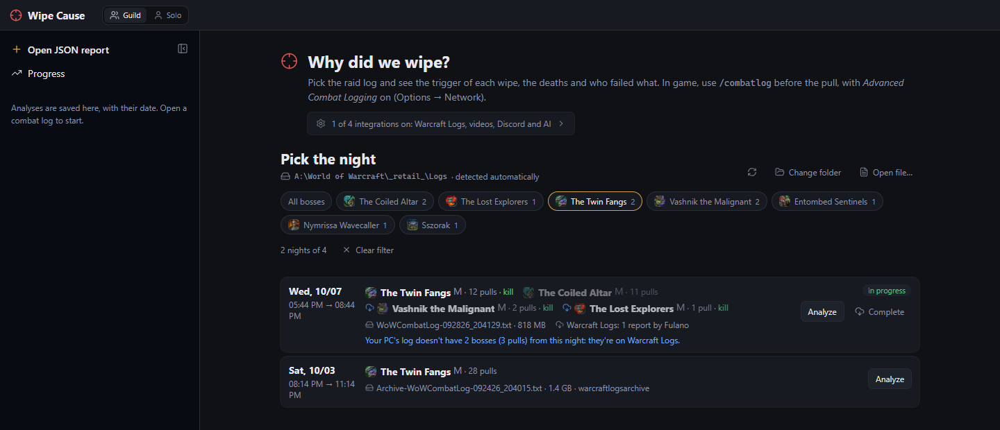
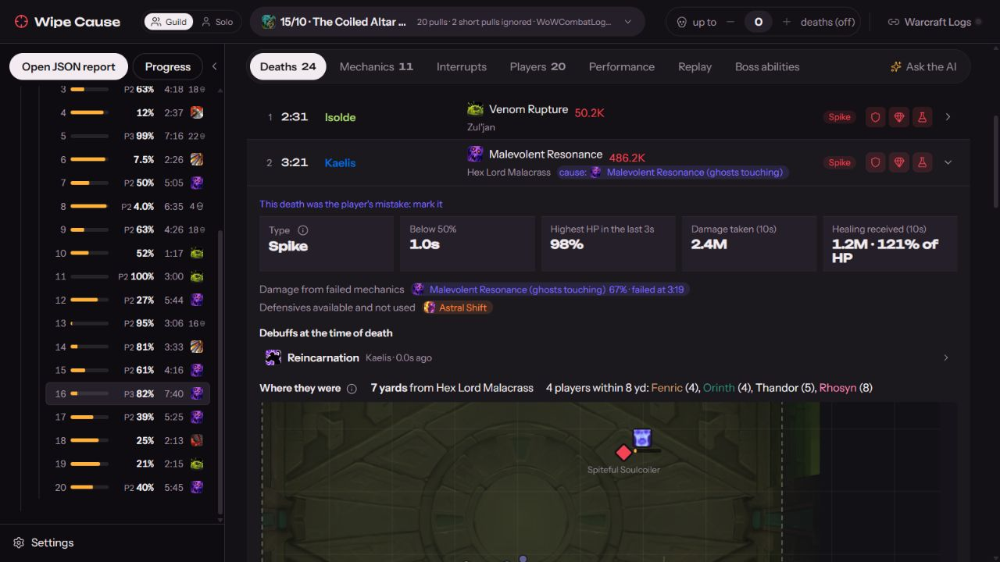
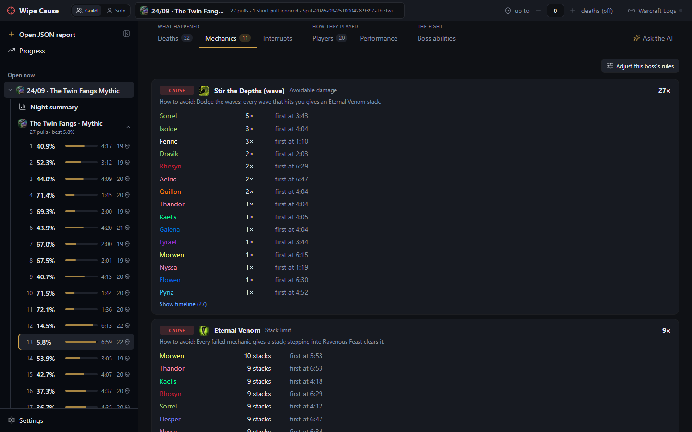
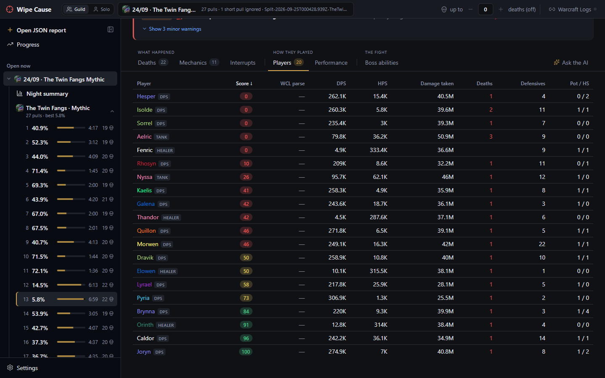
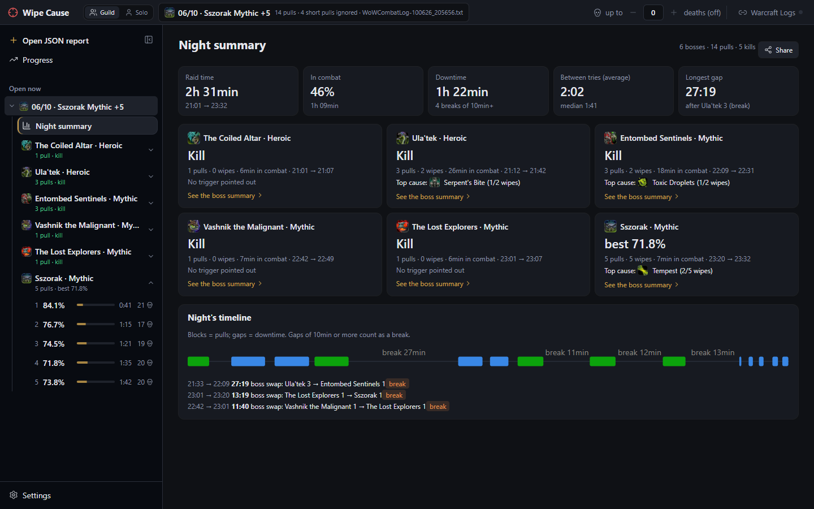
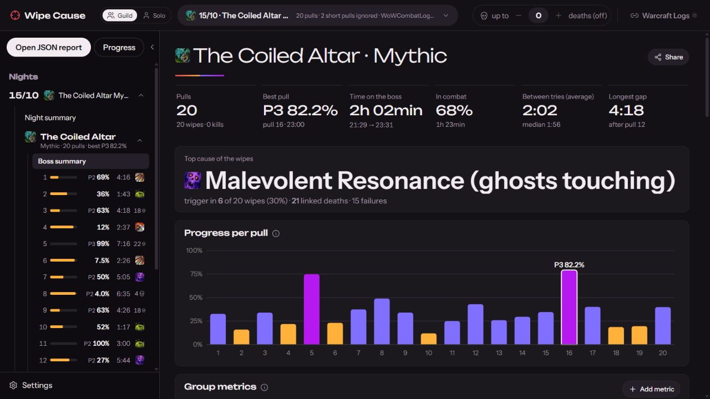
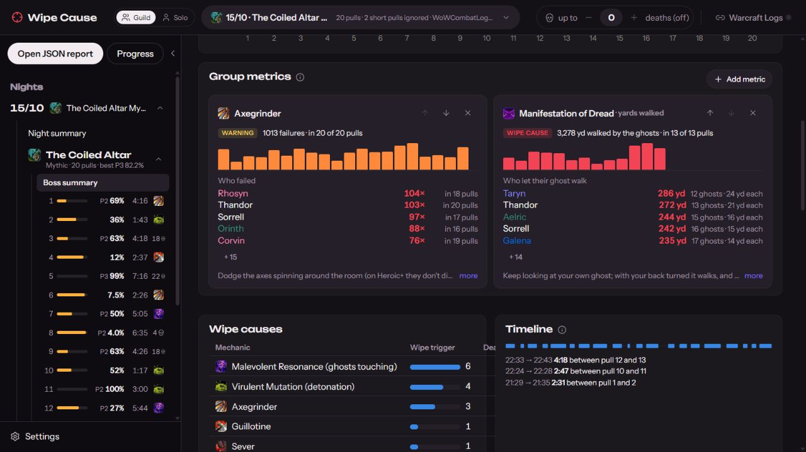
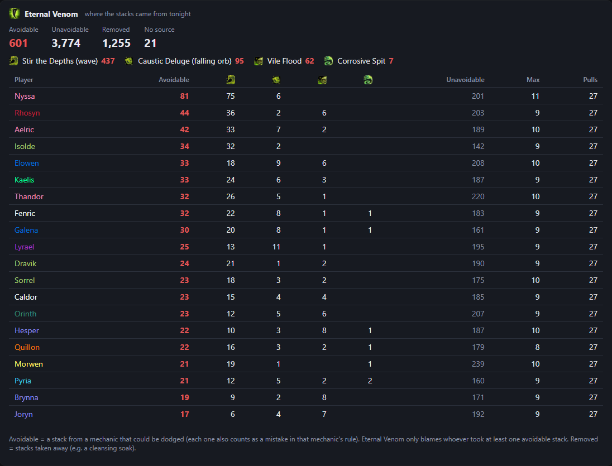
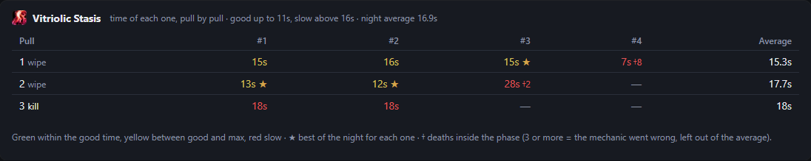

# User guide

[← Back to README](../README.md)

## Install

1. **[Download the installer](https://github.com/keter45/wipe-cause/releases/latest/download/WipeCause_x64-setup.exe)** (`WipeCause_x64-setup.exe`). Windows 10 or 11 (the app uses WebView2, which comes with Windows).
2. Open the file. The first time, Windows may show *"Windows protected your PC"*: click **More info → Run anyway** (the app doesn't have a paid signing certificate yet).
3. Done. The app **updates itself** when a new version comes out; no need to download it again.

### Or use it online

**[Open Wipe Cause in the browser](https://keter45.github.io/wipe-cause/)**, no install: drag the `WoWCombatLog.txt` onto the page or open a Warcraft Logs report. It's the same analysis as the app, running inside your browser — the log never leaves your PC. Live mode, Warcraft Recorder videos and automatic Discord posts need the app. Best in Chrome or Edge.

> [!TIP]
> There's no Wipe Cause server: everything runs on your PC. The Warcraft Logs account is optional and only used to see the guild's logs and fill in what your log missed.

### First steps

The first time, the app opens on **Settings** with a step-by-step guide (afterwards it lives in *Settings → How it works*):

1. **WoW logs folder** — found automatically on most PCs (`World of Warcraft\_retail_\Logs`).
2. **In game** — in *Options → Network*, turn on *Advanced Combat Logging*; before the first pull, `/combatlog` (or the Warcraft Logs uploader, which turns it on by itself).
3. **Sign in with Warcraft Logs** (recommended) — with your account the app sees your guild's logs, completes what your log missed, turns live mode on by itself and shows everyone's parse. No key or client to create.
4. **Optional** — turn live on when WoW opens (with the app closed, the game opens Wipe Cause minimized in the tray, already live; a light watcher with no window starts with Windows), Warcraft Recorder videos, Discord and AI.

## How it works

### 1. Pick the night

<i>One line per night, with each night's bosses. The filter shows only one boss's nights.</i>

**New analysis** brings together the logs on your PC and the guild's Warcraft Logs reports, one line per night. **Analyze** uses your PC's log (fast, no download); **Analyze all** reads one by one the logs in the list that haven't been analyzed yet and saves them in the history, for Progress. The logs folder includes the Warcraft Logs uploader's `warcraftlogsarchive`. Dungeon-only (M+) logs don't show up. **Guild / Pug / All** separates the guild raid from raids with other characters and random people: by the core of players that repeats across your nights (one log can have both, split boss by boss). To find a boss's nights, filter by it (and by difficulty) in the bar above the list; the choice is remembered. **Open file…** analyzes a log from somewhere else; **Detect** goes back to the automatically detected folder and **Change folder** picks another one.

Bosses and pulls that **aren't in your log** but are on Warcraft Logs (you left early, joined late, were away) show a download icon, and nights that only exist on Warcraft Logs (the last 30 days) show **Download**. **Complete** downloads only what's missing — it takes a few minutes, so you decide; after the first download, reopening is fast. Dungeons (M+) are left out, and wipes shorter than 30s are ignored.

Every analysis is saved in the sidebar under **Nights**, with its date: **Pin** keeps it, **Delete from history** removes one and **Delete all unpinned analyses** cleans up the rest. At the top of an open night, **Re-analyze the log** reads it again (after an app update or a rule change), **Saved nights** opens the history and **Pick another night…** goes back to the list.

### 2. See why you wiped

The top of the pull is the **verdict**: where the boss ended, the wipe's **trigger** (the mechanic failure that set off the deaths) and the mechanic mistakes that caused the wipe, with who made them (the other mistakes and warnings open under **Show N other mistakes and warnings**) (see the [pull screenshot](screenshots/en/pull.webp)). Below it, the tabs.

When the raid gives up (after a disaster, several players stop casting at the same time and die), the pull shows **Wipe call** (or **Possible call**, when the signal is weaker). With a sure call, what happens after it counts like the death cutoff: nobody is blamed for dying on purpose.

| Deaths | Mechanics |
|---|---|
|  |  |
| Spike or slow death, missing healing, active debuffs (with stacks), killing blow, defensives/potion/healthstone and a mini map of where everyone was. | Each boss mechanic with who failed it, how many times, the first time and how to avoid it. |

- **Interrupts**: casts that went through, who kicked, who tried and missed, who could have and didn't — and, with the assignments pasted, whose turn it was.
- **Players**: damage done and taken, defensives, potions and each player's **score**.

<i>The 0–100 score takes off points for mechanic mistakes, a missed turn in the interrupt assignments and a decisive death.</i>

## Night and boss summary

<i>The night summary: raid time, downtime between tries, one card per boss and the timeline with the breaks.</i>

In the **boss summary**: the best pull, the top cause of the wipes, progress pull by pull, the **Wipe causes** table (mechanic, trigger, deaths and failures), the boss's timeline with the breaks, the villains and heroes scoreboard and the downtime.

### Group metrics

Pick the mechanics that matter to the group under **Add metric** (the ones that failed most come first). Each one becomes a card with the failures pull by pull — click a bar to open the pull —, who failed and who helped. You can reorder and remove them; the choice is saved for that boss.

### Where the stacks came from

For stacking debuffs, like Eternal Venom on The Twin Fangs, the app tells where every stack came from: the **avoidable** ones (waves, an orb landing on you, Vile Flood, the Corrosive Spit line), the unavoidable ones and the ones that were removed. The rule only blames whoever took an avoidable stack.

### Intermission times

Phases where the boss is immune until the raid solves the mechanic are timed pull by pull, with the best of the night for each one.

### Healing CDs from the note

Paste the addon CD note (NSRT, the one MRT shows) in the **Healing CDs** section of the boss summary or in the pull tab. Each line is matched to the player cast: **on time** (within 10 s), early, late or not used, and no blame when the phase was not reached, ended before, the player died or does not have the spell. The app measures and removes the addon clock offset in each phase (on The Coiled Altar, the addon P2 starts about 8 s later). When the note changes between tries, click **New version** before editing: each pull is judged by the version that applied to it. The same box serves the interrupt assignments, which come from the `intstart`…`intend` block. The section also shows the **boss hits** (unavoidable damage over 80% of the raid health in 5 s): whether each line covered the hit, heals used with no damage around, and hits with no CD in the note. Each CD heal shows its **overheal** against outside healers of the same spec (and the night number next to it in the pull tab); two heals on the same hit with high overheal are marked **stacked**. In the boss summary, **Suggested note** lists one-step changes for each version (add a free CD on an uncovered hit, move a line used on time but off the hit): tick the ones you want and **Copy** returns the pasted note with only those changes. Rules (in Portuguese): [heal-cd-note.md](heal-cd-note.md).

## More features

### 🔴 Live mode and Discord

With **Live** on (at the top), the app follows the most recent `WoWCombatLog` in the logs folder. Without WoW open on this PC and with a Warcraft Logs account, it follows the guild's live log (someone needs the uploader's *Live Logging* on); with *Turn live on by itself* (Settings → Warcraft Logs), it starts as soon as the guild starts the raid. When a pull ends, it re-analyzes the log in a few seconds, opens the new pull and shows a notification — you can see why you wiped before the next pull.

Closing the window leaves the app in the tray (near the clock) with live mode running; click the icon to bring it back and use **Quit** in the icon's menu to close it for good.

The pull notification has a field to note the reason for the wipe right away, the way the raid saw it (it doesn't disappear while you type). The note is saved on the PC, shows at the top of the pull (where you can edit it later), marks the pull in the list, goes on the share card and into the "Ask the AI" context.

In **Settings → Discord**, paste the raid channel's webhook. In live mode, everything arrives as an image (the same card as *Share*): on every wipe, the reason for the wipe; on every kill, the boss summary; and at the end of the raid (live turned off or 30 min with no new pull), the night summary. The pull, the boss summary and the night summary can also be sent right away through *Share*. Each automatic post (wipe, kill, night summary and the wipe clip) turns on and off separately, and **Send test** checks the webhook. The **Discord** button at the top pauses and resumes automatic posting without touching the options (*Share* keeps working).

### 📤 Share

The pull, the boss, the night, a player's performance and solo mode have **Share**: it builds a card to **copy as an image** and paste on Discord/WhatsApp, **save as PNG or HTML** (and **PDF** with clickable links, in the Full version) or **send the image to Discord** through the configured webhook. When the pull has mistakes that led to the wipe, it also has **Save try recap clip (WebP)** and **Message to Discord**, a text message about the pull or the boss. Each card has two versions:

- **Summary** (default, and what goes out automatically in live mode): the essentials at a glance. For a pull, the verdict, the top 3 findings, the decisive deaths, who scored below 80 and the failure map; for a boss, each pull's HP, the top causes, who scored below 80 and the highlights; for solo, your numbers against the reference and the 3 most costly mistakes.
- **Full**: everything open, wider. Every death in order, the mechanics with who failed them, the interrupts that went through and the player table (pull); pull by pull and the scoreboard (boss and night); the stretches where the reference pulled ahead, cooldowns and extra damage taken (solo); rotation, potions and setup (performance).

### 🧮 Player score

Each player gets a 0–100 score per pull: it starts at 100 and loses points for:

- **mechanic mistakes**, by the rule's severity, up to 3 per mechanic. A tank's avoidable damage weighs half, since they often take it on purpose to hold or position the boss;
- **missing their own turn** in the interrupt assignments;
- **a decisive death**, more if they had a defensive left.

At the end it weighs the time alive until the first death and, on a kill, the **Warcraft Logs parse**: from 50 (the median) up it loses nothing; below it loses proportionally, up to 30% (parse 25 loses 15%). Wipes have no parse, so they skip this part. The parse is fetched once (with the night's report set and the Warcraft Logs account connected) and saved in the app. A death in a **mass wipe** (more than 5 deaths within 1.5s — explosion, Execution, enrage) doesn't count: it's a consequence of the wipe, and the blame goes to the mechanic and whoever caused it. It shows in the Players tab (hover to see the deductions), as an average on the boss scoreboard and per night in Progress.

### 🤖 Ask the AI

Every pull has an **Ask the AI** tab: the AI gets a dossier of the pull (the boss mechanics with the rules' tips, verdict, deaths, defensives, positions, interrupt assignments, dispels, notes and a summary of the night's other pulls) and answers only from it. You can read the dossier, with its size, in **View dossier**.

It works with any provider using OpenAI's chat format, with presets for free options: **Google Gemini** and **Groq** (free plans with no card), **OpenRouter** (`:free` models) and **Ollama** (runs on your PC, free and offline), chosen in **Settings → Ask the AI**. The API key is kept in the Windows Credential Manager. On free plans, the provider may use the questions to train models — the dossier includes player names.

### ⚡ Performance

Each pull's **Performance** tab compares a player with the **top players of the same spec on Warcraft Logs**, with a similar item level (and a similar kill time, if the pull was a kill). In progression there's no kill time: the top's fight is cut at the same time the player stayed alive, so a 2:30 wipe is compared with the first 2:30 of the kill.

- **At the top**: damage (or healing) per second alive, time alive, casts per minute and item level, then **Main differences**. In guild mode you pick the player, and the app remembers the choice.
- **Burst windows**: pick the cooldowns to compare; each use shows the casts from 3s before to 20s after on a timeline, side by side with the same use by the top.
- **Cooldowns**: when each one was used, how many times (and how many fit in the time) and whether the 1st use came late or early.
- **Where the reference pulled ahead**: your damage every 5s against the reference's, with the 3 stretches with the biggest difference and each one's casts side by side.
- **Casts by ability**: casts per minute and % of damage per ability, and the reading of the [spec's base rotation](#-rotation).
- **Extra damage taken**: the boss abilities that hit you much more than the reference, per minute alive.
- **Setup**: combat potion, stat distribution, different talents and items side by side, with missing enchants and gems.
- **Share**: the player's report becomes a card (see [Share](#-share)) — for people who don't have the app.

To use the tops, sign in with Warcraft Logs in **Settings → Warcraft Logs** (the tab shows a **Connect** button that opens it). Your own API client ([warcraftlogs.com/api/clients](https://www.warcraftlogs.com/api/clients/)) is an advanced option on the same screen, kept in the Windows Credential Manager. Queries only send the boss, spec and report codes; responses are cached. To compare with someone from your own raid, pick **In your own raid** in **Compare with**, in the same tab. If the night's report link is set, the pull also gets links to your fight on Warcraft Logs and WoWAnalyzer; with a top as the reference, the tab also links to their Raider.IO and Warcraft Logs profiles and to both logs side by side.

### 👤 Solo mode

At the top, **Guild / Solo** switches the app's focus. In guild mode, the question is why the raid wiped. In solo, it's how **you** can improve. "You" is whoever recorded the log; when analyzing from Warcraft Logs, or to look at another character, choose on the screen itself.

- **Pull → You tab**: at the top, four colored cards (green good, yellow attention, red bad, gray context only): output, rotation, survival and mechanic mistakes. Then **For the next pull**: your mistakes sorted by what they cost, each with the moment (▶ in the video) and what to do. Below, tabs:
  - **Mechanics:** your deaths and mechanic mistakes, each with a **replay** of the seconds before (your path, the hits you took, what was on the ground), and the defensives the spec's tops use on this boss's mechanics.
  - **Rotation** (or **Healing**, for healers): the reading of the [spec's base rotation](#-rotation), with the tops on the same boss on every item; for healers, the [healing comparison](#-healers).
  - **Cooldowns:** cooldown usage and, for healers, on which boss mechanic the reference uses each big cooldown.
  - **Spec guide:** key points, priority and sources.
- **Pull → Detailed comparison tab**: you against a reference (a top of your spec on Warcraft Logs, someone in the raid or yourself on another pull), with everything from the [Performance](#-performance) tab. For healers, the Warcraft Logs search brings kills from other guilds with at least 70% of our healer composition.
- **Night and boss summary**: your pulls boss by boss, the best of each and the mistakes that repeat.
- **Progress**: a boss across the saved nights: your best output, rotation, deaths and mechanic mistakes per pull.

### 📜 Rotation

Each spec can have a **written base rotation** in `rotations/<class>-<spec>.yaml` (key points, priority per hero tree for single target and AoE, opener and checks), built from Wowhead's rotation guide and the patch's SimulationCraft APL and calibrated on the logs of the world's best players of each spec (what not even they do is dropped). In the **Performance** tab (and in solo mode's **You** tab), the player's log is read against it: efficiency (0–100), clear mistakes and tweaks, with the moment of each (▶ in the video), the opener and cooldown usage.

**Compared with the tops on this boss:** the app ships with the median of the world's best players of the spec on each raid boss. Every rotation item shows your number next to theirs; the **opener** is the tops' one on that boss and for your hero tree (it changes from boss to boss and with talents), compared with yours; along with: the ability they use much more or less on that boss (AoE vs single target), the cooldown they hold for later (or fire on the pull), when they drink the potion and where you stopped after a boss mechanic while they kept casting.

**Procs and cooldowns, how the tops decide:** the app finds in the tops' logs what spends each proc (Art of War → Blade of Justice, Divine Resonance → Hammer of Wrath...) and which cooldowns they fire together, and points out where you decide differently: the proc you let expire much more than they do ("Divine Resonance: you let 51% expire (tops 0%)"), the other abilities you cast with the proc waiting, the cooldown they use as soon as it's ready and you hold, and what they line up (Avenging Wrath with Wake of Ashes) and you don't, with the ▶ for each moment. Holding for a phase changes from boss to boss: with enough tops on the boss, the cooldown comparison is that boss's. Only what goes well beyond what the tops themselves do shows up, and a proc you never spent (another build) isn't flagged.

**The fight's context:** your rotation is compared separately in the stretches where you were hitting 1 enemy and in the AoE ones (3 or more), with that boss's tops: "AoE: the tops use Divine Storm for 80% of casts; you 20%". A pull much shorter than the tops' fight (a wipe in an early phase) doesn't compare the mix. Buffs and debuffs the tops keep up all the time through their rotation (not gear ones) become uptime checks on their own. And when a talent changes the tops' rotation on every boss (not just the AoE ones, where the fight is what changes it), whoever plays that build is compared with the tops of the same build.

In the **Performance** tab's comparison, the same decisions are also compared with the chosen reference, someone from the raid or a Warcraft Logs top (the app also downloads their buffs): "Explosive Shot: once ready, you take 8.8s to use it on average (Bettaozor 1.3s)". With a single log there's no way to tell what's normal, so only a big difference between the two that also goes beyond what the tops do shows up: what two good players do differently from each other is style, not a mistake.

Specs with a rotation: every damage spec — **Death Knight** (Frost, Unholy), **Demon Hunter** (Havoc, Devourer), **Druid** (Balance, Feral), **Evoker** (Devastation, Augmentation), **Hunter** (Beast Mastery, Marksmanship, Survival), **Mage** (Arcane, Fire, Frost), **Monk** (Windwalker), **Paladin** (Retribution), **Priest** (Shadow), **Rogue** (Assassination, Outlaw, Subtlety), **Shaman** (Elemental, Enhancement), **Warlock** (Affliction, Demonology, Destruction) and **Warrior** (Arms, Fury).

### 🤖 Bot (SimulationCraft)

In the **Performance** tab, **Compare with → Bot (SimulationCraft)** has SimulationCraft play the same character: your gear, talents, consumables and buffs (Bloodlust and Power Infusion at the same moments), on the night's kill (with no kill, the longest pull you didn't die in), moving as much as the fight asked and without mechanics. What's left is rotation: the % of the bot's potential (with the bot's range over 1000 fights), **What to change first** with an estimate of the damage, and the decisions where you left the range of 20 bot fights. It doesn't show for healers.

In the boss summary, **Bot for the raid** simulates the whole raid; the Players table and Progress show each one's % of the bot's potential. The first time, the app downloads SimulationCraft (~15 MB); the simulation only runs in the installed app (Windows).

### 💚 Healers

Healing isn't compared with the tops: HPS is misleading (a raid taking extra damage, a raid built with few healers) and top logs get more distorted over time. The healer reference is **Mythic kills from other guilds** (8 per boss for each spec, taken from several pages of the ranking, without the top and without using the parse to pick), with the **healer composition closest to ours** and without distorted logs (raid taking too much damage or healing concentrated on one healer). Healers from your own raid are never the reference: they're who the analysis wants to help. Full rules in [docs/healer-analysis.md](healer-analysis.md) (in Portuguese).

- **Context, not a grade:** HPS, share of the healers' healing and raid damage taken, each with the reference range drawn.
- **What to adjust:** only where the reference does what is asked and you're outside its range: cooldown sitting, lost proc (Infusion of Light, Surge of Light, Strength of the Black Ox…), spec combos (Divine Toll inside Beacon of Virtue, Wild Growth before Convoke), Atonement/Renewing Mist/Rejuvenation on the raid, idle time while people were hurt, mana left at the kill and overheal above the reference.
- **Where the healing comes from:** each spell's share of healing, overheal and casts, yours and the reference's.
- **Cooldown timings:** on which boss mechanic most of the reference uses each big cooldown ("2nd Stir the Depths · reference +3 s · you +8 s"), on a timeline of the fight.

Healing counts absorbs (Power Word: Shield and other shields), as Warcraft Logs does.

Specs with healer analysis: **Discipline Priest**, **Holy Priest**, **Holy Paladin**, **Restoration Druid**, **Restoration Shaman**, **Mistweaver Monk** and **Preservation Evoker**.

### 🛠️ Tuning the boss rules

Every raid has its own strategy, so boss rules can be tuned without touching files:

- **Adjust this boss's rules** (Mechanics tab): turn each mechanic on/off, change its severity, how many hits per player are tolerated, at how many stacks to warn, the maximum time until a dispel, the lethal stacks, a phase's good and slow times, who can be blamed and the tip and message texts; **Restore the default** undoes it. Only what differs from the default is saved, so your tuning keeps working when the app updates its rules.
- **Progression focus (★)**: the mechanics holding progression back go into the verdict even when minor, come first and weigh 1.5× in the score.
- The **Boss abilities** tab lists each enemy ability with its source, hits and damage on players, and marks the ones a rule already uses (**has a rule**). **Create rule** (Boss abilities tab): for something the rules don't catch, pick in plain language what that ability means ("taking this is a mistake", "must be interrupted", "stack that kills"…); the preview shows what it would flag in the pull.
- **Mark mistake**: for what the log can't prove (positioning, baits, assignments), mark in the pull who failed and what — or "this death was the player's fault" in the death details. It goes into the verdict, the score and the AI context.
- **Export / Import**: send a boss's tuning to the officers so everyone uses the same setup.

Saving re-analyzes the open log. Tuning is stored in `rule-tuning/<encounter_id>.json` in the app's data folder (`wipe-cli analyze <log> --tuning <folder>` applies it too).

### ✋ Interrupt assignments, dispels and special mechanics

In the **Interrupts** tab, paste the MRT/NSRT note (or write `Cast: Alice, Bob, Carol`, one line per add): the app checks cast by cast whose turn it was, who kicked, who covered and on which turn the cast went through — and the pull's verdict and Discord start pointing out who let it through.

The rules also cover:

- **`dispel`**: the time until each debuff is dispelled and who was left without one.
- **`phase_duration`**: timed phases, like the Vitriolic Stasis puzzle on Entombed Sentinels.
- **Stacking debuffs with sources**: where every stack came from (e.g. Eternal Venom on The Twin Fangs).
- **`exclusive_auras`**: who picked up two auras that must not be held together. E.g. Mark of Acid and Mark of Blood on Entombed Sentinels, when someone gets near the other boss mid-fight; swapping sides after the intermission doesn't count.

### 📍 Positions

With Advanced Combat Logging, each death (before the cutoff) comes with a **replay** of the 15 seconds before it: the player's path, health, every big hit they took (with the mechanic that killed them highlighted), the distance to the nearest boss and everyone around, plus who was within 8 yards at the moment. Mechanics that depend on movement or stacks get the same replay: one per culprit for avoidable damage, positioning, stacking debuffs and the double mark (with every hit marked as a red ring), and one per failure for collective ones (soaks, explosions, the purple orb's detonation). The log doesn't record pools or droplets, but it does record where each player was when one hit them: every replay draws those spots on the ground (droplets, pools, soak circles, projectiles), colored by mechanic. The map draws the arena floor from wherever someone stood during the pull (the log has no map), with a 10-yard grid and scale, and opens on where the raid was during the replay and switches to a zoom on who it follows; drag to move the map and use the mouse wheel to zoom; space pauses and the arrow keys step through it. Boss casts show up too: the spell icon and a cast bar next to the boss while it casts, an arrow for where it was facing when it finished, the area of frontals like the Coiled Altar Severs (a triangle pointing at the boss target during the cast), and a strip under the map with every boss's casts over the replay.

On Mythic Coiled Altar, the app rebuilds where every orb was (who carried it, where each one was dropped, which ones Sever broke) and, at each detonation, points out who took an orb to another one sitting on the ground: "Rainface took the purple within 7 yards of a green on the ground". When nobody got close (e.g. a purple was left at the timer), it blames no one.

The **Replay** tab (under "The fight") plays the whole pull, top-down: the app re-reads just that pull from the combat log and shows everyone moving from start to finish, with boss frontals, ground marks and ghosts. Like the Warcraft Logs replay, everything sits on the map itself: boss health with the cast in progress (click it to see the damage each player did to that boss), meters for damage done, damage taken, damage taken by ability, healing done and healing received up to that moment (click a category to open it, right-click to go back), and raid frames with each player's health, whether they're dead and the crucial debuff they carry (the ones the boss rules know about), with the stack count in the icon corner (the raid frames can be collapsed to free up the map). Right under the map, a timeline marks phases, deaths, serious mechanic failures and boss frontals (**One lane per mechanic** splits the failures into one lane each), and clicking any of them jumps to just before it; the mouse wheel zooms into it (Shift + wheel moves sideways), and speed goes from 0.25× to 8×. Any replay turns into an animated clip (WebP) with the Clip button (a part of up to 30 s, framing **Whole raid** or **Focused**, and zoom), to save or send to Discord; from the pull's Share menu and in live mode, each wipe goes to Discord with the card and a clip of the mistakes that led to the wipe, in sequence (it can be turned off in the Discord settings). Click a player on the map or in the raid frames to follow them: their path is highlighted, and a panel shows their health, active debuffs and defensives, their deaths and mistakes in the pull, and everything that happened to them in the last 15 seconds (damage taken with the mechanic behind it, healing, casts, interrupts, dispels). The map also draws what the boss leaves around: on Coiled Altar, the purple and green orbs on the ground with the purple's danger radius, a ring around whoever carries one, the area around the carrier and the spinning axes (in P2, an axe that goes 10 s without hitting anyone disappears; the log only shows where an axe is now and then; if someone walks where it would be without taking damage, it fades out, marking where it was). Raid defensives with an area (Anti-Magic Zone, Darkness, Spirit Link Totem, Power Word: Barrier) show up too, in the color of whoever used them and for as long as they last, along with the adds that need interrupting, with their cast bar from the moment they spawn (it fills at the real cast speed, so a kicked cast stops where it was cut, and curses that slow casting such as Curse of Tongues stretch it) and the name of whoever kicked each cast (gone once interrupted or dead), the adds that must die and the lines they fire at their target. Soaks show as the circle where they'll land, with how many players are inside and how many are needed. Orbs disappear when the frontal breaks them (the raid gets one Venom Rupture stack per broken orb, so the app knows how many broke) and when the boss detonates the leftovers on dropping new orbs or changing phase. The world markers your group places show up too, like in game. The map is north-up, with the arena image underneath for the bosses that have one (every Venomous Abyss boss except Nymrissa Wavecaller, plus Kith'ix) (from raidplan.io, aligned using where players stood in the logs) and the walkable floor outlined; everything outside it is dimmed. Buttons under the map choose what shows: ground marks, debuffs over heads, areas and players' names. **Layers** turns countdowns, the next frontal and cast, animations, player CC, warlock gateways, who interrupted the cast and room landmarks on and off; **Markers** shows or hides the group's world markers. It needs the combat log on this PC, so pulls that came from Warcraft Logs don't have it. On multi-phase bosses the pull list shows the phase each try reached (P2, Int., P3) instead of the first boss's health. In place of the death count, each wipe shows the icon of what set it off (the mechanic tied to the deaths); scattered deaths with no common cause keep the skull.

In phase 2, when two Manifestations of Dread touch (Malevolent Resonance on both targets), the app checks where each target was facing in the 5 seconds before. The log doesn't show the ghost walking, only where it started chasing, but a ghost only walks while its target has their back turned, so looking toward that spot means looking at the ghost. Whoever spent most of that time with their back turned gets the blame: "Anaxxi had their back to their own ghost for 5s of the 5s before it touched Hazuki's". When both were looking, it blames no one. The replay draws every ghost: the path is simulated (it walks toward its owner while the owner looks away) and adjusted to what the log does show, where the two ghosts met at the collision and where a ghost caught its owner. A list shows how far each one had walked up to that moment; walking isn't always a mistake, since players sometimes move their ghost on purpose.

In the Entombed Sentinels intermission, the app rebuilds everyone's Helical Toxins stacks (the log hides the starting number; it comes from the debuff's tick) and lists every touch with the wrong sum: 3 + 3 = 6 (nobody can clear it anymore), or a 1 + 1 that left two 3s with no partner. For each one it says who walked into whom in the seconds before, who the right partner nearby was, and plays back the positions of everyone with the debuff in the 15 seconds before the touch.

### 📈 Progress

In the sidebar, **Progress** compares every saved night of a boss: best pull per night, the % of wipes where each mechanic was the trigger (to see whether the mistake is going down) and, per player, deaths per pull, score and parse each night, what kills them most and how many of those deaths had a defensive left. It only uses the guild raid (pugs can be included). It also shows **who is improving and who is getting worse** (start vs end of the nights each one played) and, for the **progression** (the wipes before the first kill), the best and worst score on the wipes and the best and worst parse on the kill.

### 🌐 Warcraft Logs

With a Warcraft Logs account, your guild's reports (unlisted ones too) show up in **New analysis**, next to the PC's logs; a link that's not on the list can be pasted at the bottom of the screen. Whatever is in a log on your PC comes from it; only what's missing is downloaded from Warcraft Logs (downloaded events stay on disk, to re-analyze without spending the API). Several people uploaded the same night? The reports become a single analysis, with one copy of each pull.

With the Warcraft Logs account connected, the app finds the night's report on its own: it searches the login's guilds and the reports you uploaded, around the log's time, and keeps the one with the same pulls (boss, difficulty and time). Without a login, or to change it, paste the link in the Warcraft Logs bar (it's saved for that log file; "Remove" stops the app from searching again). Each pull gets a button that opens the report already filtered to the boss and difficulty, with the try number as WCL shows it ("Wipe 13") — it also counts the short pulls the app ignores. The report button doesn't use the API.

### 🎥 Warcraft Recorder

If you record your fights with [Warcraft Recorder](https://warcraftrecorder.com), set the videos folder (**Settings → Warcraft Recorder videos**, or the **Videos** button at the top). Without it, the app tries to detect the folder from the Recorder's config and matches each video to its pull by boss and start time. The pull gets a **▶ Video** button, and every death, trigger and mechanic event gets a **▶** that opens the video 5s before the moment.

**Guild videos (Recorder cloud):** in *Settings → Warcraft Recorder videos*, sign in with the Warcraft Recorder cloud account. The videos the guild uploads become other points of view of each pull: in the player, switch POV and the video keeps going from the same second.

### ⚙️ Settings

Everything the app needs lives in **Settings** (bottom of the sidebar), each item with its status (ready, needs setup, off):

- **Essential:** the WoW logs folder and the in-game combat log (`/combatlog` + Advanced Combat Logging — the app warns you if the open log was recorded without it).
- **Analysis:** the default death cutoff for new logs.
- **Open with WoW:** live when WoW opens (the app opens in the tray, already following the raid).
- **Integrations** (optional): Warcraft Logs, Warcraft Recorder videos folder, Discord webhook and the "Ask the AI" provider.
- **About:** version, updates and the boss rules folder (`.yaml` files there replace the built-in rules).

When a feature depends on an integration that isn't set up yet, it shows a shortcut to the right section.

**Analyze up to N deaths** (top of the screen; the default, 4, is in Settings): after a few deaths the wipe is already decided. Mechanic mistakes, failures, interrupts and the trigger only count up to the N-th death of each wipe (kills have no cutoff); the rest is dimmed. Changing N is instant (0 = count everything).

### 🗣️ Languages

The app is in English and Portuguese (Brazil): English by default, Portuguese when the computer is set to Portuguese, and it can be switched in **Settings**, instantly and without losing what's open. The analysis, rule tips, rotation, share cards, Discord messages, AI dossier and tray menu follow the chosen language. Ability, boss and mechanic names stay in English in both, as they come from the game.
