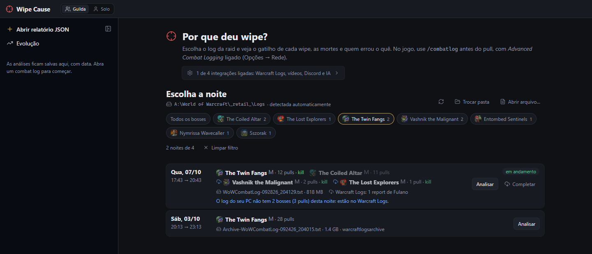
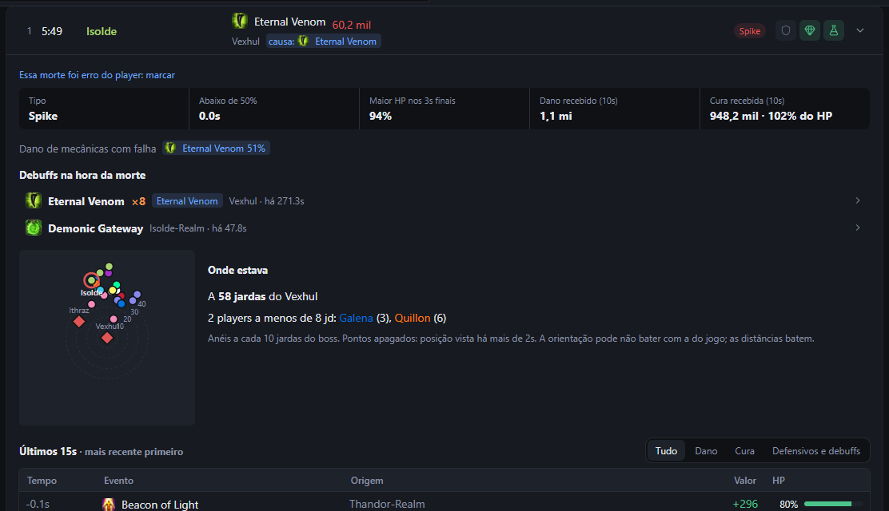
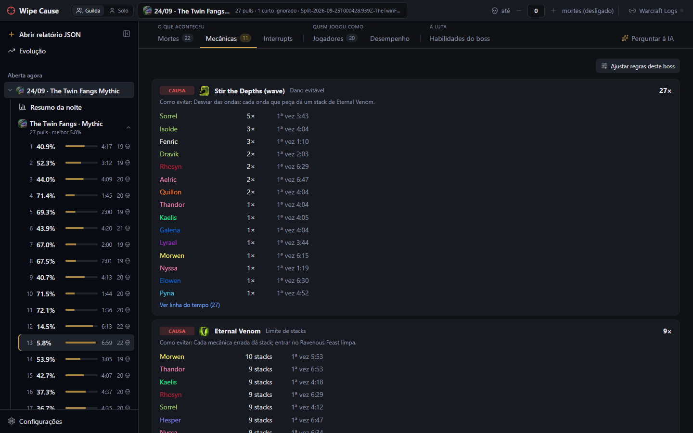
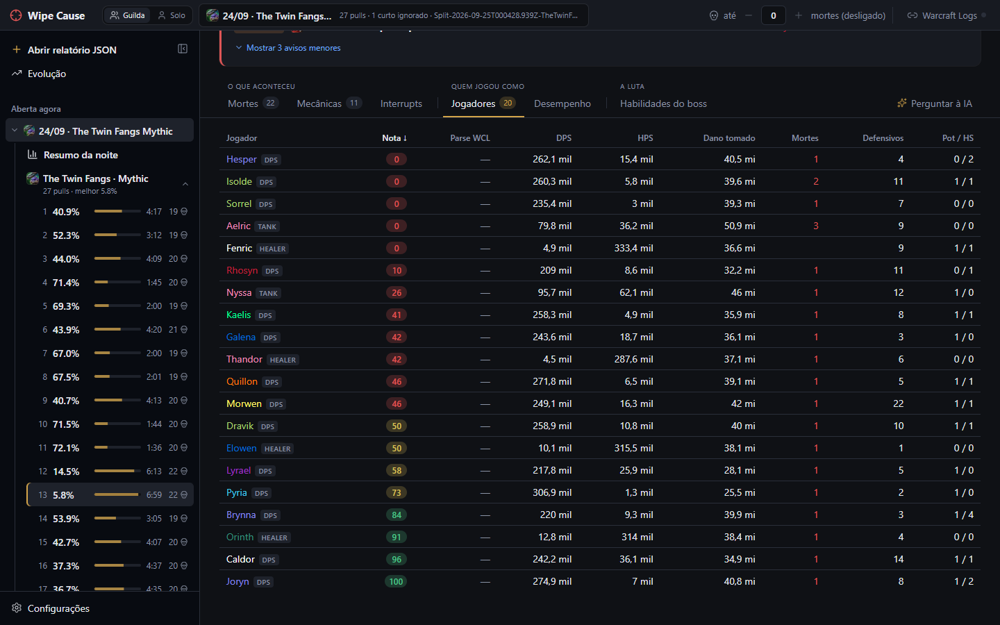
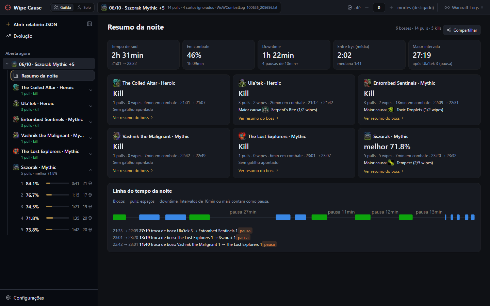
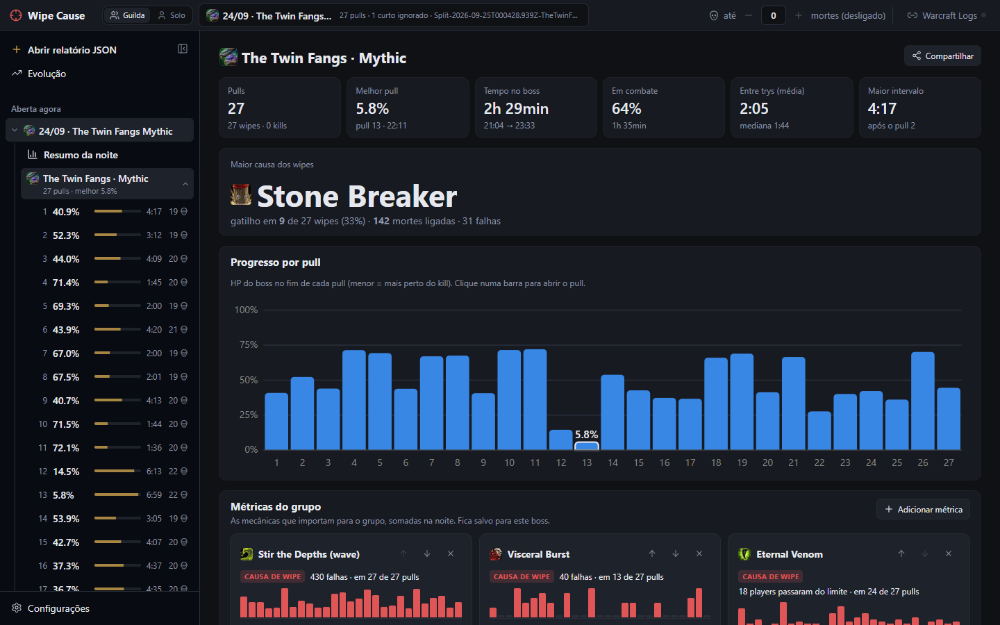
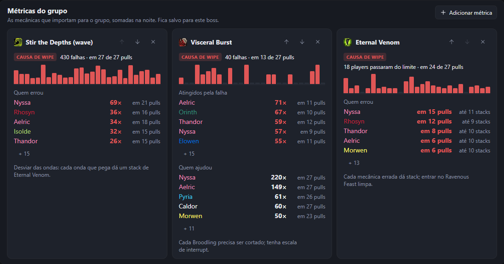
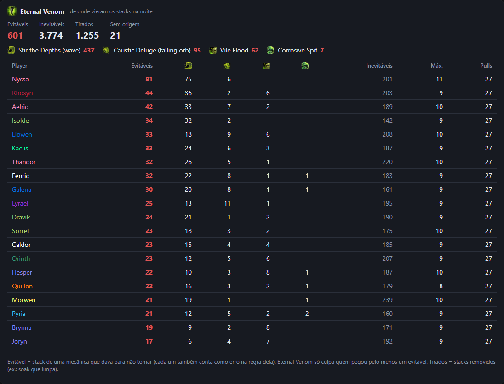
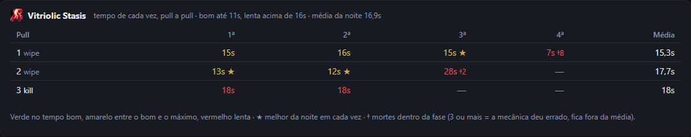

# Guia de uso

[← Voltar ao README](../README.pt-BR.md)

## Instalar

1. **[Baixe o instalador](https://github.com/keter45/wipe-cause/releases/latest/download/WipeCause_x64-setup.exe)** (`WipeCause_x64-setup.exe`). Windows 10 ou 11 (o app usa o WebView2, que vem com o Windows).
2. Abra o arquivo. Na primeira vez, o Windows pode mostrar *"O Windows protegeu o computador"*: clique em **Mais informações → Executar assim mesmo** (o app ainda não tem certificado de assinatura pago).
3. Pronto. O app **se atualiza sozinho** quando sai versão nova; não precisa baixar de novo.

### Ou use online

**[Abra o Wipe Cause no navegador](https://keter45.github.io/wipe-cause/)**, sem instalar: arraste o `WoWCombatLog.txt` para a página ou abra um report do Warcraft Logs. É a mesma análise do app, rodando dentro do seu navegador — o log não sai do seu PC. O modo ao vivo, os vídeos do Warcraft Recorder e o envio automático ao Discord precisam do app. Melhor no Chrome ou no Edge.

> [!TIP]
> Não tem servidor do Wipe Cause: tudo roda no seu PC. A conta do Warcraft Logs é opcional e só serve para ver os logs da guilda e completar o que o seu log não pegou.

### Primeiros passos

Na primeira vez, o app abre em **Configurações** com o passo a passo (depois ele fica em *Configurações → Como funciona*):

1. **Pasta de logs do WoW** — encontrada sozinha na maioria dos PCs (`World of Warcraft\_retail_\Logs`).
2. **No jogo** — em *Opções → Rede*, ligue o *Advanced Combat Logging*; antes do primeiro pull, `/combatlog` (ou o uploader do Warcraft Logs, que liga sozinho).
3. **Entrar com o Warcraft Logs** (recomendado) — com a sua conta o app vê os logs da sua guilda, completa o que faltou no seu log, liga o ao vivo sozinho e mostra o parse de cada um. Não precisa criar chave nem client.
4. **Opcional** — ligar o ao vivo quando o WoW abrir (com o app fechado, o jogo abre o Wipe Cause minimizado na bandeja e já ao vivo; um vigia leve, sem janela, inicia com o Windows), vídeos do Warcraft Recorder, Discord e IA.

## Como funciona

### 1. Escolha a noite

<i>Uma linha por noite, com os bosses de cada uma. O filtro mostra só as noites de um boss.</i>

**Nova análise** junta os logs do seu PC e os reports da guilda no Warcraft Logs, uma linha por noite. **Analisar** usa o log do seu PC (rápido, sem baixar nada); **Analisar todos** lê um por um os logs da lista que ainda não foram analisados e guarda no histórico, para a Evolução. A pasta de logs inclui a `warcraftlogsarchive` do uploader do Warcraft Logs. Logs só de masmorra (M+) não aparecem. **Guilda / Pug / Todos** separa a raid da guilda das raids com outros personagens e gente aleatória: pelo núcleo de players que se repete nas suas noites (um mesmo log pode ter os dois, separados boss a boss). Para achar as noites de um boss, filtre por ele (e pela dificuldade) na barra acima da lista; a escolha fica lembrada. **Abrir arquivo…** analisa um log de outro lugar; **Detectar** volta para a pasta detectada sozinha e **Trocar pasta** escolhe outra.

Bosses e pulls que **não estão no seu log** mas estão no Warcraft Logs (você saiu antes, entrou depois, estava longe) aparecem com o ícone de download, e as noites que só existem no Warcraft Logs (os últimos 30 dias) aparecem com **Baixar**. **Completar** baixa só o que falta — demora alguns minutos, então é você quem decide; depois do primeiro download, reabrir é rápido. Masmorras (M+) ficam de fora, e wipes com menos de 30s são ignorados.

Cada análise fica salva na barra lateral, em **Noites**, com a data: **Fixar** guarda, **Apagar do histórico** tira uma e **Apagar todas as análises não fixadas** limpa o resto. No topo de uma noite aberta, **Reanalisar o log** lê de novo (depois de uma atualização do app ou de mudar uma regra), **Noites salvas** abre o histórico e **Escolher outra noite…** volta para a lista.

### 2. Veja por que deu wipe

O topo do pull é o **veredito**: o boss em quanto ficou, o **gatilho** do wipe (a falha de mecânica que puxou as mortes) e os erros de mecânica que causaram o wipe, com quem errou (os outros erros e avisos abrem em **Mostrar N outros erros e avisos**) (veja o [print do pull](screenshots/pt/pull.webp)). Abaixo, as abas.

Quando a raid desiste (depois de um desastre, vários players param de castar ao mesmo tempo e morrem), o pull mostra **Call de wipe** (ou **Possível call**, quando o sinal é mais fraco). Com a call certa, o que vem depois conta como o corte de mortes: ninguém leva culpa por morrer de propósito.

| Mortes | Mecânicas |
|---|---|
|  |  |
| Spike ou morte lenta, se faltou cura, debuffs ativos (com stacks), golpe final, defensivos/poção/healthstone e um mini mapa de onde todo mundo estava. | Cada mecânica do boss com quem errou, quantas vezes, a primeira vez e como evitar. |

- **Interrupts**: casts que passaram, quem cortou, quem tentou e errou, quem podia e não cortou — e, com a escala colada, de quem era a vez.
- **Jogadores**: dano causado e tomado, defensivos, poções e a **nota** de cada um.

<i>A nota de 0 a 100 desconta erros de mecânica, a vez perdida na escala de interrupts e a morte decisiva.</i>

## Resumo da noite e do boss

<i>O resumo da noite: tempo de raid, downtime entre as trys, um cartão por boss e a linha do tempo com as pausas.</i>

No **resumo do boss**: o melhor pull, a maior causa dos wipes, o progresso pull a pull, a tabela **Causas dos wipes** (mecânica, gatilho, mortes e falhas), a linha do tempo do boss com os intervalos, o placar de vilões e mocinhos e o downtime.

### Métricas do grupo

Escolha as mecânicas que importam para o grupo em **Adicionar métrica** (as que mais falharam vêm primeiro). Cada uma vira um cartão com as falhas pull a pull — clique numa barra para abrir o pull —, quem errou e quem ajudou. Dá para reordenar e tirar; a escolha fica salva para aquele boss.

### De onde vieram os stacks

Em debuffs que acumulam, como o Eternal Venom do The Twin Fangs, o app diz de onde veio cada stack: os **evitáveis** (onda, orb caindo em cima, Vile Flood, linha do Corrosive Spit), os inevitáveis e os que foram tirados. A regra só culpa quem pegou stack evitável.

### Tempo das intermissões

Fases em que o boss fica imune até o raid resolver a mecânica são cronometradas pull a pull, com o melhor da noite em cada vez.

### CDs de cura da note

Cole a note de CDs do addon (NSRT, a que o MRT mostra) na seção **CDs de cura** do resumo do boss ou na aba do pull. Cada linha é casada com o cast do player: **na hora** (até 10 s), adiantado, atrasado ou não usou, e sem culpa quando a fase não chegou, acabou antes, o player morreu ou não tem a spell. O app mede e desconta o desvio do relógio do addon em cada fase (no The Coiled Altar, o P2 do addon começa uns 8 s depois). Quando a note mudar entre as tries, clique em **Nova versão** antes de editar: cada pull é julgado pela versão que valia nele. A mesma caixa serve à escala de interrupts, que sai do bloco `intstart`…`intend`. Regras: [heal-cd-note.md](heal-cd-note.md).

## Mais recursos

### 🔴 Modo ao vivo e Discord

Com **Ao vivo** ligado (no topo), o app acompanha o `WoWCombatLog` mais recente da pasta de logs. Sem o WoW aberto neste PC e com a conta do Warcraft Logs, ele segue o log ao vivo da guilda (alguém precisa estar com o *Live Logging* do uploader ligado); com a opção *Ligar o ao vivo sozinho* (Configurações → Warcraft Logs), ele liga assim que a guilda começa a raid. Quando um pull termina, ele reanalisa o log em alguns segundos, abre o pull novo e mostra uma notificação — dá para ver o motivo do wipe antes do próximo pull.

Fechar a janela deixa o app na bandeja (perto do relógio), com o ao vivo rodando; clique no ícone para voltar e use **Sair** no menu do ícone para fechar de vez.

O aviso do pull tem um campo para anotar o motivo do wipe na hora, do jeito que a raid percebeu (ele não some enquanto você escreve). A anotação fica salva no PC, aparece no topo do pull (onde dá para editar depois), marca o pull na lista, vai no cartão de compartilhar e entra no contexto do "Perguntar à IA".

Em **Configurações → Discord**, cole o webhook do canal da raid. No modo ao vivo, tudo chega como imagem (o mesmo cartão do *Compartilhar*): em cada wipe, o motivo do wipe; em cada kill, o resumo do boss; e no fim da raid (ao vivo desligado ou 30 min sem pull novo), o resumo da noite. O pull, o resumo do boss e o resumo da noite também enviam na hora pelo *Compartilhar*. Cada envio automático (wipe, kill, resumo da noite e o clipe do wipe) liga e desliga separado, e **Enviar teste** confere o webhook. O botão **Discord** no topo pausa e religa o envio automático sem mexer nas opções (o *Compartilhar* continua funcionando).

### 📤 Compartilhar

O pull, o boss, a noite, o desempenho de um jogador e o modo solo têm **Compartilhar**: gera um cartão para **copiar como imagem** e colar no Discord/WhatsApp, **salvar como PNG ou HTML** (e **PDF** com links clicáveis, na versão Completo) ou **enviar a imagem ao Discord** pelo webhook configurado. Quando o pull tem erros que levaram ao wipe, ele também tem **Salvar clipe com o resumo da try (WebP)** e **Mensagem no Discord**, um texto sobre o pull ou o boss. Cada cartão tem duas versões:

- **Resumo** (padrão, e o que vai sozinho no ao vivo): o principal para uma olhada. No pull, o veredito, os 3 achados principais, as mortes decisivas, quem ficou abaixo de 80 e o mapa da falha; no boss, o HP de cada pull, as maiores causas, quem ficou abaixo de 80 e os destaques; no solo, os seus números contra a referência e os 3 erros que mais custaram.
- **Completo**: tudo aberto, mais largo. Cada morte em ordem, as mecânicas com quem errou, os interrupts que passaram e a tabela dos jogadores (pull); o pull a pull e o placar (boss e noite); os trechos em que a referência abriu vantagem, os cooldowns e o dano tomado a mais (solo); rotação, poções e setup (desempenho).

### 🧮 Nota por player

Cada player recebe uma nota de 0 a 100 por pull: parte de 100 e perde pontos por:

- **erros de mecânica**, pela gravidade da regra, até 3 por mecânica. Dano evitável de tank pesa metade, porque muitas vezes ele toma de propósito para segurar ou posicionar o boss;
- **deixar passar a própria vez** na escala de interrupts;
- **morte decisiva**, e mais se tinha defensivo sobrando.

No fim pesam o tempo vivo até a primeira morte e, no kill, o **parse do Warcraft Logs**: de 50 (a mediana) para cima não perde nada; abaixo perde proporcional, até 30% (parse 25 perde 15%). Wipe não tem parse, então fica sem essa parte. O parse é buscado uma vez (com o report da noite cadastrado e a conta do Warcraft Logs conectada) e fica salvo no app. Morte em **wipe geral** (mais de 5 mortes em até 1,5s — explosão, Execution, enrage) não conta: é consequência do wipe, e a culpa fica com a mecânica e quem a causou. Aparece na aba Jogadores (passe o mouse para ver os descontos), como média no placar do boss e por noite na Evolução.

### 🤖 Perguntar à IA

Cada pull tem a aba **Perguntar à IA**: a IA recebe um dossiê do pull (mecânicas do boss com as dicas das regras, veredito, mortes, defensivos, posições, escala de interrupts, dispels, notas e um resumo dos outros pulls da noite) e responde só com base nele. Dá para ver o dossiê, com o tamanho dele, em **Ver dossiê**.

Funciona com qualquer provedor no formato de chat da OpenAI, com presets para opções gratuitas: **Google Gemini** e **Groq** (planos gratuitos sem cartão), **OpenRouter** (modelos `:free`) e **Ollama** (roda no seu PC, grátis e offline), escolhidos em **Configurações → Perguntar à IA**. A chave de API fica no Gerenciador de Credenciais do Windows. Nos planos gratuitos, o provedor pode usar as perguntas para treinar modelos — o dossiê inclui os nomes dos players.

### ⚡ Desempenho

A aba **Desempenho** de cada pull compara um player com os **top players da mesma spec no Warcraft Logs**, com item level parecido (e tempo de kill parecido, se o pull foi kill). Na progressão não há tempo de kill: o fight do top é recortado no mesmo tempo que o player ficou vivo, então um wipe de 2:30 é comparado com os 2:30 iniciais do kill.

- **No topo**: dano (ou cura) por segundo vivo, tempo vivo, casts por minuto e item level, e depois as **Diferenças principais**. No modo guilda você escolhe o jogador, e o app lembra a escolha.
- **Janelas de burst**: marque os cooldowns que quer comparar; cada uso mostra os casts de 3s antes a 20s depois numa linha do tempo, lado a lado com o mesmo uso do top.
- **Cooldowns**: quando cada um foi usado, quantas vezes (e quantas cabiam no tempo) e se o 1º uso veio atrasado ou adiantado.
- **Onde a referência abriu vantagem**: o seu dano a cada 5s contra o da referência, com os 3 trechos de maior diferença e os casts de cada um lado a lado.
- **Casts por habilidade**: casts por minuto e % do dano de cada habilidade, e a leitura da [rotação base da spec](#-rotação).
- **Dano tomado a mais**: as habilidades do boss que pegaram bem mais em você que na referência, por minuto vivo.
- **Setup**: poção de combate, distribuição de status, talentos diferentes e itens lado a lado, com encantamentos e gemas que faltam.
- **Compartilhar**: o relatório do jogador vira um cartão (veja [Compartilhar](#-compartilhar)) — para quem não tem o app.

Para usar os tops, entre com o Warcraft Logs em **Configurações → Warcraft Logs** (a aba mostra um botão **Conectar** que abre lá). O client próprio da API ([warcraftlogs.com/api/clients](https://www.warcraftlogs.com/api/clients/)) é uma opção avançada da mesma tela e fica no Gerenciador de Credenciais do Windows. As consultas enviam só boss, spec e códigos de report; as respostas ficam em cache. Para comparar com alguém da própria raid, escolha **Na própria raid** em **Comparar com**, na mesma aba. Se o link do report da noite estiver cadastrado, o pull também ganha links para o seu fight no Warcraft Logs e no WoWAnalyzer; com um top como referência, a aba também leva aos perfis dele no Raider.IO e no Warcraft Logs e aos dois logs lado a lado.

### 👤 Modo solo

No topo, **Guilda / Solo** troca o foco do app. No modo guilda, a pergunta é por que a raid wipou. No solo, é como **você** pode melhorar. "Você" é quem gravou o log; na análise do Warcraft Logs, ou para ver outro personagem, escolha na própria tela.

- **Pull → aba Você**: no topo, quatro cartões coloridos (verde bom, amarelo atenção, vermelho ruim, cinza só contexto): output, rotação, sobrevivência e erros de mecânica. Depois, **Para o próximo pull**: os seus erros ordenados pelo que custaram, cada um com o momento (▶ no vídeo) e o que fazer. Embaixo, abas:
  - **Mecânicas:** as suas mortes e erros de mecânica, cada um com um **replay** dos segundos antes (o seu caminho, os golpes que você tomou, o que estava no chão), e os defensivos que os tops da spec usam nas mecânicas deste boss.
  - **Rotação** (ou **Cura**, para healer): a leitura da [rotação base da spec](#-rotação), com os tops do mesmo boss em cada item; para healer, a [cura comparada](#-healers).
  - **Cooldowns:** o uso dos cooldowns e, para healer, em qual mecânica do boss a referência usa cada cooldown grande.
  - **Guia da spec:** pontos principais, prioridade e fontes.
- **Pull → aba Comparação detalhada**: você contra uma referência (um top da spec no Warcraft Logs, alguém da raid ou você em outro pull), com tudo da aba [Desempenho](#-desempenho). Para healer, a busca no Warcraft Logs traz kills de outras guildas com pelo menos 70% da nossa composição de healers.
- **Resumo da noite e do boss**: os seus pulls boss a boss, o melhor de cada um e os erros que se repetem.
- **Evolução**: um boss ao longo das noites salvas: o seu melhor output, a rotação, as mortes e os erros de mecânica por pull.

### 📜 Rotação

Cada spec pode ter a **rotação base escrita** em `rotations/<classe>-<spec>.yaml` (pontos principais, prioridade por árvore de herói em alvo único e AoE, abertura e checagens), feita a partir do guia de rotação do Wowhead e da APL do SimulationCraft do patch e calibrada nos logs dos melhores players do mundo de cada spec (o que nem eles cumprem sai). Na aba **Desempenho** (e na aba **Você** do modo solo), o log do player é lido contra ela: aproveitamento (0–100), os erros claros e os ajustes, com o momento de cada um (▶ no vídeo), a abertura e o uso dos cooldowns.

**Comparado com os tops neste boss:** o app traz embutida a mediana dos melhores players do mundo da spec em cada boss do raide. Cada item da rotação mostra o seu número ao lado do deles; a **abertura** é a dos tops naquele boss e na sua árvore de herói (ela muda de boss para boss e com os talentos), comparada com a sua; e aparecem também: a habilidade que eles usam bem mais ou menos naquele boss (AoE x alvo único), o cooldown que eles seguram para depois (ou soltam no pull), o momento da poção e onde você parou depois de uma mecânica do boss enquanto eles continuaram castando.

**Procs e cooldowns, como os tops decidem:** o app descobre nos logs dos tops quem gasta cada proc (Art of War → Blade of Justice, Divine Resonance → Hammer of Wrath...) e quais cooldowns eles soltam juntos, e aponta onde você decide diferente: o proc que você deixa acabar bem mais que eles ("Divine Resonance: você deixou acabar 51% (tops 0%)"), as outras habilidades que você casta com o proc esperando, o cooldown que eles usam assim que fica pronto e você segura, e o que eles alinham (Avenging Wrath junto do Wake of Ashes) e você não, com o ▶ de cada momento. Segurar para uma fase muda de boss para boss: com tops suficientes no boss, a comparação dos cooldowns é a daquele boss. Só aparece o que passa bem do que os próprios tops fazem, e proc que você nunca gastou (outro build) não é cobrado.

**O contexto da luta:** a rotação é comparada separada nos trechos em que você acertava 1 inimigo e nos de AoE (3 ou mais), com os tops daquele boss: "AoE: os tops usam Divine Storm em 80% dos casts; você em 20%". Pull bem mais curto que a luta dos tops (wipe numa fase do começo) não compara a mistura. Buffs e debuffs que os tops mantêm o tempo todo pela rotação (não os de equipamento) viram checagem de uptime sozinhos. E quando um talento muda a rotação dos tops em todos os bosses (não só nos de AoE, onde quem muda é a luta), quem joga esse build é comparado com os tops do mesmo build.

Na comparação da aba **Desempenho**, as mesmas decisões também são comparadas com a referência escolhida, alguém da raid ou um top do Warcraft Logs (o app baixa também os buffs dele): "Explosive Shot: depois de pronto, você leva 8.8s para usar, em média (Bettaozor 1.3s)". Com um log só não há como saber o que é normal, então aparece só diferença grande entre os dois e que também passa do que os tops fazem: o que dois bons players fazem diferente entre si é estilo, não erro.

Specs com rotação: todas as de dano — **Death Knight** (Frost, Unholy), **Demon Hunter** (Havoc, Devourer), **Druid** (Balance, Feral), **Evoker** (Devastation, Augmentation), **Hunter** (Beast Mastery, Marksmanship, Survival), **Mage** (Arcane, Fire, Frost), **Monk** (Windwalker), **Paladin** (Retribution), **Priest** (Shadow), **Rogue** (Assassination, Outlaw, Subtlety), **Shaman** (Elemental, Enhancement), **Warlock** (Affliction, Demonology, Destruction) e **Warrior** (Arms, Fury).

### 🤖 Robô (SimulationCraft)

Na aba **Desempenho**, **Comparar com → Robô (SimulationCraft)** põe o SimulationCraft para jogar o mesmo personagem: seu equipamento, talentos, consumíveis e buffs (Bloodlust e Power Infusion nos mesmos momentos), na kill da noite (sem kill, o pull mais longo em que você não morreu), andando o que a luta pediu e sem mecânicas. A diferença que sobra é rotação: o % do potencial do robô (com a faixa do robô em 1000 lutas), **O que mudar primeiro** com uma estimativa do dano, e as decisões em que você saiu da faixa de 20 lutas do robô. Não aparece para healer.

No resumo do boss, **Robô para a raide** simula a raide toda; a tabela de Jogadores e a Evolução mostram o % do potencial do robô de cada um. Na primeira vez o app baixa o SimulationCraft (~15 MB); a simulação roda só no app instalado (Windows).

### 💚 Healers

Cura não se compara com os tops: o HPS engana (raid tomando dano a mais, raid montada com poucos healers) e os logs do topo distorcem cada vez mais com o tempo. A referência de healer são **kills no mítico de outras guildas** (8 por boss em cada spec, tirados de várias páginas do ranking, sem o topo e sem usar o parse na escolha), com a **composição de healers mais parecida com a nossa** e sem os logs distorcidos (raid tomando dano demais ou cura concentrada num healer). Os healers da própria raid nunca são a referência: são quem a análise quer ajudar. Regras completas em [docs/healer-analysis.md](healer-analysis.md).

- **Contexto, não nota:** HPS, fatia da cura dos healers e dano tomado pela raid, cada um com a faixa da referência desenhada.
- **O que ajustar:** só onde a referência cumpre o que se cobra e você está fora da faixa dela: cooldown parado, proc perdido (Infusion of Light, Surge of Light, Strength of the Black Ox…), combinações da spec (Divine Toll dentro do Beacon of Virtue, Wild Growth antes do Convoke), Atonement/Renewing Mist/Rejuvenation na raid, tempo parado com gente ferida, mana sobrando no kill e overheal acima da referência.
- **De onde vem a cura:** a fatia de cada habilidade na cura, o overheal e os casts, seus e da referência.
- **Momentos dos cooldowns:** em qual mecânica do boss a maioria da referência usa cada cooldown grande ("2ª Stir the Depths · referência +3 s · você +8 s"), numa linha do tempo da luta.

A cura conta as absorções (Power Word: Shield e outros escudos), como no Warcraft Logs.

Specs com análise de healer: **Discipline Priest**, **Holy Priest**, **Holy Paladin**, **Restoration Druid**, **Restoration Shaman**, **Mistweaver Monk** e **Preservation Evoker**.

### 🛠️ Ajustar as regras do boss

Cada raid tem sua estratégia, então as regras dos bosses podem ser ajustadas sem mexer em arquivo:

- **Ajustar regras deste boss** (aba Mecânicas): ligar/desligar cada mecânica, mudar a gravidade, quantos hits por player são tolerados, com quantos stacks avisar, o tempo máximo até o dispel, os stacks que matam, os tempos bom e lento de uma fase, quem pode ser culpado e os textos de dica e mensagem; **Restaurar o padrão** desfaz. Só o que muda em relação ao padrão é salvo, então os ajustes continuam valendo quando o app atualiza as regras.
- **Foco da progressão (★)**: as mecânicas que estão segurando a progressão entram no veredito mesmo quando leves, vêm primeiro e pesam 1,5× na nota.
- A aba **Habilidades do boss** lista cada habilidade inimiga com a origem, os hits e o dano em players, e marca as que uma regra já usa (**tem regra**). **Criar regra** (aba Habilidades do boss): para algo que as regras não pegam, escolha em linguagem simples o que aquela habilidade significa ("tomar isso é erro", "tem que ser cortado", "stack que mata"…); a prévia mostra o que ela marcaria no pull.
- **Marcar erro**: para o que o log não prova (posição, bait, escala), marque no pull quem errou e o quê — ou "essa morte foi erro do player" no detalhe da morte. Entra no veredito, na nota e no contexto da IA.
- **Exportar / Importar**: mande os ajustes de um boss para os officers usarem a mesma configuração.

Salvar reanalisa o log aberto. Os ajustes ficam em `rule-tuning/<encounter_id>.json` na pasta de dados do app (`wipe-cli analyze <log> --tuning <pasta>` também aplica).

### ✋ Escala de interrupts, dispels e mecânicas especiais

Na aba **Interrupts**, cole a nota do MRT/NSRT (ou escreva `Cast: Fulano, Ciclano, Beltrano`, uma linha por add): o app confere cast a cast de quem era a vez, quem cortou, quem cobriu e em que vez o cast passou — e o veredito do pull e o Discord passam a apontar quem deixou passar.

As regras também cobrem:

- **`dispel`**: o tempo até o dispel de cada debuff e quem ficou sem.
- **`phase_duration`**: fases cronometradas, como o puzzle do Vitriolic Stasis no Entombed Sentinels.
- **Debuff acumulativo com fontes**: de onde veio cada stack (ex.: Eternal Venom no The Twin Fangs).
- **`exclusive_auras`**: quem pegou duas auras que não podem andar juntas. Ex.: Mark of Acid e Mark of Blood no Entombed Sentinels, quando alguém chega perto do outro boss no meio da luta; a troca de lado depois da intermissão não conta.

### 📍 Posições

Com Advanced Combat Logging, cada morte (antes do corte) vem com um **replay** dos 15 segundos antes dela: o caminho do player, a vida, cada golpe grande que ele tomou (com a mecânica que matou em destaque), a distância até o boss mais perto e todo mundo em volta, além de quem estava a menos de 8 jardas no momento. Mecânicas que dependem de movimentação ou de stacks ganham o mesmo replay: um por culpado em dano evitável, posicionamento, debuff que acumula e marca dupla (cada acerto aparece como um anel vermelho), e um por falha nas coletivas (soak, explosão, detonação do orb roxo). O log não registra poças nem gotas, mas registra onde cada player estava quando foi atingido por uma: todo replay desenha esses pontos no chão (gotas, poças, círculo de soak, projétil), com uma cor por mecânica. O mapa desenha o chão da arena pelos lugares em que alguém pisou no pull (o log não tem o mapa), com grade e régua de 10 jardas, e abre em onde a raid esteve durante o replay e alterna para o zoom em quem ele acompanha; dá para arrastar o mapa e usar a roda do mouse para zoom; espaço pausa e as setas avançam e voltam. Os casts dos bosses também aparecem: o ícone do spell e a barra de cast ao lado do boss enquanto ele casta, uma seta para onde ele olhava ao terminar, a área dos frontais como os Sever do Coiled Altar (um triângulo apontado para o alvo do boss durante o cast) e uma faixa embaixo do mapa com os casts de cada boss ao longo do replay.

No Coiled Altar Mythic, o app reconstrói onde estava cada orb (quem carregava, onde cada um caiu, quais o Sever quebrou) e, em cada detonação, aponta quem levou um orb até outro parado no chão: "Rainface levou o roxo a 7 jardas de um verde no chão". Quando ninguém chegou perto (ex.: sobrou roxo no tempo), não culpa ninguém.

A aba **Replay** (em "A luta") toca o pull inteiro visto de cima: o app relê só aquele pull no combat log e mostra todo mundo se movendo do começo ao fim, com os frontais do boss, as marcas no chão e os fantasmas. Como no replay do Warcraft Logs, tudo fica em cima do mapa: a vida dos bosses com o cast em andamento (clique para ver o dano que cada player deu naquele boss), os medidores de dano feito, dano tomado, dano tomado por habilidade, cura feita e cura recebida até aquele momento (clique numa categoria para abrir, botão direito volta) e o quadro do raid com a vida de cada player, quem está morto e o debuff crucial que ele carrega (os que as regras do boss conhecem), com o número de stacks no canto do ícone (o quadro da raide pode ser recolhido para liberar o mapa). Logo abaixo do mapa, a linha do tempo marca fases, mortes, falhas graves de mecânica e frontais do boss (**Uma faixa por mecânica** separa as falhas em uma faixa cada), e clicar em qualquer um vai para logo antes dele; a roda do mouse dá zoom nela (Shift + roda anda para os lados), e a velocidade vai de 0,25× a 8×. Qualquer replay vira um clipe animado (WebP) com o botão Clipe (um trecho de até 30 s, enquadramento **Raid toda** ou **Focado**, e zoom), para salvar ou mandar no Discord; no Compartilhar do pull e no modo ao vivo, cada wipe vai para o Discord com o cartão e um clipe dos erros que levaram ao wipe, em sequência (dá para desligar nas configurações do Discord). Clique num player no mapa ou no quadro do raid para seguir ele: o caminho fica em destaque, e um painel mostra a vida, os debuffs e defensivos ativos, as mortes e erros dele no pull e tudo o que aconteceu com ele nos últimos 15 segundos (dano tomado com a mecânica por trás, cura, casts, interrupts, dispels). O mapa também desenha o que o boss deixa em volta: no Coiled Altar, os orbs roxos e verdes no chão com o raio de perigo do roxo, um anel em quem carrega um, a área em volta de quem carrega e os machados girando (na P2, o machado que passa 10 s sem acertar ninguém some; o log só mostra onde o machado está de vez em quando; se alguém passa onde ele estaria sem levar dano, ele fica apagado, marcando onde estava). Também aparecem os defensivos de raid em área (Anti-Magic Zone, Darkness, Spirit Link Totem, Power Word: Barrier), na cor de quem usou e pelo tempo que duram, e os adds que precisam ser interrompidos, com a barra de cast desde que nascem (ela anda no ritmo real do cast, então um cast cortado para no ponto em que foi cortado, e curses que deixam o cast mais lento, como Curse of Tongues, esticam a barra) e o nome de quem cortou cada cast (somem quando são cortados ou morrem), os adds que precisam morrer e as linhas que eles soltam até o alvo. Os soaks aparecem como o círculo onde vão cair, com quantos players estão dentro e quantos precisam. Os orbs somem quando o frontal os quebra (o raid ganha uma stack de Venom Rupture por orb quebrado, então o app sabe quantos quebraram) e quando o boss explode os que sobraram, ao soltar orbs novos ou trocar de fase. As marcas de chão que o grupo coloca (world markers) também aparecem, como no jogo. O mapa tem o norte para cima, com a imagem da arena por baixo nos bosses que têm uma (todos do Venomous Abyss menos Nymrissa Wavecaller, e o Kith'ix) (do raidplan.io, alinhada pelo lugar onde os players pisaram nos logs) e o chão andável marcado; fora dele fica escurecido. Botões embaixo do mapa escolhem o que aparece: marcas no chão, debuffs na cabeça, áreas e os nomes dos players. **Camadas** liga e desliga as contagens, o próximo frontal e cast, as animações, o CC dos players, os portais de warlock, quem interrompeu o cast e os lugares da sala; **Marcas** mostra ou esconde as marcas de chão do grupo. Precisa do combat log no PC, então pulls que vieram do Warcraft Logs não têm. Em boss de várias fases, a lista de pulls mostra a fase a que cada try chegou (P2, Int., P3) em vez do HP do boss da primeira. No lugar do número de mortes, cada wipe mostra o ícone do que o puxou (a mecânica ligada às mortes); mortes separadas, sem uma causa comum, ficam com a caveira.

Na fase 2, quando dois Manifestation of Dread se encostam (Malevolent Resonance nos dois alvos), o app vê para onde cada alvo olhava nos 5 segundos antes. O log não mostra o fantasma andando, só onde ele começou a perseguir, mas o fantasma só anda com o alvo de costas, então olhar para aquele ponto é olhar para o fantasma. Quem passou a maior parte desse tempo de costas leva a culpa: "Anaxxi ficou de costas para o próprio fantasma 5s dos 5s antes de ele encostar no de Hazuki". Quando os dois olhavam, não culpa ninguém. O replay desenha cada fantasma: o caminho é simulado (ele anda até o dono enquanto o dono não olha) e ajustado ao que o log mostra, onde os dois fantasmas se encontraram na colisão e onde um fantasma alcançou o dono. Uma lista mostra quanto cada um tinha andado até aquele momento; andar nem sempre é erro, porque às vezes o player leva o fantasma de propósito.

Na intermissão do Entombed Sentinels, o app reconstrói os stacks de Helical Toxins de todo mundo (o log esconde o número inicial; ele sai do tick do debuff) e lista cada encontro com soma errada: 3 + 3 = 6 (ninguém limpa mais), ou um 1 + 1 que deixou dois 3 sem par. Em cada um diz quem andou até quem nos segundos antes, qual era o parceiro certo por perto, e mostra um replay das posições de quem tinha o debuff nos 15 segundos antes do encontro.

### 📈 Evolução

Na barra lateral, **Evolução** compara todas as noites salvas de um boss: melhor pull por noite, a % dos wipes em que cada mecânica foi o gatilho (dá para ver se o erro está diminuindo) e, por player, mortes por pull, nota e parse em cada noite, o que mais o mata e quantas dessas mortes tinham defensivo sobrando. Usa só a raid da guilda (dá para incluir os pugs). Mostra também **quem está melhorando e quem está piorando** (começo x fim das noites em que cada um jogou) e, na **progressão** (os wipes antes da primeira kill), a melhor e a pior nota nos wipes e o melhor e o pior parse na kill.

### 🌐 Warcraft Logs

Com a conta do Warcraft Logs, os reports da sua guilda (inclusive os não listados) aparecem em **Nova análise**, junto dos logs do PC; um link de fora da lista pode ser colado no fim da tela. O que estiver num log do seu PC sai dele; do Warcraft Logs só se baixa o que falta (os eventos baixados ficam no disco, para reanalisar sem gastar a API). Várias pessoas subiram a mesma noite? Os reports viram uma análise só, com uma cópia de cada pull.

Com a conta do Warcraft Logs conectada, o app acha sozinho o report da noite: procura nas guildas do login e nos reports que você subiu, perto do horário do log, e fica com o que tem os mesmos pulls (boss, dificuldade e horário). Sem login, ou para trocar, cole o link na barra do Warcraft Logs (fica salvo para aquele arquivo de log; "Remover" faz o app não procurar de novo). Cada pull ganha um botão que abre o report já filtrado no boss e na dificuldade, com o número da try como o WCL mostra ("Wipe 13") — ele conta também os pulls curtos que o app ignora. O botão do report não usa a API.

### 🎥 Warcraft Recorder

Se você grava as lutas com o [Warcraft Recorder](https://warcraftrecorder.com), cadastre a pasta dos vídeos (**Configurações → Vídeos do Warcraft Recorder**, ou o botão **Vídeos** no topo). Sem cadastro, o app tenta detectar a pasta pela configuração do Recorder e casa cada vídeo com o pull pelo boss e horário de início. No pull aparece o botão **▶ Vídeo**, e cada morte, gatilho e evento de mecânica ganha um **▶** que abre o vídeo 5s antes do momento.

**Vídeos da guilda (nuvem do Recorder):** em *Configurações → Vídeos do Warcraft Recorder*, entre com a conta da nuvem do Warcraft Recorder. Os vídeos que a guilda sobe viram outros pontos de vista de cada pull: no player, troque de POV e o vídeo continua no mesmo segundo.

### ⚙️ Configurações

Tudo o que o app precisa fica em **Configurações** (rodapé da barra lateral), cada item com o status (pronto, falta configurar, desligado):

- **Essencial:** a pasta de logs do WoW e o combat log no jogo (`/combatlog` + Advanced Combat Logging — o app avisa se o log aberto veio sem ele).
- **Análise:** o corte de mortes padrão para logs novos.
- **Abrir com o WoW:** ao vivo quando o WoW abre (o app abre na bandeja, já acompanhando a raid).
- **Integrações** (opcionais): Warcraft Logs, pasta de vídeos do Warcraft Recorder, webhook do Discord e o provedor do "Perguntar à IA".
- **Sobre:** versão, atualizações e a pasta das regras de boss (arquivos `.yaml` nela substituem as regras embutidas).

Quando um recurso depende de uma integração que ainda não foi ligada, ele mostra um atalho que abre a seção certa.

**Analisar até N mortes** (topo da tela; o padrão, 4, fica em Configurações): depois de algumas mortes o wipe já está decidido. Erros de mecânica, falhas, interrupts e o gatilho só contam até a N-ésima morte de cada wipe (kill não tem corte); o resto aparece esmaecido. Mudar o N é instantâneo (0 = conta tudo).

### 🗣️ Idiomas

O app é em inglês e português (Brasil): inglês por padrão, português quando o computador está em português, e troca em **Configurações**, na hora e sem perder o que está aberto. A análise, as dicas das regras, a rotação, os cartões de compartilhar, as mensagens do Discord, o dossiê da IA e o menu da bandeja seguem o idioma escolhido. Nomes de habilidades, bosses e mecânicas ficam em inglês nos dois, como vêm do jogo.
