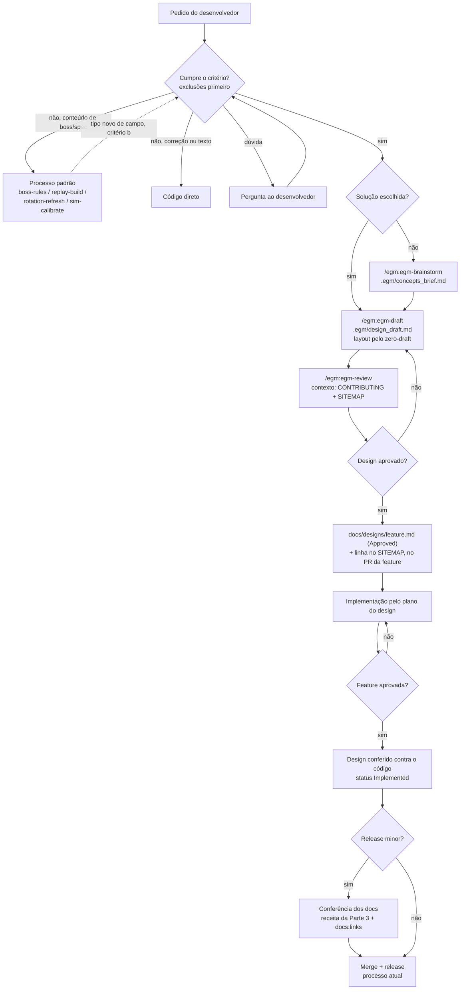

# Adoção do fluxo EGM e auditoria da documentação

*   **Author:** Vinicius Andrade (@keter45)
*   **Status:** Approved
*   **Date:** 2026-10-26 (revisado e aprovado em 2026-10-27, depois do `/egm:egm-review`)

Convenção: títulos e rótulos do template EGM ficam em inglês; o resto, em
português.

--------------------------------------------------------------------------------

## Overview

O wipe-cause está na v0.42.0 (127 commits). Até aqui, cada feature nasceu de
uma conversa: o pedido vira branch, PR, squash e release depois da aprovação.
O "porquê" de cada decisão ficou espalhado em notas de release, em documentos
de método (`docs/replay-methods.md`, `docs/simulation.md`,
`docs/healer-analysis.md`) e na memória local do Claude Code (arquivos fora do
repositório, lidos só pelas sessões desta máquina). Os termos do domínio (robô,
spec, execute, processos padrão) estão no [guia de contribuição](../CONTRIBUTING.pt-BR.md).

**EGM** (Elephant-Goldfish Model) é um plugin do Claude Code (`egm@egm`,
[google/elephant-goldfish-model](https://github.com/google/elephant-goldfish-model))
para escrever o design antes do código. A sessão principal (o "Elephant")
conversa com o desenvolvedor e escreve o design. Revisores isolados (os
"Goldfish") leem só o design, o código e os arquivos de contexto que recebem,
sem a conversa, sem memória e sem o `CLAUDE.md` (o plugin os roda com
`omitClaudeMd`).

Este design faz três coisas:

1.  **Escreve no repositório as regras de trabalho do projeto**, num lugar que
    os revisores isolados leem.
2.  **Coloca o fluxo EGM no repositório**, com uma regra escrita de quando ele
    se aplica: toda feature grande passa a ter um design em `docs/designs/`.
3.  **Audita a documentação atual contra o código da v0.42.0** e corrige o que
    estiver errado.

O fluxo, na ordem (o diagrama em *Technical Plan* é a versão de referência):
brainstorm → draft → review → design aprovado → design no PR da feature →
implementação → feature aprovada → conferência dos docs (se for release minor)
→ release.

## The Problem

**Os docs não acompanham o código em todos os pontos.** O levantamento de
2026-10-26 achou:

*   `docs/APP-MAP.pt-BR.md` descreve a v0.37.0. Não cita Twin Fangs, Vashnik
    nem o portal do warlock (v0.39–v0.42). Só existe em português, e nenhum
    README, USAGE ou CONTRIBUTING aponta para ele.
*   Docs em inglês ligam para docs só em português sem aviso:
    `docs/USAGE.md` para `healer-analysis.md`, e `docs/CONTRIBUTING.md` para
    `simulation.md` e `coiled-altar-replay-audit.md`. `replay-methods.md`, que
    tem os 11 princípios do motor do replay, não é citado no CONTRIBUTING.
*   Há pelo menos uma âncora quebrada: `APP-MAP.pt-BR.md:11` liga
    `#cobertura-da-inspeção`, e o título é `## 8. Cobertura da inspeção`. A
    checagem de 2026-10-26 só conferia arquivos; as âncoras passam a ser
    conferidas pelo `npm run docs:links`.

**As regras de trabalho não estão onde os revisores leem.** Seis regras
decidem como uma feature é desenhada neste projeto. Três estão no CONTRIBUTING,
espalhadas por blocos diferentes (release só depois da aprovação; processos
padrão; o replay mostra as habilidades do boss). Duas estão só em docs de
método (`replay-methods.md`: "boss é dado, não código"; `healer-analysis.md`:
"healers da guilda nunca são referência"). A regra de interface (ícone + nome,
cor de classe, sem faixa lateral) existe só na memória local. Os revisores
isolados recebem apenas o design, o código e os arquivos de contexto passados
ao `/egm:egm-review`; uma regra fora desses arquivos não chega à revisão, e um
design que a viole pode passar.

**Features grandes não deixam um registro do porquê.** A nota de release diz o
que mudou para o usuário; o PR diz o que mudou no código. Nenhum dos dois guarda
as alternativas descartadas nem os números que levaram à decisão (exceção: as
duas auditorias de replay, que registram medidas e fontes). Quando uma decisão
precisa ser revista, ela é reconstruída da conversa ou do diff.

## Goals

1.  **As regras de trabalho estão no CONTRIBUTING (pt e en)**, seção "Regras do
    projeto", com o texto final da Parte 1 do *Technical Plan*. A regra
    bilíngue continua na seção que já existe.
2.  **Existe um critério escrito de quando usar o EGM** (*Technical Plan →
    Critério de feature grande*), que a sessão confere olhando o pedido, com as
    exclusões valendo primeiro e "na dúvida, pergunta" para o resto.
3.  **`docs/designs/` existe, com `SITEMAP.md`**, e cada design tem um status
    (Proposed, Approved, Implemented, Superseded).
4.  **O `CLAUDE.md` do projeto diz como o Claude executa o fluxo**: quando
    propor o EGM, onde salvar, que contexto passar aos revisores, versões do
    plugin, layout pelo `zero-draft` e a conferência antes da release minor.
5.  **O fluxo encaixa no processo de release que já existe.** O PR da feature
    contém o design com status Approved e o cita na descrição. A nota de
    release não cita o design: ela aparece dentro do app para o usuário final.
6.  **Docs conferidos contra a v0.42.0.** Cada unidade do inventário da Parte 3
    (README, USAGE, CONTRIBUTING, APP-MAP, docs de regras, auditorias de replay,
    `docs/screenshots/README.md` e as skills do projeto) recebe OK / ATENÇÃO /
    REVISAR. O CONTRIBUTING e os três docs de regras são corrigidos neste PR;
    o resto também, salvo o APP-MAP se passar do limite da Parte 3.
7.  **Todo link de um doc em inglês para um doc só em português traz
    "(in Portuguese)"** (*Technical Plan → Decisões*).
8.  **Quando a skill `zero-draft` estiver instalada, toda decisão de layout de
    feature passa por ela**, também em telas do app, no design e na
    implementação. A regra de interface do projeto prevalece (ver Parte 1).

## Non-Goals

*   **Designs retroativos para as versões já lançadas** (ver Alternativa L).
*   **EGM para conteúdo de boss ou de spec que só usa campos existentes**, e
    para correção de bug com causa conhecida (ver Alternativa D e o critério).
*   **`/egm-bootstrap` (README por pasta)** (ver Alternativa I).
*   **Skill própria de contexto (`wipe-cause-elephant`)** (ver Alternativa B e
    *Future Improvements*).
*   **Bloqueio automático no CI** (PR sem design falhar). O projeto tem um único
    desenvolvedor; ver *Future Improvements*.
*   **Mudar a mecânica do release** (`release:build`, `release.mjs`,
    `latest.json`). Muda só a ordem: o design vem antes da implementação.
*   **Reescrever docs que a auditoria marcar como OK.**
*   **Manter as cópias das skills em `.agents/skills/`** (ver *Fora do repo*).

## Open Questions

*   Nenhuma no momento. As perguntas da primeira versão estão decididas na
    tabela "Decisões" da seção *Technical Plan*.

## Critical User Journeys (CUJs)

### CUJ 1: Feature grande nova

*   **Given**: o `CLAUDE.md` e o `docs/designs/SITEMAP.md` existem.
*   **When**: o desenvolvedor pede algo que cumpre o critério (ex.: "comparar a
    noite com a semana anterior", que muda núcleo e interface).
*   **Then**: a sessão propõe `/egm:egm-brainstorm` (solução ainda não escolhida)
    ou `/egm:egm-draft` (solução escolhida) antes de escrever código; o design
    passa pelo `/egm:egm-review`, é aprovado, entra no PR da feature e no
    SITEMAP; a implementação segue o plano do design; o PR cita o design.

### CUJ 2: Boss novo (fora do EGM)

*   **Given**: um guia de boss colado ou um log de boss novo.
*   **When**: o desenvolvedor pede para cadastrar o boss.
*   **Then**: a sessão usa `boss-rules`, `replay-build` e `sim-calibrate`, sem
    design. O EGM só entra se o boss pedir um tipo novo de campo (critério b).

### CUJ 3: Revisor isolado pega a violação de uma regra

*   **Given**: um design que propõe um `if` para um boss específico no motor do
    replay.
*   **When**: `/egm:egm-review` roda com o CONTRIBUTING como contexto.
*   **Then**: um revisor aponta a violação de "boss é dado, não código", sem ter
    lido o `CLAUDE.md` nem a memória.

### CUJ 4: Sessão nova respeita uma decisão já tomada

*   **Given**: uma sessão nova do Claude Code, sem a conversa anterior.
*   **When**: o pedido contraria uma regra (ex.: usar os healers da guilda como
    referência).
*   **Then**: pelo `CLAUDE.md` → CONTRIBUTING ("Regras do projeto") →
    `healer-analysis.md`, a sessão cita a regra e recusa ou pergunta, em vez de
    reabrir a decisão.

### CUJ 5: Auditoria da documentação

*   **Given**: os docs atuais e o código da v0.42.0.
*   **When**: a auditoria roda (uma vez, neste PR).
*   **Then**: cada unidade sai com OK / ATENÇÃO / REVISAR e a evidência no
    código; o desenvolvedor confirma os REVISAR; eles são corrigidos.

### CUJ 6: Feature com tela ou componente novo

*   **Given**: um design de feature grande que cria ou muda uma tela, e a skill
    `zero-draft` instalada.
*   **When**: a sessão chega à parte de layout, no design ou na implementação.
*   **Then**: a sessão usa o `zero-draft` para hierarquia, composição, estados de
    interação e acessibilidade, e a tela mantém a regra de interface (Parte 1).

## Technical Plan (Architecture)

Este design não muda o app. As peças são: uma seção de regras e uma de fluxo no
CONTRIBUTING (pt e en), o `CLAUDE.md`, o `docs/designs/` com o SITEMAP, um
script que confere links, uma linha em cada uma de quatro skills, a correção
de uma frase em `replay-methods.md`, a linha `.egm/` no `.gitignore`, uma regra
de permissão opcional e as correções da auditoria. As seções abaixo são: o
critério, as decisões, o diagrama do fluxo, onde cada coisa fica escrita, as
três partes (regras, fluxo, auditoria) e o que muda fora do repo.

### Critério de feature grande

Texto final, usado na seção "Fluxo de feature" de `docs/CONTRIBUTING.pt-BR.md`
e, traduzido, de `docs/CONTRIBUTING.md`. O `CLAUDE.md` tem só um resumo e o
link.

**pt:**

> Passa pelo EGM o pedido que cumpre pelo menos um destes:
>
> *   **(a)** muda o núcleo (`crates/` ou `src-tauri/`) e a interface (`src/`)
>     na mesma mudança;
> *   **(b)** cria um tipo novo de campo ou de checagem em `encounters/`,
>     `rotations/` ou `data/*.json`;
> *   **(c)** traz uma integração externa nova (serviço, programa ou formato de
>     arquivo que o app ainda não lê).
>
> Ficam fora, mesmo que cumpram (a): correção de bug com causa conhecida, e
> conteúdo de boss ou de spec que só usa campos que já existem (esses vão pelos
> processos padrão). Também ficam fora: mudança só de texto (docs ou frases da
> interface) e mudança só visual que não cria tela nem componente. Na dúvida,
> a sessão pergunta ao desenvolvedor.

**en:**

> A request goes through EGM when it meets at least one of these:
>
> *   **(a)** it changes the core (`crates/` or `src-tauri/`) and the interface
>     (`src/`) in the same change;
> *   **(b)** it creates a new kind of field or check in `encounters/`,
>     `rotations/` or `data/*.json`;
> *   **(c)** it brings a new external integration (a service, program or file
>     format the app does not read yet).
>
> Left out, even if they meet (a): a bug fix with a known cause, and boss or
> spec content that only uses fields that already exist (those go through the
> standard processes). Also left out: text-only changes (docs or interface
> phrases) and visual-only changes that create no screen or component. When in
> doubt, the session asks the developer.

**Conferido contra releases passadas.** v0.40.0 (robô em execute pela vida de
cada fase) e v0.39.0 (CC dos players, portal do warlock, menu Camadas) mudaram
núcleo e interface: entram por (a). v0.38.0 (replay do Coiled Altar) criou
formas novas nas regras: entra por (b). v0.41.0 e v0.42.0 são replay de boss,
mas criaram campos novos (`soak.ahead`; `rotation` em `data/arenas.json`):
entram por (b), e o design teria sido do campo genérico, não do boss. v0.28.2
(`fix: filtra highlights do wipe`) mexeu em 1 arquivo do núcleo e 11 da
interface, mas é correção com causa conhecida: fica fora.

### Decisões

Aceitas no draft (2026-10-26) e ajustadas depois do review (2026-10-27).

| Pergunta | Decisão | Por quê |
| :-- | :-- | :-- |
| Língua dos designs | Só português | Ver [Alternativa E](#alternativa-e-designs-nos-dois-idiomas). |
| Docs de regras só em pt | Ficam em pt; o link num doc em inglês ganha "(in Portuguese)" | Traduzir 708 linhas de regras dobra a manutenção de docs que mudam a cada boss. |
| APP-MAP | Atualizar o texto contra a v0.42.0 e ligar no CONTRIBUTING | É o único mapa das telas e das conexões entre elas. Entra na conferência antes de cada release minor. |
| Onde o design é aprovado | Na conversa, depois do `/egm:egm-review`; o PR da feature contém o design com status Approved | Ver [Alternativa F](#alternativa-f-pr-só-de-design-antes-do-pr-da-feature). |
| Como os docs ficam em dia | A receita da Parte 3 roda antes de cada release minor; o `/egm:egm-drift-report` não entra | Ver [Alternativa J](#alternativa-j-drift-report-do-egm). |
| Designs depois do merge | Congelados (status Implemented); quem troca uma decisão escreve um design novo e marca o antigo como Superseded | Um design é registro do porquê, não especificação viva. |
| Layout | `zero-draft` quando instalada, com a regra de interface acima dela | Decisão do desenvolvedor; ver [Alternativa K](#alternativa-k-layout-só-pelas-regras-escritas). |

### Fluxo de uma feature nova

Este diagrama é a versão de referência do fluxo; os outros textos o seguem.



### Onde cada coisa fica escrita

*   **CONTRIBUTING (pt e en):** o que vale para qualquer contribuidor e o que os
    revisores precisam ler: as "Regras do projeto" e uma seção curta "Fluxo de
    feature" (o critério, e que a feature grande tem um design em
    `docs/designs/`, contido no PR da feature). Nada que dependa do plugin.
*   **`CLAUDE.md`:** como o Claude Code executa o fluxo: comandos `/egm:*`,
    `.egm/`, contexto dos revisores, versões, `zero-draft`, conferência antes da
    minor e a proibição de ler `samples/`.
*   **Memória local:** nada novo (ver *Fora do repo*).

### Parte 1: regras de trabalho no repo

Uma seção nova **"Regras do projeto" / "Project rules"** em
`docs/CONTRIBUTING.pt-BR.md` e `docs/CONTRIBUTING.md`, logo depois de "Textos
nas duas línguas" / "Texts in both languages". Uma linha por regra, com o link
para o doc que detalha. Links para docs só em português levam "(in Portuguese)"
na versão em inglês.

| # | Regra | Onde está hoje | Detalhe |
| :- | :- | :- | :- |
| 1 | Boss é dado, não código | `replay-methods.md` (princípio 1) | `replay-methods.md` |
| 2 | Referência de healer vem de fora da guilda | `healer-analysis.md` | `healer-analysis.md` |
| 3 | Release só com feature aprovada | CONTRIBUTING ("Versões e atualização automática") | o mesmo bloco |
| 4 | Peça de boss ou de spec é processo padrão | CONTRIBUTING ("Processos padrão") | a mesma seção |
| 5 | Interface | só na memória local | sem doc; o texto da regra é o detalhe |
| 6 | O replay mostra as habilidades do boss | CONTRIBUTING (bloco do replay, "Regra do projeto") | `replay-methods.md` |

No CONTRIBUTING, cada nome de doc citado nas regras vira link (caminhos
relativos a `docs/`).

**Texto final, pt:**

1.  **Boss é dado, não código.** O que um boss mostra ou cobra sai da regra dele
    (`encounters/`) ou de `data/*.json`. Boss que pede algo novo ganha um campo
    genérico, pensado para outros bosses, pelo Fluxo de feature (critério b);
    nunca um `if` para um boss. Detalhe: `replay-methods.md`,
    princípio 1.
2.  **Referência de healer vem de fora da guilda.** A análise de healer compara
    só com logs de outras guildas. Os logs da nossa raid nunca são o "certo":
    nem o colega da mesma spec, nem um kill anterior do próprio player, nem para
    calibrar metas. Detalhe: `healer-analysis.md`.
3.  **Release só com feature aprovada.** Versão e release saem só depois que o
    desenvolvedor aprova a feature. Detalhe: bloco "Versões e atualização
    automática".
4.  **Peça de boss ou de spec é processo padrão:** um script faz os números e
    escreve um relatório OK / ATENÇÃO / REVISAR; uma skill resolve os REVISAR.
    Detalhe: seção "Processos padrão".
5.  **Interface.** Toda habilidade aparece com ícone e nome (ícone sozinho só
    onde não cabe texto, com o nome no tooltip). Todo boss aparece com o ícone
    do boss. Todo personagem aparece na cor da classe, também dentro de frases.
    Cartões, listas e avisos não têm faixa nem borda colorida na lateral ou no
    topo; item selecionado muda só o fundo. Exceção: mensagens de texto do
    Discord.
6.  **O replay mostra as habilidades do boss.** Frontais como cone, o que fica
    no chão, áreas em volta de quem carrega algo ou de uma unidade do boss,
    linhas, soaks, explosões, orbs e adds aparecem sempre no mapa, em cima da
    arena do boss. Detalhe: `replay-methods.md`.

**Texto final, en:**

1.  **A boss is data, not code.** What a boss shows or checks comes from its rule
    (`encounters/`) or from `data/*.json`. A boss that needs something new gets
    a generic field, designed with other bosses in mind, through the Feature
    workflow (criterion b); never an `if` for one boss. Details:
    `replay-methods.md` (in Portuguese), principle 1.
2.  **The healer reference comes from outside the guild.** Healer analysis
    compares only with other guilds' logs. Our raid's logs are never the
    "right" answer: not a teammate of the same spec, not the player's own
    earlier kill, not for calibrating targets. Details:
    `healer-analysis.md` (in Portuguese).
3.  **Release only with an approved feature.** A version and a release come out
    only after the developer approves the feature. Details: "Versions and
    automatic updates" block.
4.  **A boss or spec piece is a standard process:** a script does the numbers
    and writes an OK / ATENÇÃO / REVISAR report; a skill handles the REVISAR
    items. Details: "Standard processes" section.
5.  **Interface.** Every ability shows with its icon and name (icon alone only
    where text does not fit, with the name in the tooltip). Every boss shows
    with the boss icon. Every character shows in the class color, also inside
    sentences. Cards, lists and notices have no colored stripe or border on the
    side or top; a selected item changes only its background. Exception: Discord
    text messages.
6.  **The replay shows the boss abilities.** Frontals as cones, things on the
    ground, areas around whoever carries something or around a boss unit,
    lines, soaks, explosions, orbs and adds always show on the map, on top of
    the boss arena. Details: `replay-methods.md` (in Portuguese).

**O `zero-draft` no layout.** A skill se descreve como feita para sites e exclui
"UI de app dentro de um design system já existente". Aqui ela é usada também
no app, por decisão do desenvolvedor, com um limite: serve para conferir
hierarquia, composição, estados de interação, acessibilidade e tipografia de
uma tela nova ou alterada; não define uma direção visual nova. Quando o que ela
pede conflita com a regra 5, prevalece a regra 5. Ela entra na parte de layout
do design e na implementação dessa parte. A skill fica em
`~/.claude/skills/zero-draft/`, fora do repositório; por isso a regra mora no
`CLAUDE.md`, não no CONTRIBUTING, e quem não tem a skill segue só a regra 5. A
`make-interfaces-feel-better`, instalada localmente no projeto, continua como
ferramenta de polimento visual depois do layout, sem papel no processo.

### Parte 2: o fluxo EGM

*   **`docs/designs/SITEMAP.md`** — índice dos designs: Link, Status, Data, Autor,
    Componentes, Descrição. O `/egm:egm-draft` acrescenta a linha; a coluna
    Status é mantida à mão. Uma linha aponta para "Regras do projeto" no
    CONTRIBUTING, onde estão os docs de regras.
*   **Ciclo de vida de um design:** Proposed → Approved (depois do review e da
    aprovação na conversa) → Implemented (no último commit do PR, antes
    do merge, depois de conferido contra o código) → Superseded by `<design>` (quando um design novo troca a decisão;
    o novo cita o antigo). Um design Implemented não é reconferido.
*   **Conferência de um design no PR da feature:** antes da aprovação da
    feature, um agente `egm:egm-codebase-details` roda com a variante de design do
    prompt ("Auditoria: prompt literal de cada agente"). Os REVISAR são corrigidos no código ou no
    design (o desenvolvedor escolhe).
*   **Seção "Fluxo de feature" / "Feature workflow"** no CONTRIBUTING: o
    critério, o parágrafo "uma feature grande tem um design em `docs/designs/`
    (índice no SITEMAP), contido no PR da feature com status Approved e citado
    na descrição; o design pode ser escrito à mão, pelo template do SITEMAP, ou
    com o plugin EGM", e o passo antes da release minor (`npm run docs:links` e a
    conferência dos docs).
*   **`CLAUDE.md`** na raiz (item 4 do plano).
*   **`.egm/` no `.gitignore`** — briefs, rascunhos e relatórios de review ficam
    fora do git; só o design final vai para `docs/designs/`.
*   **Skills dos processos padrão** — `boss-rules`, `replay-build`,
    `rotation-refresh` e `sim-calibrate` ganham uma linha cada: quando o
    trabalho cumpre o critério, parar e propor o EGM. A `replay-build` e o
    `replay-methods.md` trocam "crie um campo genérico novo" por "campo genérico
    novo pelo Fluxo de feature", para não ficarem com duas instruções opostas.
*   **`scripts/check-doc-links.mjs`** + `npm run docs:links` — confere os links
    entre docs (item 5 do plano). Roda antes de cada release minor.

### Parte 3: auditoria dos docs

1.  **Inventário (14 unidades).** (1) README pt+en, (2) USAGE pt+en,
    (3) CONTRIBUTING pt+en, (4) APP-MAP seções 1–3, (5) APP-MAP seções 4–8,
    (6) `replay-methods.md`, (7) `simulation.md`, (8) `healer-analysis.md`,
    (9) `coiled-altar-replay-audit.md`, (10) `twin-fangs-vashnik-replay-audit.md`,
    (11) `docs/screenshots/README.md`, (12) skill `boss-rules` (com
    `references/schema.md`), (13) skill `replay-build`, (14) skills
    `rotation-refresh` e `sim-calibrate`. O APP-MAP vai em duas unidades porque
    tem 586 linhas. As notas de release ficam fora: são registro do que foi
    lançado.
2.  **Conferência isolada.** Um agente `egm:egm-codebase-details` por unidade,
    em paralelo, só leitura, com o prompt literal do plano. Ele recebe só o doc
    e o código.
3.  **Status.** REVISAR = o doc afirma algo que o código contradiz, ou omite um
    comando, tela, opção ou script que existe. ATENÇÃO = desatualizado sem levar
    a erro (versão citada, exemplo velho). O status da unidade é o pior achado;
    sem achado, OK.
4.  **Confirmação e correção.** O agente principal junta as saídas em
    `.egm/docs-audit.md` (REVISAR primeiro). O desenvolvedor confirma a lista de
    REVISAR; os confirmados são corrigidos nas duas línguas onde o doc tem duas.
    ATENÇÃO é corrigido quando cabe em um parágrafo sem ler mais código; o resto
    vai para a descrição do PR.
5.  **O que bloqueia.** CONTRIBUTING e os três docs de regras (unidades 3, 6, 7,
    8) precisam sair corrigidos neste PR, porque são o que os revisores leem. Se
    a correção do APP-MAP (unidades 4 e 5) passar de 150 linhas alteradas, ela
    vira um PR próprio, depois deste.
6.  **Antes de cada release minor**, a mesma receita roda nas unidades 3 a 8 e
    nas outras cujo arquivo mudou desde a última tag minor
    (`git diff --name-only <tag>..HEAD`).

O relatório fica em `.egm/`, fora do git; o PR leva o resumo (ver Alternativa H).

### Fora do repo

*   **Memória local.** As memórias `always-bilingual.md`,
    `replay-engine-over-boss.md`, `guild-logs-not-reference.md`,
    `ui-spell-icons.md`, `release-on-approved-feature.md` e
    `standard-processes.md` trocam o texto da regra por um ponteiro para "Regras
    do projeto" e mantêm os detalhes de implementação (ex.: quais componentes
    usar para ícone e cor de classe). Nenhuma memória nova.
*   **`.agents/skills/`** tem cópias antigas das skills do projeto, fora do git
    e já diferentes das de `.claude/skills/`. Este design não as atualiza; quem
    usa essas cópias não recebe as linhas do critério. Atualizar ou apagar fica
    para o desenvolvedor.

## Alternatives Considered

### Alternativa A: adotar o EGM sem auditar os docs antes

*   **Pros**: começa hoje; nenhum trabalho de docs na frente da próxima feature.
*   **Cons**: os revisores conferem o design contra os docs que recebem. Se o
    CONTRIBUTING e os docs de regras estiverem errados, eles podem aprovar o que
    contradiz o código ou reprovar o que está certo.
*   **Reason for Rejection**: o pedido foi revisar os docs. A auditoria só
    bloqueia os docs que os revisores leem (Parte 3, item 5). Este primeiro
    design foi revisado antes da auditoria; os achados dele que dependem do
    APP-MAP valem com ressalva.

### Alternativa B: regras e fluxo só no `CLAUDE.md`

*   **Pros**: um arquivo só, lido por toda sessão.
*   **Cons**: os revisores rodam com `omitClaudeMd` e não leem o `CLAUDE.md`;
    uma regra que só está lá não chega à revisão (CUJ 3). Também não é bilíngue
    nem é lido por quem contribui sem o Claude Code.
*   **Reason for Rejection**: as regras ficam no CONTRIBUTING. O `CLAUDE.md` fica
    só com o modo de operar do Claude, que de fato só serve a ele.

### Alternativa C: arquivo novo de regras (`docs/RULES.md`)

*   **Pros**: um lugar só para regras.
*   **Cons**: o CONTRIBUTING já tem duas regras (processos padrão, release) e a
    bilíngue; um arquivo novo divide as regras em dois lugares e dobra o par
    pt/en para manter.
*   **Reason for Rejection**: uma seção no CONTRIBUTING resolve.

### Alternativa D: EGM para toda mudança, incluindo boss e spec

*   **Pros**: um processo só.
*   **Cons**: os processos padrão já produzem um relatório OK / ATENÇÃO /
    REVISAR, e as auditorias de replay já guardam medidas e fontes. Um design
    por boss repetiria esse relatório. Estimativa: um boss que leva horas pelos
    processos levaria um dia com brainstorm, draft e review.
*   **Reason for Rejection**: custo alto sem decisão nova. O critério (b) leva ao
    EGM o único caso de boss que muda o motor: o tipo novo de campo.

### Alternativa E: designs nos dois idiomas

*   **Pros**: segue a regra bilíngue ao pé da letra; o repositório é público.
*   **Cons**: o design muda a cada seção revisada; duas versões dobram o custo de
    cada revisão, e uma delas sempre fica atrás. O leitor do design é quem
    desenvolve, não o usuário do app, para quem a regra foi feita.
*   **Reason for Rejection**: custo dobrado e risco de as duas versões dizerem
    coisas diferentes.

### Alternativa F: PR só de design antes do PR da feature

*   **Pros**: é o que o EGM recomenda; o design fica aprovado num marco separado.
*   **Cons**: com um único desenvolvedor, é abrir e mergear o próprio PR sem
    outro revisor; a aprovação real acontece na conversa.
*   **Reason for Rejection**: burocracia sem revisor (ver *Future
    Improvements*).

### Alternativa G: auditar os docs com o `/egm:egm-review` completo

*   **Pros**: usa o pipeline inteiro do EGM.
*   **Cons**: o `/egm:egm-review` foi feito para design docs: confere goals, CUJs
    e prontidão do plano, em cinco estágios. Num README ou num USAGE, quase
    tudo que ele achasse seria "isto não é um design".
*   **Reason for Rejection**: a pergunta da auditoria é uma só (o doc bate com o
    código?) e só o revisor de precisão técnica a responde, com o prompt da
    Parte 3 no lugar do formato da persona.

### Alternativa H: guardar o relatório da auditoria em `docs/`

*   **Pros**: segue o modelo das auditorias de replay.
*   **Cons**: a auditoria de replay guarda medidas que continuam verdadeiras. O
    relatório dos docs descreve problemas que o próprio PR corrige.
*   **Reason for Rejection**: o resumo no PR guarda o que foi achado; o relatório
    inteiro fica em `.egm/`.

### Alternativa I: `/egm-bootstrap` para gerar README por pasta

*   **Pros**: mapa de cada pasta para os agentes.
*   **Cons**: o projeto já tem o mapa das pastas (CONTRIBUTING) e o das telas
    (APP-MAP). Dezenas de READMEs gerados seriam mais uma camada para ficar
    velha; o guia do plugin (`docs/getting_started.md`, "Bootstrapping") diz
    que eles podem ser dispensáveis quando os designs já citam o código.
*   **Reason for Rejection**: repete o que já existe.

### Alternativa J: drift report do EGM

*   **Pros**: é a ferramenta do plugin para isso; o EGM sugere rodar toda semana.
*   **Cons**: em `docs/designs/`, ele trata cada design como especificação viva:
    todo design antigo vira "divergência" quando uma feature nova mexe na mesma
    área, e o custo cresce a cada design. Em `docs/`, ele trata como drift
    "qualquer lógica não citada num design ou README", lê tudo num contexto só
    (o APP-MAP de 586 linhas inteiro) e não tem como excluir arquivos. O projeto
    não tem rotina semanal.
*   **Reason for Rejection**: alarme falso a cada release faz a rotina ser
    abandonada. A receita da Parte 3, antes de cada release minor, responde a
    mesma pergunta com as regras do projeto.

### Alternativa K: layout só pelas regras escritas

*   **Pros**: não depende de nada fora do repositório; os revisores conseguem
    conferir tudo.
*   **Cons**: a regra 5 cobre ícone, nome, cor e faixa; não cobre hierarquia,
    composição, estados de interação nem acessibilidade de uma tela nova.
*   **Reason for Rejection**: o desenvolvedor escolheu usar o `zero-draft` nessas
    partes, com a regra 5 acima dele.

### Alternativa L: designs retroativos para as versões já lançadas

*   **Pros**: o histórico inteiro ficaria no mesmo formato.
*   **Cons**: exigiria reconstruir cada decisão a partir de diffs e notas de
    release, sem mudar nenhuma decisão futura.
*   **Reason for Rejection**: as decisões que ainda valem já estão nos docs de
    regras, ligados pelo CONTRIBUTING.

--------------------------------------------------------------------------------

## Non-Functional Requirements

### Riscos e limites

| Risco | Mitigação | Sinal |
| :-- | :-- | :-- |
| A auditoria aponta um REVISAR falso e a correção piora um doc certo | O desenvolvedor confirma cada REVISAR antes da correção | REVISAR recusado na confirmação |
| O processo é abandonado (tudo depende de o Claude seguir o `CLAUDE.md`) | Reavaliar depois de 3 designs: tempo gasto × achados que mudaram uma decisão | Feature que cumpre o critério sai sem design |
| Leitura de `samples/` por um revisor ou pela sessão (o isolamento do EGM é de contexto, não de arquivos) | Linha no `CLAUDE.md` mandando passar a proibição a todo revisor; regra opcional de negação de leitura para `samples/**/*.env` (item 6 do plano) | Revisor cita um arquivo de `samples/` |
| Atualização do plugin EGM ou do Claude Code muda o comportamento | Versões fixadas no `CLAUDE.md` (`egm@egm` 0.1.0; Claude Code 2.1.271 ou mais novo) | Revisor lê o `CLAUDE.md` ou a memória |
| Contribuidor sem Claude Code ou sem o plugin | O CONTRIBUTING basta: regras, critério e template do design | — |
| Cópias das skills em `.agents/skills/` sem as linhas novas | Registrado em *Fora do repo* | — |

### Privacidade

A auditoria e os revisores leem só o que está versionado. `samples/` (logs da
guilda e `wcl-credentials.env`) não é passado aos agentes, e nada de lá é
citado no relatório ou no PR.

### Rollback

A mudança é só de documentação, de instrução para o Claude, de um script de
conferência e de uma configuração opcional. Desfazer = reverter o PR e
restaurar nas memórias locais o texto da regra que foi trocado pelo ponteiro (o
git não reverte o que está fora do repo). O app não muda e não há release.

### Future Improvements

*   PR só de design (Alternativa F) se entrar um segundo desenvolvedor.
*   O `CLAUDE.md` vira uma skill de contexto se passar de 60 linhas.
*   Bloqueio no CI para PR sem design, se o risco "processo abandonado"
    aparecer.

--------------------------------------------------------------------------------

## Detailed Implementation Plan

Um branch `docs/egm-adoption` e um PR. Cada commit adiciona arquivos com
`git add <arquivo>`, um por um (nunca `git add -A` nem `git add .`). Não há
release. O `.claude/launch.json`, já modificado no checkout, não entra em
nenhum commit.

| Commit | Itens |
| :- | :- |
| 1. Design e índice | 1 (Status Approved), 2, 3 |
| 2. Regras e fluxo | 4; 5; 6 (só se aprovado); 7 e 8 (seções, tabela e blocos novos); 9 (aviso de língua); 10 (âncora); 11 (linhas novas); 12 (princípio 1) |
| — | A auditoria (Parte 3) roda no branch depois do commit 2. |
| 3. Correções da auditoria | REVISAR confirmados em 7, 8, 9, 11, 12, 13, 14, 15; item 10 (mudanças definidas + REVISAR) |
| 4. Fechamento | 1 e 2 (Status Implemented), depois da conferência do design e da aprovação da feature |

O item 16 (memória local) é feito depois do merge.

### Auditoria: prompt literal de cada agente

Agente `egm:egm-codebase-details`, um por unidade, em paralelo. O mesmo prompt
serve para a auditoria deste PR, para a conferência antes de cada release minor
e para a conferência de um design no PR da feature (variante de design). Os
campos entre `<…>` são preenchidos; as linhas que começam com `<só …:>` só
entram nas unidades citadas.

```text
Mode: REVIEW

Alvos (um por linha):
<caminho absoluto de cada arquivo da unidade>
Faixa: <unidade 4: "seções 1–3"; unidade 5: "seções 4–8"; design: "seção
Detailed Implementation Plan"; nas outras: os arquivos inteiros>
Repositório: <raiz do repositório>, versão <campo version de package.json>.
Persona: <caminho absoluto de agents/codebase_details.md no cache do plugin>

Não há Target Standard. As regras abaixo substituem a seção "Audit against the
Standard", o passo 2 "Verify Code vs. Doc", os Audit Vectors e o formato
Blocker/Major/Nit da persona. Reporte só o que os passos abaixo pedem. Não leia
nada em samples/.

1. Para cada afirmação verificável do texto (nome de arquivo, comando, flag,
   campo YAML, tela, comportamento, número de versão), procure a evidência no
   código. Liste só o que o código contradiz e o que não tem evidência (neste
   caso, "sem evidência" no lugar de arquivo:linha). Não liste o que o código
   confirma.
<só unidades 2, 3, 4, 5:>
2. Liste comandos, telas, opções e scripts que existem no código e não
   aparecem no doc.
<só unidades 1, 2, 3:>
3. Aponte onde as versões pt e en dizem coisas diferentes.
<só unidades 9 e 10:>
4. Os números são medidas datadas: não compare com o valor atual; confira só se
   os campos, scripts e arquivos citados existem.

Status de cada achado:
- REVISAR: o texto afirma algo que o código contradiz ou que não tem
  evidência; nas unidades 2, 3, 4 e 5, também cada omissão do passo 2.
- ATENÇÃO: desatualizado sem levar a erro (versão citada, exemplo velho).

Saída: um item por achado, com arquivo, trecho (até 2 linhas), status,
evidência arquivo:linha (ou "sem evidência") e a correção em uma frase.
Sem achado: "OK".
```

**Variante de design:** Alvos = o design; Faixa = "seção Detailed
Implementation Plan"; só o passo 1; a evidência é o código depois da
implementação.

**Passadas e aceite.** Depois da primeira passada, o desenvolvedor confirma ou
recusa cada REVISAR; os recusados ficam em `.egm/docs-audit.md` com o motivo e
não são corrigidos. Depois da correção, o prompt roda de novo só nas unidades
que tiveram REVISAR confirmado, até duas vezes (passadas 2 e 3). Aceite:
nenhum REVISAR novo nem confirmado pendente nas unidades 3, 6, 7 e 8; nas
outras, o REVISAR que sobrar vai para a descrição do PR com o motivo.

**Descrição do PR:** status por unidade; REVISAR corrigidos; REVISAR recusados
e restantes, com o motivo; ATENÇÃO pendentes; link para este design.

### Target Files to Create/Modify

#### 1. `docs/designs/egm-adoption.md` (Modify + adicionar ao git)

*   **Type / Scope**: este design, que já existe.
*   **Proposed Changes**: entra no commit 1 com `Status: Approved`. No commit 4,
    depois da conferência pela variante de design e da aprovação da feature,
    `Status: Implemented`.

#### 2. `docs/designs/SITEMAP.md` (Modify + adicionar ao git)

*   **Type / Scope**: índice dos designs, que já existe.
*   **Proposed Changes** (commit 1; o Status muda no commit 4):
    *   A introdução passa a dizer: "Índice dos design docs do wipe-cause. O
        `/egm:egm-draft` acrescenta uma linha em 'Designs' a cada design salvo;
        a coluna Status é preenchida e mantida à mão. Quando usar o fluxo: seção
        'Fluxo de feature' do [guia de contribuição](../CONTRIBUTING.pt-BR.md#fluxo-de-feature)."
    *   A tabela "Designs" ganha a coluna Status, depois de Link. A linha deste
        design fica:

        ```text
        | [egm-adoption.md](egm-adoption.md) | Approved | 2026-10-26 | @keter45 | `docs/`, `CLAUDE.md`, `.claude/skills/`, `scripts/` | Regras do projeto, fluxo EGM e auditoria dos docs |
        ```

    *   A tabela "Docs de regras existentes" sai. No lugar, a frase: "Regras e
        docs de método: seção [Regras do projeto](../CONTRIBUTING.pt-BR.md#regras-do-projeto)
        e os blocos de 'Processos padrão' do guia de contribuição."
    *   Seção nova "Template", para quem escreve um design sem o plugin:
        cabeçalho com Author, Status e Date; depois, nesta ordem, Overview, The
        Problem, Goals, Non-Goals, Open Questions, Critical User Journeys,
        Technical Plan, Alternatives Considered, Non-Functional Requirements e
        Detailed Implementation Plan (com Verification Plan).

#### 3. `.gitignore` (Modify)

*   **Type / Scope**: configuração do git.
*   **Proposed Changes** (commit 1): na seção "# Claude Code local", entram as
    linhas:

    ```text
    # rascunhos, briefs e relatórios do EGM; o design final vai para docs/designs
    .egm/
    ```

#### 4. `CLAUDE.md` (Create)

*   **Type / Scope**: instrução do projeto para o Claude Code, em português.
*   **Proposed Changes** (commit 2): o arquivo inteiro é este (menos de 60
    linhas):

    ```markdown
    # wipe-cause

    App que lê o combat log do WoW (ou um report do Warcraft Logs) e explica por
    que a raide morreu. Comece por [README.md](README.md),
    [docs/CONTRIBUTING.pt-BR.md](docs/CONTRIBUTING.pt-BR.md) e
    [docs/designs/SITEMAP.md](docs/designs/SITEMAP.md).

    ## Regras

    As regras do projeto estão em
    [Regras do projeto](docs/CONTRIBUTING.pt-BR.md#regras-do-projeto).

    ## Antes de escrever código

    Feature grande = (a) muda núcleo e interface juntos, (b) cria tipo novo de
    campo ou checagem em `encounters/`, `rotations/` ou `data/*.json`, ou
    (c) traz integração externa nova. Ficam fora: correção com causa conhecida,
    boss ou spec com campos existentes, mudança só de texto, mudança só visual
    sem tela ou componente novo. Texto completo:
    [Fluxo de feature](docs/CONTRIBUTING.pt-BR.md#fluxo-de-feature).

    - Cumpre: proponha `/egm:egm-brainstorm` (solução ainda não escolhida) ou
      `/egm:egm-draft` (solução escolhida) antes de codar.
    - Não cumpre e é boss ou spec: use a skill do processo padrão.
    - Na dúvida: pergunte.

    ## EGM

    EGM artifact directory: .egm

    - Plugin `egm@egm` 0.1.0; Claude Code 2.1.271 ou mais novo (abaixo disso,
      os revisores não rodam isolados).
    - No `/egm:egm-review`, passe como contexto dos revisores
      `docs/CONTRIBUTING.pt-BR.md`, `docs/designs/SITEMAP.md` e os docs de
      regras que o design cita, e diga a todo revisor: "não leia nada em
      `samples/`".
    - Design salvo: `docs/designs/<feature>.md` com Status Approved e a linha no
      SITEMAP (com a coluna Status), dentro do PR da feature; a descrição do PR
      cita o design.
    - Antes de aprovar a feature: confira o design contra o código com a
      variante de design do prompt em "Auditoria: prompt literal de cada
      agente" de [egm-adoption.md](docs/designs/egm-adoption.md). No último
      commit do PR, antes do merge: Status Implemented no design e no SITEMAP.

    ## Layout de tela

    Se a skill `zero-draft` estiver instalada, use-a no layout de tela nova ou
    alterada, no design e na implementação, só para conferir hierarquia,
    composição, estados de interação, acessibilidade e tipografia; ela não
    define direção visual nova. Em conflito, vale a regra 5 de "Regras do
    projeto". Sem a skill, siga só a regra 5.

    ## Antes de uma release minor

    `npm run docs:links` e a conferência dos docs (Parte 3, item 6, de
    [egm-adoption.md](docs/designs/egm-adoption.md)).
    ```

#### 5. `scripts/check-doc-links.mjs`, `scripts/check-doc-links.test.mjs` (Create) e `package.json` (Modify)

*   **Type / Scope**: script Node sem dependências e o teste dele; o script
    `docs:links` em `package.json`, ao lado de `replay:check` e `sim:check`
    (commit 2).
*   **Proposed Changes**:
    *   Padrão do repositório: importa `ROOT` de `scripts/lib/checks.mjs`;
        cabeçalho em comentário, em português, com o uso (como em
        `scripts/replay-check.mjs`); só roda o `main` quando chamado direto;
        exporta `slugify(titulo)` e `extractLinks(texto)`.
    *   **Arquivos lidos:** só os versionados (`git ls-files`) que casam com
        `README.md`, `README.pt-BR.md`, `CLAUDE.md`, `docs/**/*.md` (menos
        `docs/releases/`) e `.claude/skills/*/SKILL.md`. Assim a skill de
        terceiro fora do git não entra.
    *   **Links conferidos:** `[texto](alvo)`, ``, e os atributos
        `href="…"` e `src="…"` de tags HTML. Ficam fora: links dentro de código
        entre crases ou de blocos cercados (três crases), alvos `http:`, `https:` e
        `mailto:`, e links de referência `[x][ref]`.
    *   **Alvo:** resolvido a partir da pasta do arquivo; precisa existir
        (arquivo ou diretório). Alvo vazio antes de `#` = o próprio arquivo.
    *   **Âncora:** precisa bater com o slug de algum título do destino. Slug:
        minúsculas; remove todo caractere que não seja letra, número, marca
        (acento), espaço, `-` ou `_`; cada espaço vira `-`, sem juntar hífens
        repetidos nem cortar hífen do começo; o segundo título igual ganha
        `-1`, o terceiro `-2`; títulos dentro de blocos cercados não contam. O
        slug de `scripts/lib/checks.mjs` não serve (é só ASCII).
    *   **Saída:** uma linha `arquivo:linha → alvo` por falha; código 1 se
        houver alguma, 0 se não.
    *   **Listagem:** `fs.readdirSync(dir, { recursive: true })` ou a saída do
        `git ls-files` (Node 20, como pede o CONTRIBUTING; `fs.globSync` exige
        Node 22).
    *   **Testes** (`check-doc-links.test.mjs`, rodado pelo `npm test` do
        vitest, que o CI já roda): arquivo inexistente → falha; âncora
        inexistente → falha; âncora com acento (`#cobertura-da-inspeção`) →
        passa; título com emoji (`### 📜 Rotation` → `#-rotation`) → passa;
        título repetido → `-1`; título com travessão (`a — b` → `a--b`); link
        entre crases e em bloco cercado → ignorado; `https:` e `mailto:` →
        ignorados; `href` de HTML → conferido; alvo que é diretório → aceito;
        formato da linha de saída.

#### 6. `.claude/settings.json` (Create, só com a aprovação do desenvolvedor)

*   **Type / Scope**: permissões do Claude Code no projeto, versionadas
    (commit 2).
*   **Proposed Changes**: o arquivo inteiro:

    ```json
    {
      "permissions": {
        "deny": ["Read(./samples/**/*.env)"]
      }
    }
    ```

    Não bloqueia `samples/` inteiro, porque as skills leem relatórios em
    `samples/replay/`, `samples/sim/` e `samples/refresh/`. Se a verificação
    mostrar que Grep, Glob ou Bash ainda leem o arquivo, o limite fica escrito
    na linha de `samples/` da tabela de riscos, sem regra nova. Sem a
    aprovação, o item é pulado e o risco fica na tabela.

#### 7. `docs/CONTRIBUTING.md` (Modify)

*   **Type / Scope**: guia de contribuição em inglês.
*   **Proposed Changes** (commit 2). Os textos literais estão em blocos `text`,
    com os links como devem ficar no arquivo de destino:
    *   Tabela "Layout", depois da linha `docs/screenshots/`:

        ```text
        | [`docs/designs/`](designs/SITEMAP.md) | design docs for big features (in Portuguese), indexed in `SITEMAP.md` |
        | [`docs/APP-MAP.pt-BR.md`](APP-MAP.pt-BR.md) | map of the screens and how they connect (in Portuguese) |
        ```

    *   Seção nova `### Project rules`, depois de "Texts in both languages": o
        texto final em inglês das seis regras da Parte 1, com os nomes de doc
        como links.
    *   Seção nova `### Feature workflow`, depois de "Project rules": o texto
        final em inglês do critério, e depois:

        ```text
        A big feature has a design in `docs/designs/` (index in [SITEMAP.md](designs/SITEMAP.md)),
        with Status Approved, inside the feature's PR and cited in the PR description. It can be
        written by hand, following the template in the SITEMAP, or with the EGM plugin (`egm@egm`).

        Before a minor release: `npm run docs:links` exits with 0, and the doc check from
        [the EGM design](designs/egm-adoption.md) (in Portuguese) runs on CONTRIBUTING, the APP-MAP
        and the rule docs, plus any doc changed since the last minor tag.
        ```

    *   Bloco "Building a boss's replay": `Project rule:` vira
        `[Project rule 6](#project-rules):`. A frase "Example audit: …" e a
        frase nova logo depois ficam:

        ```text
        Example audit: [docs/coiled-altar-replay-audit.md](coiled-altar-replay-audit.md) (in Portuguese).
        Method: [docs/replay-methods.md](replay-methods.md) (in Portuguese). Another audit:
        [docs/twin-fangs-vashnik-replay-audit.md](twin-fangs-vashnik-replay-audit.md) (in Portuguese).
        ```

    *   Bloco "Configuring a boss's simulation": o link para `simulation.md`
        ganha " (in Portuguese)" logo depois.
    *   Bloco "Versions and automatic updates": novo passo 1; os passos 1–3
        atuais viram 2–4.

        ```text
        1. For a minor version, first run the checks in [Feature workflow](#feature-workflow).
        ```

    *   Commit 3: REVISAR confirmados da unidade 3.

#### 8. `docs/CONTRIBUTING.pt-BR.md` (Modify)

*   **Type / Scope**: guia de contribuição em português.
*   **Proposed Changes** (commit 2):
    *   Tabela "Estrutura", depois da linha `docs/screenshots/`:

        ```text
        | [`docs/designs/`](designs/SITEMAP.md) | design docs das features grandes, com índice no `SITEMAP.md` |
        | [`docs/APP-MAP.pt-BR.md`](APP-MAP.pt-BR.md) | mapa das telas e de como elas se ligam |
        ```

    *   Seção nova `### Regras do projeto`, depois de "Textos nas duas
        línguas": o texto final em português das seis regras da Parte 1, com os
        nomes de doc como links.
    *   Seção nova `### Fluxo de feature`, depois de "Regras do projeto": o
        texto final em português do critério, e depois:

        ```text
        Uma feature grande tem um design em `docs/designs/` (índice no [SITEMAP.md](designs/SITEMAP.md)),
        com Status Approved, dentro do PR da feature e citado na descrição do PR. Ele pode ser escrito
        à mão, pelo template do SITEMAP, ou com o plugin EGM (`egm@egm`).

        Antes de uma release minor: `npm run docs:links` sai com 0, e a conferência dos docs do
        [design do EGM](designs/egm-adoption.md) roda no CONTRIBUTING, no APP-MAP e nos docs de
        regras, e em todo doc que mudou desde a última tag minor.
        ```

    *   Bloco "Montar o replay de um boss": `Regra do projeto:` vira
        `[Regra do projeto 6](#regras-do-projeto):`. Depois de "Auditoria de
        exemplo: …", a frase nova:

        ```text
        Método: [docs/replay-methods.md](replay-methods.md). Outra auditoria:
        [docs/twin-fangs-vashnik-replay-audit.md](twin-fangs-vashnik-replay-audit.md).
        ```

    *   Bloco "Versões e atualização automática": novo passo 1; os passos 1–3
        atuais viram 2–4.

        ```text
        1. Numa versão minor, rode antes as conferências do [Fluxo de feature](#fluxo-de-feature).
        ```

    *   O bloco "Configurar a simulação de um boss" não muda.
    *   Commit 3: REVISAR confirmados da unidade 3.

#### 9. `docs/USAGE.md` (Modify)

*   **Type / Scope**: guia de uso em inglês.
*   **Proposed Changes**: no parágrafo da referência de healer, o link para
    `healer-analysis.md` ("Full rules in …") ganha " (in Portuguese)" logo
    depois (commit 2). REVISAR confirmados da unidade 2 (commit 3).

#### 10. `docs/APP-MAP.pt-BR.md` (Modify)

*   **Type / Scope**: mapa funcional e técnico do app (unidades 4 e 5).
*   **Proposed Changes**:
    *   Commit 2: na linha 11, a âncora `#cobertura-da-inspeção` vira
        `#8-cobertura-da-inspeção`.
    *   Commit 3: o parágrafo "Referência" inteiro (linha 5) passa a ser:

        ```text
        **Referência:** navegação na versão `0.37.0` em **21/10/2026**, com as alterações locais da
        árvore de trabalho daquela data; texto conferido contra o código da versão `0.42.0` em
        **<data da auditoria>**, só pelo código, sem abrir as telas.
        ```

    *   Commit 3, 3.13 (Robô): "desde a v0.40.0, o robô fica na fase de execute
        pelo mesmo tempo que a luta, medido pela vida do boss em cada fase".
    *   Commit 3, 3.14 (Replay): o que entrou na v0.38–v0.42, pelo menos: menu
        Camadas; CC dos players; portal do warlock; poças, frontais, fragmentos
        e escudos; ondas; área à frente do boss; lugares da sala; contagem de
        adds vivos; linha do tempo por mecânica; cor e ícone por tipo de add;
        sala girada no mundo (`rotation` em `data/arenas.json`). Descrito como
        capacidade do motor, com os bosses como exemplo.
    *   Commit 3, seção 7: arquivos novos desde a v0.37.0 que a auditoria
        apontar.
    *   Commit 3, seção 8: subseção nova "Conferência contra o código
        (v0.42.0)" com a data e o que foi conferido; "Navegação executada" não
        muda.
    *   Commit 3: os demais REVISAR confirmados.
    *   **Limite:** se a parte do commit 3 passar de 150 linhas (soma de
        inserções e remoções em `git diff --numstat docs/APP-MAP.pt-BR.md`),
        ela inteira sai deste PR e vira um PR próprio. A âncora do commit 2 e
        a linha da tabela "Layout"/"Estrutura" ficam neste PR.

#### 11. Skills dos processos padrão (Modify)

*   **Type / Scope**: `.claude/skills/*/SKILL.md` (unidades 12, 13 e 14).
*   **Proposed Changes** (commit 2; REVISAR confirmados no commit 3). Cada
    linha nova entra como último item da seção indicada:
    *   `boss-rules`, "Regras de escrita":

        ```text
        - Se o boss pedir um tipo de campo que `encounters/` ou `data/*.json` não têm, pare o
          cadastro e proponha o EGM: é o critério (b) do Fluxo de feature (CONTRIBUTING).
        ```

    *   `replay-build`, no topo: o item "**Boss é dado:** …" (linhas 16–17)
        inteiro passa a ser:

        ```text
        - **Boss é dado:** tudo sai da regra YAML ou de `data/*.json`. Se o boss pede algo novo, a
          solução é um campo genérico, nunca um `if` para ele; criar esse campo é o critério (b) do
          Fluxo de feature (CONTRIBUTING): pare e proponha o EGM.
        ```

    *   `replay-build`, "Regras":

        ```text
        - Forma ou campo novo no replay (em `encounters/` ou `data/*.json`) é o critério (b) do Fluxo
          de feature (CONTRIBUTING): pare e proponha o EGM antes de escrever o campo.
        ```

    *   `rotation-refresh`, "Regras":

        ```text
        - Se a spec pedir um tipo de checagem que `rotations/` não tem, pare e proponha o EGM: é o
          critério (b) do Fluxo de feature (CONTRIBUTING).
        ```

    *   `sim-calibrate`, "Regras":

        ```text
        - Se a correção pede medida nova no núcleo e leitura nova na interface (`src/`), que é o
          critério (a), ou campo novo em `phases`, que é o critério (b), pare e proponha o EGM pelo
          Fluxo de feature (CONTRIBUTING).
        ```

#### 12. `docs/replay-methods.md` (Modify)

*   **Type / Scope**: doc de regras do replay (unidade 6).
*   **Proposed Changes** (commit 2): no princípio 1, a frase que começa em
    "Quando um boss pede algo que não existe" e termina em "nunca um `if` para
    aquele boss." passa a ser:

    ```text
    Quando um boss pede algo que não existe, crie, pelo
    [Fluxo de feature](CONTRIBUTING.pt-BR.md#fluxo-de-feature) (critério b), um campo genérico
    novo, pensando em como outro boss usaria, nunca um `if` para aquele boss.
    ```

    REVISAR confirmados no commit 3.

#### 13. `docs/USAGE.pt-BR.md` (Modify, só se a auditoria pedir)

*   **Type / Scope**: guia de uso em português (unidade 2).
*   **Proposed Changes** (commit 3): REVISAR confirmados que valem para o pt.

#### 14. `README.md` e `README.pt-BR.md` (Modify, só se a auditoria pedir)

*   **Type / Scope**: página inicial do repositório (unidade 1).
*   **Proposed Changes** (commit 3): REVISAR confirmados, nas duas línguas.

#### 15. Outros docs (Modify, só se a auditoria pedir)

*   **Type / Scope**: `docs/simulation.md`, `docs/healer-analysis.md`,
    `docs/coiled-altar-replay-audit.md`,
    `docs/twin-fangs-vashnik-replay-audit.md`, `docs/screenshots/README.md`
    (unidades 7–11).
*   **Proposed Changes** (commit 3): REVISAR confirmados. Nas auditorias de
    replay, só referências a campos, scripts ou arquivos que mudaram de nome.

#### 16. Memória local do Claude (fora do repo, depois do merge)

*   **Type / Scope**: `C:\Users\vine1\.claude\projects\F--Projetos-wipe-cause\memory\`.
*   **Proposed Changes**: em `always-bilingual.md`, `replay-engine-over-boss.md`,
    `replay-shows-boss-skills.md`, `guild-logs-not-reference.md`,
    `ui-spell-icons.md`, `release-on-approved-feature.md` e
    `standard-processes.md`, o parágrafo que enuncia a regra vira "Regra no
    repo: docs/CONTRIBUTING.pt-BR.md, seção 'Regras do projeto'"; os detalhes
    de implementação ficam. Nenhuma memória nova; o `MEMORY.md` não muda.

### Verification Plan

*   **Testes:** `npm test` passa, com `scripts/check-doc-links.test.mjs`.
*   **Links:** `npm run docs:links` sai com código 0.
*   **`.gitignore`:** `git check-ignore .egm/x` imprime o caminho.
*   **`CLAUDE.md`:** menos de 60 linhas e a linha `EGM artifact directory: .egm`
    sozinha.
*   **Aviso de língua:** em `README.md`, `docs/USAGE.md` e
    `docs/CONTRIBUTING.md`, todo link para `APP-MAP.pt-BR.md`,
    `replay-methods.md`, `simulation.md`, `healer-analysis.md`,
    `coiled-altar-replay-audit.md`, `twin-fangs-vashnik-replay-audit.md` ou
    `designs/` tem "(in Portuguese)" na mesma frase ou na mesma linha da
    tabela.
*   **Pares pt/en:** `CONTRIBUTING.md` e `CONTRIBUTING.pt-BR.md` têm o mesmo
    número de `###` e de `<summary>`, na mesma ordem, e os mesmos passos
    numerados no bloco de versões.
*   **Skills sem contradição:** busca de "campo genérico", aceitando quebra de
    linha entre as palavras, em `.claude/skills/` e `docs/replay-methods.md`:
    toda ocorrência cita o Fluxo de feature; `replay-build/SKILL.md` não tem
    mais "crie um campo".
*   **Permissão (se o item 6 entrou):** numa sessão nova, pedir para ler
    `samples/wcl-credentials.env`; a leitura é negada. Se Grep, Glob ou Bash
    passarem, o limite está escrito na tabela de riscos.
*   **CUJ 5 (auditoria):** aceite da seção "Passadas e aceite".
*   **CUJ 3 (revisor isolado), depois do commit 2:** escrever
    `.egm/cuj3-probe.md`, um design curto que propõe um `if` pelo id do Vashnik
    em `src/` para girar a sala; rodar `/egm:egm-review .egm/cuj3-probe.md` com
    `docs/CONTRIBUTING.pt-BR.md` e `docs/designs/SITEMAP.md` como contexto dos
    revisores. Passa se algum achado Blocker ou Major citar "Boss é dado, não
    código". Apagar o probe no fim.
*   **CUJ 1 (manual):** numa sessão nova, "quero comparar a noite com a semana
    anterior"; a sessão propõe o EGM antes de escrever código.
*   **CUJ 2 (manual):** numa sessão nova, "cadastrar o boss X a partir deste
    guia"; a sessão usa `boss-rules`, `replay-build` e `sim-calibrate`, sem
    propor o EGM.
*   **CUJ 4 (manual):** numa sessão nova, "usar os healers da guilda como
    referência"; a sessão cita a regra 2 e recusa ou pergunta.
*   **CUJ 6 (manual, na primeira feature com tela nova):** a tela tem ícone e
    nome nas habilidades, ícone do boss, cor de classe (também em frases),
    nenhuma faixa ou borda colorida na lateral ou no topo, e item selecionado
    muda só o fundo.
*   **CI:** verde no PR (`.github/workflows/ci.yml`); o site publicado pelo
    `pages.yml` depois do merge fica igual ao da v0.42.0.

--------------------------------------------------------------------------------

*Drafted with EGM*
